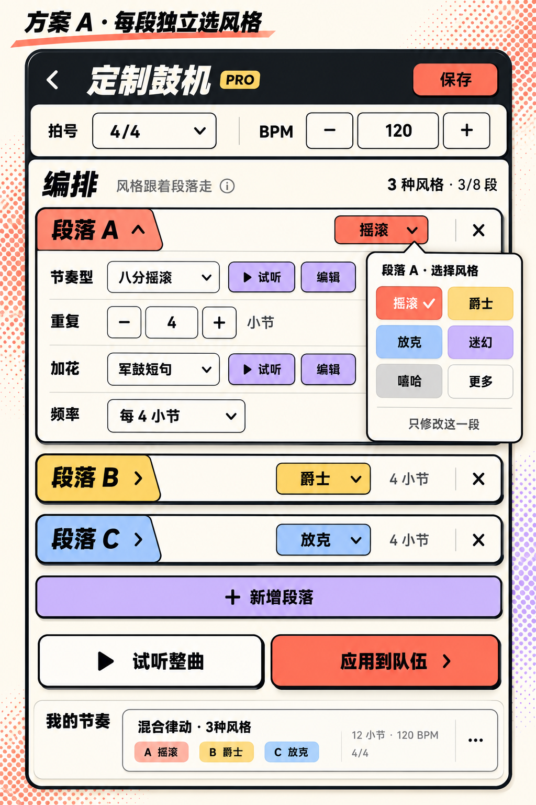
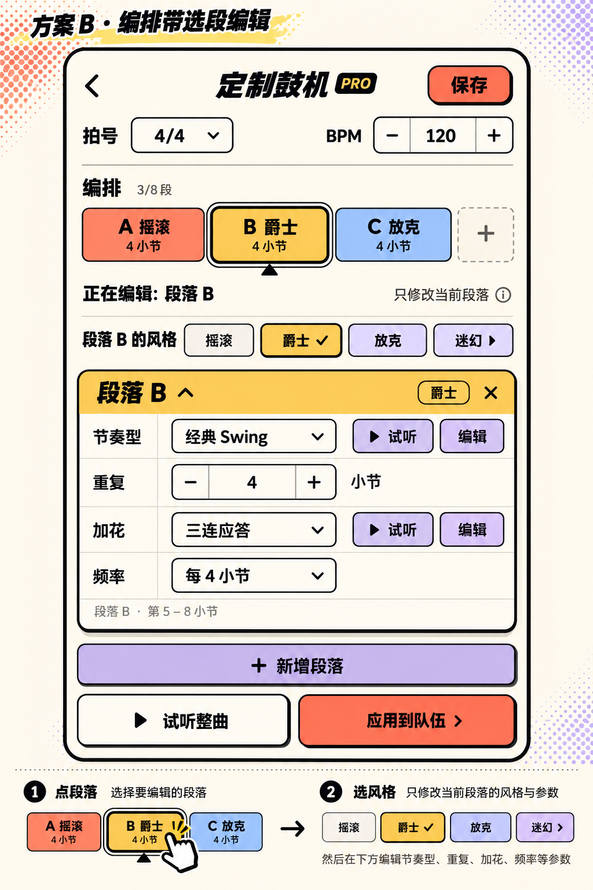
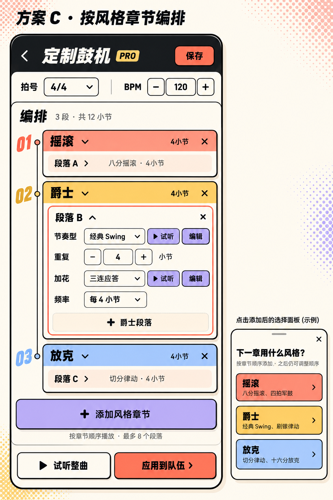

# 一个编排包含多种风格：三版交互设计

设计日期：2026-10-21。仅设计，未修改鼓机业务或页面代码。

方案 A 最新视觉细节见 [V3 调整版](refined-a-v3/README.md)：风格彩色无描边，其他菜单白色无描边，白字勾选、R8/R6、纯硬阴影、图标操作与横滑方格保存卡片。下方保留初轮三版选型说明。

队伍大厅的多风格摘要、行进页的完整编排切换见 [配套设计](extensions-lobby-march/README.md)。

## 共同前提

这轮将“多种风格”理解为：不同段落依次使用不同风格，例如 A 摇滚 → B 爵士 → C 放克。整曲仍共用 BPM 和拍号，不增加分段变速或多种风格同时叠奏。总段落上限沿用 8 段。

保留当前段落中的四行及其顺序：**节奏型、重复、加花、频率**；保留主节奏与加花各自的试听、编辑、标题整行展开收起、独立删除、保存和应用到队伍。

风格使用现有配色：摇滚珊瑚色、爵士黄色、放克浅蓝色。颜色帮助扫视，所有位置同时显示风格名称，不能只凭颜色识别。

## 方案 A：每段独立选风格（推荐）

**操作链路：**新增段落 → 继承上一段风格 → 点击该段标题右侧“摇滚⌄” → 选择爵士 → 继续设置节奏型和加花。

- 移除原来作用于整套编排的顶部风格条，把选择入口放进每个段落标题行。入口有下拉箭头，点击只打开该段的风格选择，不触发标题折叠。
- 拍号、BPM 保留为整曲设置。编排摘要显示“3种风格 · 3/8段”。
- 折叠时仍看到“段落 B / 爵士 / 4小节”；展开时四行操作原样保留。最多可有多段展开，沿用现有方式。
- 新增默认继承上一段，便于先延长同一风格；再点风格标签即可换风格，不强制每次新增都多弹一步。
- 当前风格弹层标题明确为“段落 A · 选择风格”，选择后关闭，只作用于这一段。
- 风格标签、标题折叠热区、删除按钮分别响应，避免误折叠或误删除。

**优点：**改动最贴近当前页面；每段都能直接看清、修改风格；不需要理解新的编辑模式。

**代价：**多段全部展开时页面较长，继续依靠现有折叠功能整理。后续可加入方案 B 的紧凑概览，但第一版不必同时增加第二套编辑入口。

## 方案 B：编排带选段编辑

**操作链路：**点编排带的“B 爵士” → 页面明确提示“正在编辑：段落 B” → 在熟悉的风格横滑条选择风格 → 在下方编辑 B 的四行设置。

- 拍号与 BPM 下方增加横向编排带，按实际顺序排列 A、B、C，每格有风格名称与小节数。超过屏宽横滑，不压缩成难点的小格子。
- 一次只展示选中段落的详细编辑卡。风格条标题改成“段落 B 的风格”，禁止仍写成含义不明的全局“选择风格”。
- 选中段落用黑色双描边或底部三角标识；播放位置另用小播放标识，避免把“正在编辑”误认为“正在播放”。
- 新增段落后选中新段，继承上一段风格。删除当前段后选中相邻段。
- 点击编排格只切换编辑对象，不跳播、不重启整曲试听。

**优点：**编排顺序和多风格关系最直观，长编排也不需要反复上下找段落。

**代价：**由现有的多卡片编辑改成选段编辑；需要始终清楚显示当前目标，避免用户以为风格条作用于全部段落。方案图中的静态编排带是操作概览，不是新的音频时间线。

## 方案 C：按风格章节编排

**操作链路：**添加“摇滚”章节 → 在其中新增 A、B 等摇滚段落 → 点击“添加风格章节” → 选择“爵士” → 新章节内继续编排。

- 原来的顶层“新增段落”改为“添加风格章节”，选择风格后生成一个章节，并带一个初始段落。
- 章节内部保留原有段落卡与四行编辑；“+ 爵士段落”只在当前爵士章节末尾加一段。
- 章节按播放顺序上下排列，不能自动按风格归类。同一种风格可以在后面再次出现，例如摇滚 → 爵士 → 摇滚；后面的摇滚必须保持在后面。
- 章节可收起，摘要显示风格、段数和总小节数。跨章节的段落编号仍按整曲顺序显示 A–H。
- 总段落仍不超过 8，不把章节数和段落数设为两套独立额度。
- 换章节风格会影响其内多段，确认中必须列出受影响段落。移除章节若包含多段，也必须明确影响范围。

**优点：**适合“前奏摇滚、主段爵士、结尾再摇滚”这类长段落组织，同风格的多个段落可以一起管理。

**代价：**引入章节/段落两层关系；目前最多 8 段的产品里可能偏重，误操作影响范围也更大。

## 三版共用的状态与内容规则

1. **切换范围明确。**风格只影响对应段落（C 为对应章节内各段）；不会切换到另一套草稿、清空整曲，也不会替其他段落更换预设。
2. **预设随来源风格变化。**该段的节奏型、加花菜单显示该风格的预设。普通预设切换风格时采用新风格的初始主节奏与加花，重复小节数、频率保持；选择不兼容的频率/拍号时需先有明确处理，不可静默错位。
3. **保护手写鼓点。**如果已有点格子编辑，切换前给出“保留已编辑鼓点”和“使用新风格预设”两个明确选择，默认保留；取消则完全不修改。保留时仍显示“已编辑”，不假冒成新风格预设的名称。
4. **保存为一份编排。**“我的编排”显示名称、拍号和“3种风格”摘要；载入同时恢复每段风格、预设、手写鼓点、小节数与加花设置。旧单风格作品按原风格填入所有段落，内容不丢失。
5. **编辑目标和播放目标独立。**切换页面选中段、展开收起或打开风格菜单不会改变正在播放的位置；修改后沿用现有试听更新机制，按音乐边界接入，不能为换风格启动一套新时钟。
6. **应用到队伍仍是明确操作。**保存和本地试听不新增同步动作；点击“应用到队伍”才提交完整编排。所有设备必须按同一份段落风格与鼓点数据播放。

## 实现评估（供选型，尚未实施）

当前 DrumProgram 只有一个全局 styleKey，DrumSection 没有风格字段；顶部 chooseStyle 会按“风格+拍号”保存和恢复不同草稿。因此多风格不只是把一个控件搬到段落中，必须同时改数据与解释规则。

- 数据：段落持有风格，整曲保留拍号与顺序；旧作品的全局风格作为迁移缺省值。
- 解析：主节奏、加花、说明、编辑器预设、加花开始拍等都改为按该段风格解析，不能继续读取页面全局值。
- 传输与存储：保存、载入、队伍应用、接收校验一起支持段落风格；旧版对多风格的处理需要明确兼容边界，不能悄悄降级成单风格。
- 播放：先解析完整有序鼓点计划，继续使用现有统一节拍与时钟；需验证分段边界、加花跨界、循环首尾、试听更新和双机一致性。UI 设计本身不等于已经验证不会影响同步。
- A、B 可共用同一种“每段一个风格”的底层模型；C 可以先把章节作为编辑组织层，运行时仍展开成段落序列，但编辑信息也要随作品保存。

建议首版选 **A**：最少改变现有习惯，作用范围最不容易误解。若更重视长编排的总览，再选 **B**；**C** 适合以后段落规模增加或有明确章节管理需求时引入。

## 交付与图像生成

三张图均通过内置 image_gen 生成，作为交互视觉提案，未替换运行时图片、未调整页面坐标。完整生成提示词见 [prompts.json](prompts.json)。生成图中的示例排布不代表新增的运行时限制。

