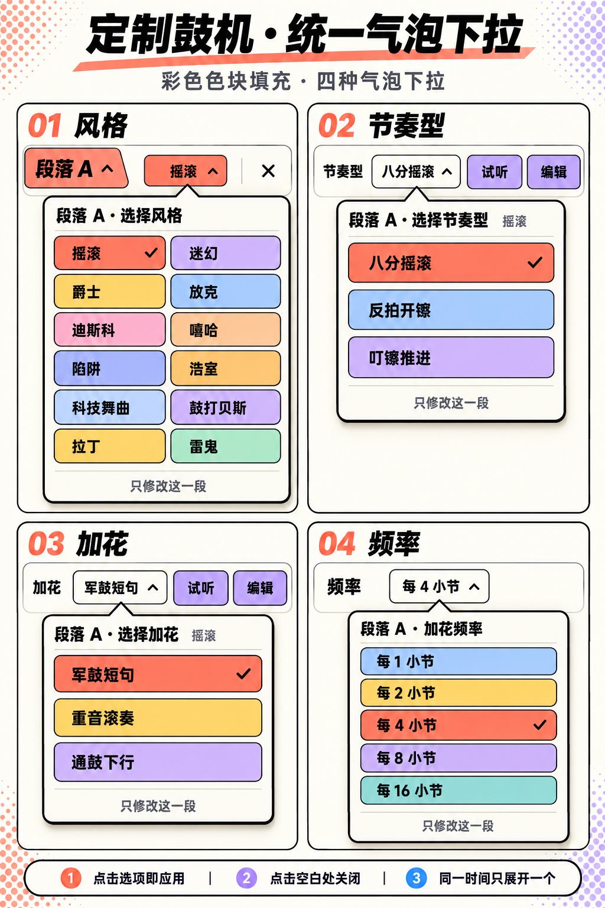

# 方案 A：四类统一气泡下拉

仅设计，未改应用代码。承接方案 A“每段独立选风格”。

当前版本按最新反馈，把四类菜单的所有选项改为整块彩色填充。上一版米色底方案保留为 [初稿](dropdown-system.png)。

## 共用外观

- 气泡：米白底、黑色描边、黑色硬阴影，小三角指向实际触发控件。
- 标题：“段落 A · 选择风格 / 选择节奏型 / 选择加花 / 加花频率”，始终明确当前编辑对象。
- 选项：全部采用完整彩色色块填充，黑色文字；当前选中项用黑色勾标识。图中四个选中项均为珊瑚色，但不能仅凭颜色判断选中。
- 风格保持双列，其余单列；统一外壳、选项样式和交互，不强行让不同数量的内容等高。
- 删除选项前的小色点，改为整个圆角矩形填色。外层气泡仍为米白色，不能把外壳也填成彩色。
- 试听与编辑继续保留在原表单行，不挪进下拉选项中。

## 所有选项

| 下拉 | 选项 | 图中选中 |
| --- | --- | --- |
| 风格 | 摇滚、迷幻、爵士、放克、迪斯科、嘻哈、陷阱、浩室、科技舞曲、鼓打贝斯、拉丁、雷鬼 | 摇滚 |
| 节奏型（摇滚示例） | 八分摇滚、反拍开镲、叮镲推进 | 八分摇滚 |
| 加花（摇滚示例） | 军鼓短句、重音滚奏、通鼓下行 | 军鼓短句 |
| 频率 | 每1小节、每2小节、每4小节、每8小节、每16小节 | 每4小节 |

节奏型与加花选项随该段风格变化，设计图以摇滚展示；其余风格复用同一组件，不新增一套皮肤。以上列表根据本次查阅的项目目录整理。

## 共用交互

1. 点击字段打开，字段箭头向上；再次点击同一字段或点击空白区域关闭。
2. 点击普通选项立即应用并关闭，不加确认按钮。点当前已选项只关闭，不重置设置。
3. 同一时间只展开一个气泡；点击另一字段，直接切换到新气泡。
4. 系统返回优先关闭气泡，不直接退出鼓机。
5. 打开、关闭、滚动选项均不触发试听、跳播或改变时间线。
6. 切换风格只影响当前段落；遇到手写鼓点，继续遵守方案 A 的保留/替换保护规则。此时只是完成风格选择意图，必要的保护确认仍先于实际替换。

## 定位与尺寸建议（设计参数，尚未接入源码）

- 首选气泡和触发字段之间间距 6vp；增大间距会使气泡离字段更远。
- 气泡默认在字段下方，底部空间不足时翻到上方，三角朝向随之翻转；不把频率菜单固定在屏幕底部。
- 距可用屏幕左右边缘至少 12vp；横向避让时三角仍指向触发字段，且避开圆角。
- 风格宽度建议 280vp；其他三种建议 224vp，均受可用宽度限制。增大宽度增加选项文字可用空间。
- 气泡圆角 12vp、内边距 12vp、黑描边 2vp；选项圆角 7vp、最小高度 44vp、间隔 8vp。
- 阴影半径 1vp，偏移 x/y 各 4vp，跟随应用现有硬阴影语言。
- 最大高度以可用视口的 60% 为参考，超出后仅选项列表滚动，标题保留；文字放大时优先增高选项，不能把文字截成无法辨认的缩写。

这些是后续实现的首选调节点，当前没有新增运行时常量或替换任何页面坐标。最终以真机宽度、系统字体倍率和安全区验证为准。

## 生成记录

内置 image_gen 生成，一张对照图含四个独立打开状态。参考图为上一轮方案 A，以上一版对照图为编辑目标。当前完整提示词见 [prompt-color-v2.json](prompt-color-v2.json)，初稿提示词见 [prompt.json](prompt.json)。

