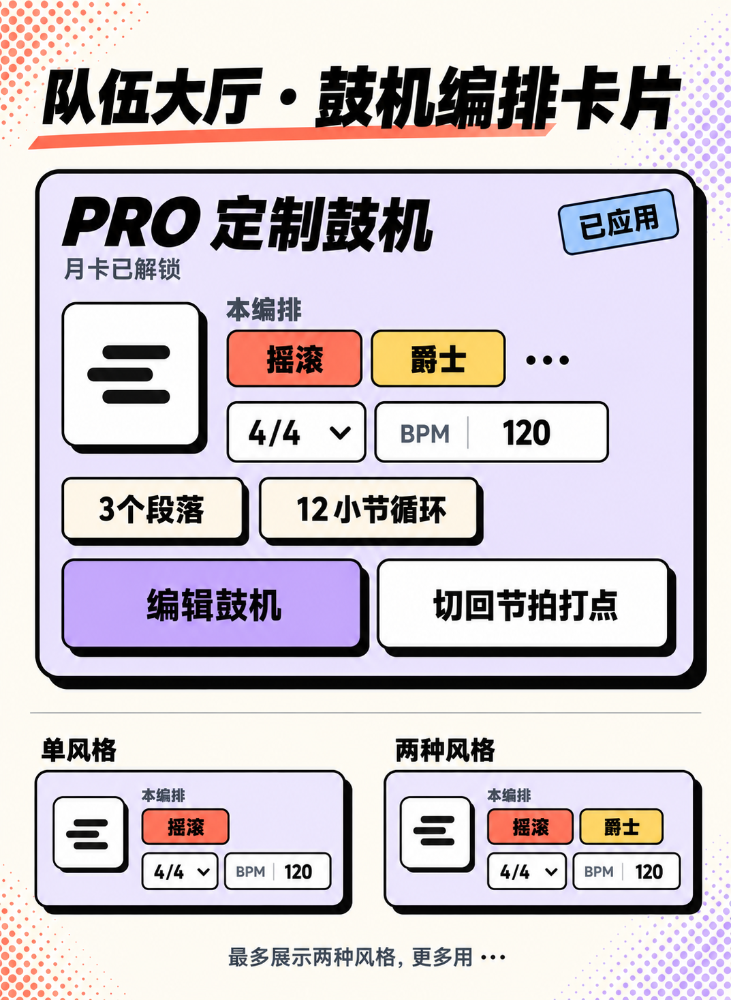
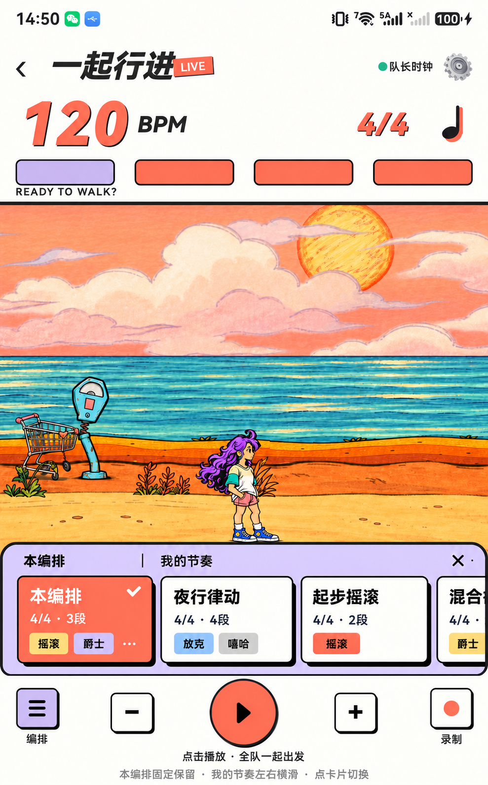

# 多风格编排：队伍大厅卡片与行进页切换

日期：2026-10-21。仅设计图与交互规格；未改应用源码、音频时间线或设备状态。承接方案 A 和 V3 外观细节。

## 队伍大厅：已应用鼓机卡片

保留原卡片的淡紫底、PRO 标题、已应用标记、月卡/试用状态、拍号与 BPM、段落/循环小节数，以及“编辑鼓机”“切回节拍打点”两个动作。

改造集中在中间摘要区：

- 将单一风格的大标题改为风格标签组：例如“摇滚 爵士 …”。
- 按段落先后顺序取风格并去重；1–2 种全部展示，超过 2 种只展示前两种加“…”。
- 不再用“硬朗推进”等单一风格描述解释整套多风格编排。
- 原单色音符圆形图标改为简洁的编排条形图标，避免用某一种风格色代表整曲。
- 月卡用户继续显示“月卡已解锁”；试用用户继续显示试用状态与截止时间；不向卡片加入分享活动文案。
- 队员仍只读，不出现队长的编辑操作。上锁时的既有提示仍是“定制鼓机包含在畅游月卡中”。

图中大卡片是超过两种风格的例子；下方仅对照一、两种风格时不出现省略号的摘要形态。

## 行进页：编排按钮与伸出条

左下角原“风 / 风格”按钮改为三条短横线的编排图标，下方文字“编排”。普通节拍模式下的音色按钮不受本设计影响。

点击后在原伸出条位置向上展开，保持底部减速、播放、加速、录制控制的顺序和位置。伸出条分成：

1. **固定的本编排**：进入本次行进时从大厅带来的完整编排，始终放在左侧。它是返回入口，不是随每次切换而被覆盖的“最新当前项”。
2. **横滑的我的编排**：右侧显示已保存的编排，保持库中既有顺序，点击整张小卡选择。这里的切换目标是整套编排，不再是摇滚/爵士等风格项。

本编排和保存项使用同一尺寸的紧凑横卡：名称、拍号/段落数、最多两个风格；仅超过两个时加“…”；不加封面、删除、编辑或载入按钮。当前使用项珊瑚底，并有白色勾。选择本身就是载入操作。此处为节省舞台高度压缩卡片，鼓机页“我的编排”仍保持前一版的方格卡片。

图中本编排选中，右侧还有横滑项；此图展示暂停/未开始状态，不展示录制专属 UI。

## 基本操作与状态

- 再点编排按钮或右上角小叉收起伸出条。
- 条目切换后保持展开，方便比较或切回。点舞台空白先收起伸出条，避免同时误收起整套面板；之后按既有方式切换面板。
- 系统返回先关闭伸出条。
- 没有已保存编排时，左侧本编排照常可选，右侧显示“还没有保存的节奏”，不强制跳页。
- 编排更改不覆写保存库。大厅编辑、返回大厅重新应用新编排时，才更新下一次行进入口的本编排基准。
- 点击已选中的条目不重复提交、不重启。
- 队长与单人练习可选择；队员端延续节奏由队长控制的权限，本地保存库不能修改整队播放。
- 如鼓机使用权益已到期，继续沿用现有的切换限制与提示，不中断当前在播编排。
- 开始录制自动收起面板时，同步收起编排伸出条；不改变当前实际使用的编排。

## BPM、拍号与同步切换

**设计默认：切编排保持当前 BPM。** 当前保存模型仅保存名称与编排内容，没有每项独立 BPM，因此不在保存卡片里编造 BPM 值。

- 同拍号、未开始或暂停：选择后更新为目标编排，保持当前播放/暂停意图，不自动开始播放。
- 不同拍号：先提示“将从 4/4 切换为 3/4，BPM 保持 120”，操作为“取消”“切换编排”。取消不改任何设置。
- 播放中：提交后短暂显示“切换中…”，在全队完成切换前保留原使用勾，完成后才将白勾移到目标项。播放控制不凭 UI 点击先行更新。
- 切换失败：清除候选的忙碌状态，使用勾与实际播放保持一致，提示“切换未完成，请重试”；不能假装切换成功。

当前代码中，运行时换风格走 SessionController.updateDrumProgram，最终会先同步配置、准备队员，再通过同一未来时刻让整队切换；不是各端收到包就立即更换。设计沿用这一约束，不承诺目前并未验证的“零中断”效果，也不在图中写“下一小节无缝切换”。

后续实现必须评估并验证：

- 多风格段落解析与完整编排的校验；
- **拍号和编排合并为一次配置切换**，不可顺序调用两个各自会触发运行中重启的接口，产生两次竞态；
- 准备失败时保留/恢复原有可播放配置，避免 UI 与实际音频不一致；
- 全队确认使用同一完整编排与拍号后，再发布统一的未来切换时刻；不新增每种风格独立的时钟；
- 本编排的基准快照和当前选中目标分开存储，才能从保存项切回未命名的原编排；
- 名称只用于显示，ID/内容用于识别，不依赖名称唯一性；
- 同拍号、异拍号、暂停、倒数、正在播放、录制中、断连/超时等场景的真实双机验证。

这些是设计对应的实现要求，尚未执行接入或验证。

## 后续视觉调节入口

本轮只有图片与设计文档，以下均为待实施的设计值，没有新增运行时属性：

| 区域 | 设计值 | 增减效果 | 实施时对应位置 |
| --- | --- | --- | --- |
| 外框/内框圆角 | 8vp / 6vp | 增大更圆，减小更方 | LeaderLobbyPage 卡片、MainPage 伸出条 |
| 硬阴影 | x=4vp、y=4vp、blur=0 | x 增大向右，y 增大向下；blur 保持 0 | 上述容器与控件 |
| 大厅卡片内边距 | 延续 14vp | 增大使内容离外框更远 | LeaderLobbyPage 鼓机卡片 padding |
| 行进条小横卡尺寸 | 建议 100vp × 68vp | 增大宽度使单屏可见项更少，增大高度使伸出条占更多舞台空间 | MainPage bottomPanel 原风格条内容 |
| 行进条总高度 | 约 125–140vp | 增大向舞台占用更多空间 | MainPage 伸出条容器 |
| 本编排固定区 | 一张横卡 + 分隔/间距 | 增大将减少右侧横滑区域 | MainPage 伸出条左列 |

实际可用范围还受设备宽度、系统字体倍率、底部安全区约束；伸出条高度会改变面板隐藏所需距离，后续实现时要一并校验，不能只改旧的 58vp 内容高而沿用原隐藏偏移。

## 图像生成

内置 image_gen 生成两张视觉提案。完整提示词与参考图角色见 [prompts.json](prompts.json)，行进页摘要省略号的校正见 [补充提示词](prompt-march-correction.json)。首稿原本尝试方格布局，最终采用紧凑横卡，以本说明与最终图为准。图片未写入运行时资源目录。

