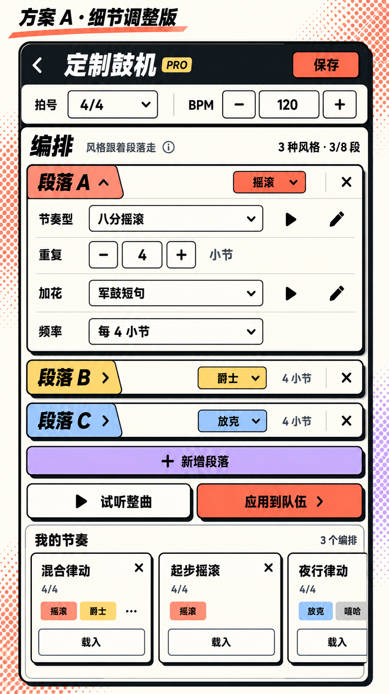
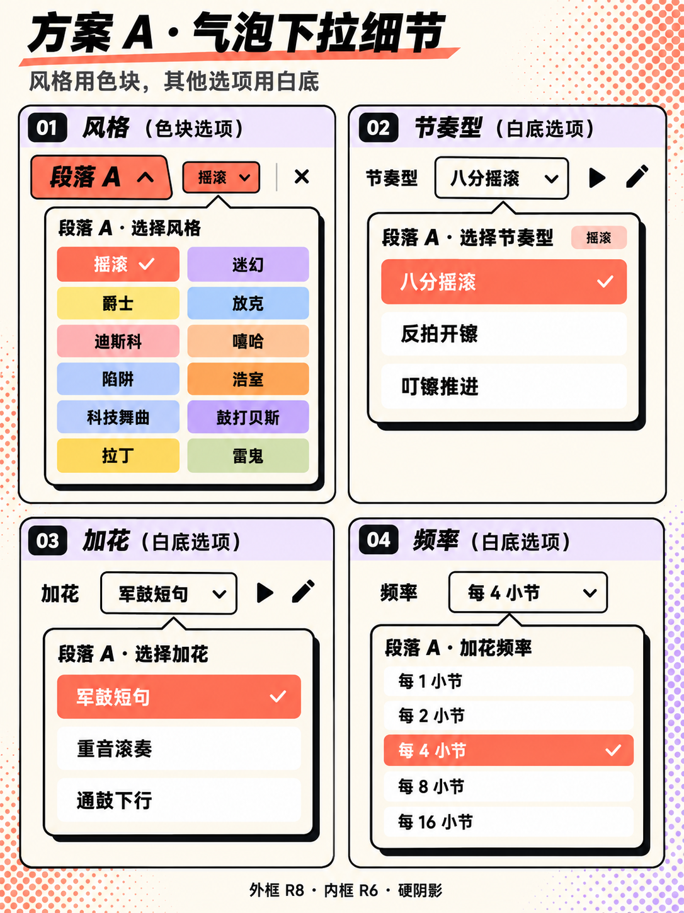

# 方案 A：细节调整版 V3

日期：2026-10-21。承接“每段独立选风格”，仅更新视觉设计图，没有修改应用页面或播放逻辑。

## 页面与下拉细节

主页面展示下拉关闭时的完整布局，细节图分别展示四种展开状态；运行时仍只打开一个下拉。

## 本版确认的视觉规则

| 对象 | 未选中 | 选中 |
| --- | --- | --- |
| 风格选项 | 完整彩色色块，无描边，黑色字 | 珊瑚色，白色字和白色勾 |
| 节奏型、加花、频率选项 | 纯白色，无描边，黑色字 | 珊瑚色，白色字和白色勾 |

- 气泡外壳保留黑色描边与指向触发字段的小尖角。
- 删除“只修改这一段”文案、底部分隔线以及该文案占用的空间。
- 外层卡片/气泡圆角 8vp，内层选项/控件圆角 6vp。
- 阴影采用不透明黑色实体偏移，模糊半径 0，不做渐变、虚化、柔化或灰色光晕。设计图首选偏移 x=4vp、y=4vp。
- 节奏型和加花右侧直接画播放三角与铅笔图标，不带文字，不保留原紫色文字按钮的外框或底板。
- “试听整曲”和“应用到队伍”继续保留文字，避免把单行图标操作和整曲操作混淆。

## 我的编排

- 每个已保存节奏用方格卡片，宽高相同，建议 112vp × 112vp。
- 横向滚动，页面可看到两个完整方格及下一个的部分内容，提示左右还有更多。
- 简要内容：名称、拍号、风格、紧凑的“载入”入口和删除叉号；不添加图片封面。
- 风格按首次出现顺序去重，最多显示两个。超过两个则在其后显示“…”；只有一到两个时不显示省略号。例：混合律动显示“摇滚 爵士 …”。
- 方格卡片仍保留原来的载入和删除能力，本轮不另设作品详情页。

## 后续实现的首选调节点

本轮没有运行时源文件坐标改动，以下为待实施的设计值：

| 参数 | 当前设计值 | 调整效果 |
| --- | --- | --- |
| 外框圆角 | 8vp | 增大更圆，减小更方 |
| 内框圆角 | 6vp | 增大更圆，减小更方 |
| 阴影偏移 | x=4vp / y=4vp | 增大 x 向右偏移，增大 y 向下偏移 |
| 阴影模糊 | 0 | 必须保持 0，符合本次明确的硬阴影要求 |
| 保存卡片边长 | 112vp | 同时增减宽高，保持正方形；增大后单屏可见卡片更少 |
| 卡片间距 | 建议 10vp | 增大可见卡片更少 |
| 图标视觉大小 | 建议 20vp | 增大图标更醒目；实际可点区域单独保证易点 |

圆角数值为设计规格；位图的视觉边缘不可替代实现阶段的精确参数。气泡仍需按安全区避让、空间不足向上翻转，图标按钮需保留无障碍名称和足够点击范围。

## 生成记录

两张图使用内置 image_gen 生成。完整提示词、原始图的编辑/参考角色见 [prompts.json](prompts.json)，页面卡片的正方形比例校正见 [补充提示词](prompt-square-correction.json)。参考裁图与校正前页面保存在 references/，用于保留设计过程。未把设计图写入应用资源目录。

