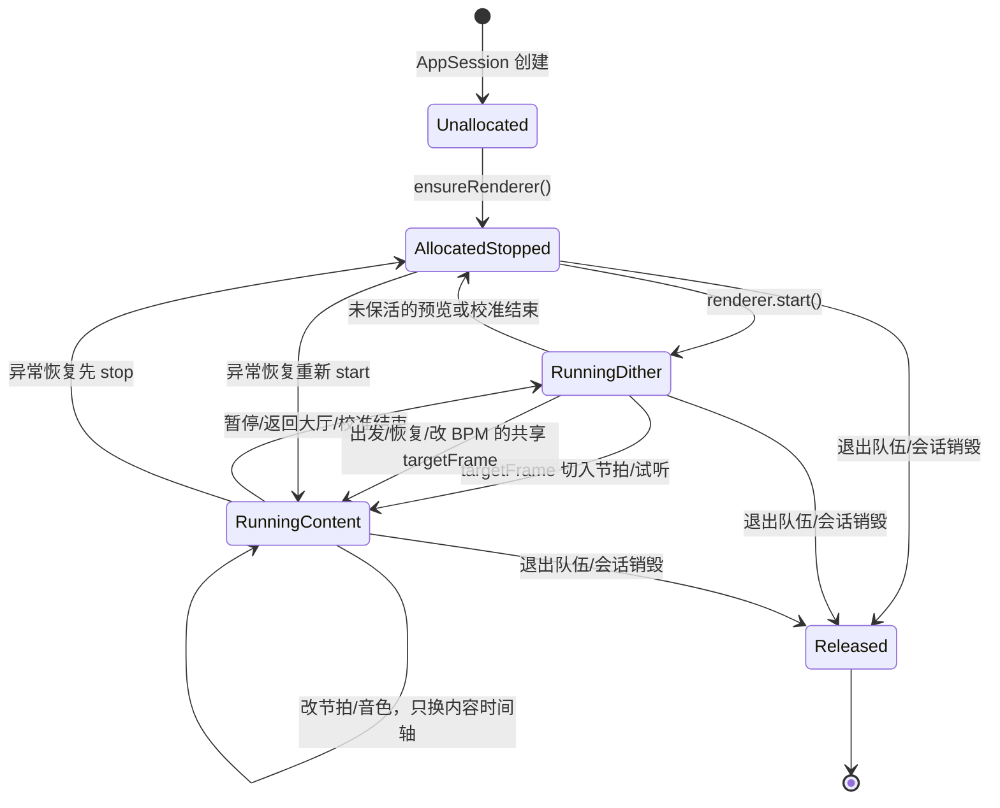

# OneBeat 多设备节拍同步方案

> 本文档描述 OneBeat（多设备同步节拍器）的跨设备同步设计及历史调查。**亚毫秒级是设计目标，不是已通过量化声学验收的精度承诺。** 2026-10-28 的测时估计保护、严格 READY、共享时钟与 PCM 反馈均已接入正常路径，持续反馈默认开启。用户双手机外放及蓝牙耳机主观听感反馈为偏差改善、没有漏拍或音质问题；尚无录音和量化偏差数据。当前状态与参数见 [分阶段修复记录](team-sync-fixes-2026-10-28.md)，原缺陷证据见 [2026-10-27 精度评审与最小验证](team-sync-accuracy-review-2026-10-27.md)。
>
> 涉及模块：时钟同步（`ClockSync`）、Transport 调度（`SessionController` / `AppSession`）、音频引擎（`MetronomeEngine`）、输出设备监测（`AudioOutputMonitor`）、绝对延迟补偿（自动估算 + 手动校准）。

---

## 1. 概述

OneBeat 通过 WiFi P2P 组网，以一台设备为**队长（leader）**、其余为**队员（member / follower）**。核心目标只有一个：

> 让所有设备的「可闻节拍声」在同一时刻响起。

难点在于三处偏差要逐一消除：

1. **设备间时钟差**：不同设备晶振不同、起点不同，需先统一时间基准；
2. **音频输出时延**：从「写入音频帧」到「喇叭发声」有数毫秒到数十毫秒的路由时延（DAC / 无线耳机等）；
3. **渲染器启动抖动**：`renderer.start()` 后写回调的首次触发时机、以及硬件时间戳何时可用，都是不确定的。

同步方案分四层，逐层收紧误差。

---

## 2. 整体架构

```
┌──────────────┐   TRANSPORT 消息（startAtLeaderMonoMs, beatIndex, countIn, bpm, beatsPerBar）
│  队长 leader  │ ────────────────────────────────────────────────▶ ┌──────────────┐
│  (本地时钟)    │                                                     │  队员 member  │
└──────────────┘                                                     │  (本地时钟)    │
       │                                                              └──────────────┘
       │ 自身也按同一时刻调度                                                 │ 用 offset 换算回本地时间
       ▼                                                                  ▼
   MetronomeEngine.scheduleFromLeaderStart()                    MetronomeEngine.scheduleFromLeaderStart()
```

- **时钟同步层**：队员用 NTP 风格的往返测时估算「队长时钟 − 队员时钟」的 offset，并用线性 skew 拟合修正晶振漂移。
- **调度层**：队长挑一个「未来的整拍下拍」作为 `startAtLeaderMonoMs` 广播出去；每台设备把它换算成自己的 `localStart`。
- **时延补偿层**：`localStart` 前移一个 `getLatency()` 的输出时延，得到 `audibleStart`，保证「可闻」时刻对齐。
- **锁钟层**：用硬件时间戳（`getAudioTimestampInfo`）估计首拍内容的目标帧；行进中共享时间与 PCM 反馈默认开启，受新鲜时间戳、静音窗口和 transport 状态约束，详见 §7。机制启用不等于已获得量化声学精度结论。

---

## 3. 时钟同步（`ClockSync.ets`）

### 3.1 NTP 风格 offset 估计

队员向队长发 ping，记录四个时间戳：

```
clientSendMs ──▶ serverRecvMs（队长收到）
clientRecvMs ◀── serverSendMs（队长回复）
```

对称假设下，单程时延 = RTT/2，于是时钟偏移：

```text
offsetMs = ((serverRecvMs - clientSendMs) + (serverSendMs - clientRecvMs)) / 2
rttMs    = (clientRecvMs - clientSendMs) - (serverSendMs - serverRecvMs)
```

约定方向：`leaderMono ≈ clientMono + offsetMs`（offset = 队长 − 队员）。

### 3.2 线性 skew 拟合

单纯用 offset 会在长时间行进中因晶振漂移而偏离。`ClockSyncEstimator` 保留一组带时间戳的样本，做线性回归：

```text
offset(t) ≈ skewRefOffsetMs + skewPpm * (t - skewRefAtMs) / 1e6
```

`getOffsetAt(t)` 按此投影，把「固定偏移」升级为「随时间漂移的偏移」。

拟合输入与约束（2026-10-15 的加权修复见 §3.4；2026-10-28 增加数据配对、训练与有效期保护）：

- 只记录每次测量经 `medianFromSamples` 过滤后的结果（`applySample` / `smoothAdjust`），**不记录单个原始 ping**。
- 加权最小二乘，权重 `1 / max(4, rtt)²`：单次测量误差上界正比于 `rtt/2`，慢链路结果不能与快链路结果等权。
- NTP 一致性重置：真实 offset 必落在 `[offset − rtt/2, offset + rtt/2]`。新结果与拟合投影之差超过 `rtt/2 + 5ms` 时，历史窗口已被证伪，清空后从新结果重新拟合，并打印 `[ClockFitDiag] action=reset`。
- 聚合结果使用同一实际样本的 offset、RTT 和测量中点，空批次显式失败。至少 3 个批次、跨度 10 秒，且加权残差 ≤3ms、`|skew|≤1000ppm` 才采用拟合；超限退回 offset，不截断斜率。最后有效测量后最多外推 15 秒，随后冻结；这些策略阈值不是已测硬件精度保证。

### 3.3 采样与重采样

- `PING_SAMPLES = 11`：起拍前的完整采样次数。测量包含 RTT 和样本间隔，实际耗时随链路变化，不能假定必在约 300ms 内完成；也可能复用已在途的轻量同步。
- `RESYNC_INTERVAL_MS = 5000`：行进中每 5s 重采样以更新共享时钟估计；新映射默认经 §7 的共享时间与 PCM 反馈参与持续校正，调试 `phase-off` 可回退。实际修正仍取决于有效硬件观测和静音窗口，不能仅凭周期测时推断音频误差。
- 网络质量分级：`rtt < 50` good / `< 150` fair / 其余 poor，仅表示响应速度。严格起拍要求至少 3 个有效 ping、样本年龄 ≤3 秒、估计误差 ≤10ms，并在音频准备后发送 READY 前复查。无效／劣质测量保留旧映射但不准入新的严格起拍；质量拒绝不等同于断连。

### 3.4 案例：队员切回前台后首次开始失败、随后拍子错位约 120ms（2026-10-15）

现象：两端都戴蓝牙耳机，多次开始/暂停都能对齐；12:53 这一次先弹「开始失败」toast，紧接着重试开始后拍子明显错位，之后再次开始又恢复对齐。

日志证据（队员 `[TransportPrepareDiag] role=member`）：

| prepare | elapsedMs | offsetBeforeMs | sampleOffsetMs（过滤后中位数） | usedOffsetMs | rttMs |
|---|---|---|---|---|---|
| 18（12:51:30，正常） | 744 | 87230317.01 | 87230308.00 | 87230317.66 | 12 |
| 19（12:52:50，队长侧超时） | 3535 | 87230162.91 | 87230307.00 | 87230159.64 | 22 |
| 20（12:52:54，用于 seq=11 开拍） | 1820 | 87230159.76 | 87230308.50 | 87230189.82 | 17 |
| 21（12:53:13，暂停） | 588 | 87230250.24 | 87230308.00 | 87230277.02 | 14 |

- 12:52:38–41 队员连续 4 次 `[AudioRouteDiag] action=playback-warmup`（路由未变），说明队员刚从后台/息屏切回前台；`handleAppForeground` 立即触发一次轻量重采样，此时 P2P 链路尚在唤醒，单次 ping 很慢（prepare-19 采 11 个 ping 用了 3.5s，正常约 0.6s）。
- 队长 `transport-prepare-19` 4001ms `reason=timeout`：`TRANSPORT_PREPARE` 送达和 11 次 ping 都很慢，严格准备按设计 fail-closed，弹出开始失败 toast。这一步本身是正确行为。
- 关键缺陷：过滤后中位数一直正确（≈87230308，rtt 12–22ms），但 `usedOffsetMs` 偏低约 150ms，且 `applySample(中位数)` 之后几乎不动。seq=11 实际用的 `offsetMs=87230193.8` 比真值小约 115ms，队员因此比队长晚约 115ms 发声，拍子混乱。约 60s 后脏样本滑出窗口，才逐步恢复。

根因：`measureWithSender` 通过 `onSample` 把**每个原始 ping** 都写进 skew 拟合窗口（60s），并且等权参与回归；`getOffsetMs()` 有拟合时返回回归投影，而不是刚测出的中位数。链路唤醒期间的原始 ping 不对称时延可达数百毫秒，拉偏整个回归；一个 rtt=22ms 的新中位数在十几个等权脏点里只占一票，因此 `usedOffsetMs` 停留在错误值。

修复（`entry/src/main/ets/sync/ClockSync.ets`、`SessionController.ets`）：

1. 移除原始 ping 回调，只把过滤后的测量结果写入拟合窗口。
2. 回归按 `1/rtt²` 加权。
3. 新结果与投影超出 NTP 区间（`rtt/2 + 5ms`）时清空窗口，以新结果为准，打印 `[ClockFitDiag] action=reset`。
4. `smoothAdjust` 改为接收完整样本，记录真实 rtt，不再沿用上一次的 rtt。

回归测试：`scripts/tests/clock-sync-fit.cjs` 回放该序列。旧实现中，单个 rtt=380ms 的结果就能把 offset 拖偏 48ms；新实现下偏差小于 3ms，且被污染的窗口会被新中位数直接重置。

复测：队员息屏或切后台约 1 分钟后回到行进页，立即开始。若首次因链路唤醒超时，属于预期内的 fail-closed；重试后应对齐。队员日志中 `usedOffsetMs` 应与 `sampleOffsetMs` 相差不超过 `rtt/2 + 5ms`，必要时会出现一条 `[ClockFitDiag] action=reset`。

---

## 4. Transport 调度

### 4.1 队长侧（`SessionController.ets`）

首次开始和恢复先向已连接队员发送严格 `TRANSPORT_PREPARE`。收到每位队员明确的 `clockReady=true` 后，才选取 `now + TRANSPORT_PREROLL_MS`（650ms）的共同起点；准备最多 4 秒，失败或超时本轮不发布起拍，也不提前切入 countdown。退出、返回大厅或新的控制请求使旧准备失效；迟到的 READY 和发送结果不能复活旧请求。单人或没有已连接队员时直接继续。

首次开始从 beat 0 起拍，恢复从 `ceil(beatIndex / beatsPerBar) * beatsPerBar` 起拍，两者都包含原有一小节倒数。严格 READY 证明时钟工作成功，不能保证未来控制包的投递期限或耳机声学状态。两端应同时更新到支持严格 ACK 的版本；旧队长不带严格标记的准备请求仍按原协议处理。

行进中改配置仍沿用独立的重启路径，先给队员发配置，再选共享的未来下拍：

```text
nextBarBeatIndex = (floor(beatIndex / beatsPerBar) + 1) * beatsPerBar
restartAt        = nowMs + TRANSPORT_RESTART_PREROLL_MS   // 650ms
```

`restartAt` 就是 `startAtLeaderMonoMs`，随 TRANSPORT 消息广播。

### 4.2 队员侧（`AppSession.ets` → `MetronomeEngine.scheduleFromLeaderStart`）

队员收到消息后，把队长时间换算回本地时间：

```text
localStart = startAtLeaderMonoMs - offsetMs
```

若消息到达时 `localStart` 已过（网络迟了），则顺延到未来的整拍：

```text
missedBeats = ceil((now - localStart) / interval)
localStart += missedBeats * interval
```

首次播放时按 `audioDelay` 延迟启动物理音频流：

```text
audioDelay = max(0, localStart - now - AUDIO_PREROLL_MS)   // AUDIO_PREROLL_MS = 650ms
```

渲染器一旦进入 `RUNNING`，播放、暂停、恢复和改 BPM 都不再调用
`stop / flush / start`。写回调持续输出：播放时填节拍内容，暂停时填 dither floor；
控制命令只是在持续增长的提交帧坐标中安排一个 `targetFrame`，到达该帧时切换内容时间轴。

650ms 的 preroll 是共享起点的提前预算。它不能保证任何网络延迟或输出补偿下都有足够余量；若实际剩余时间小于补偿加已提交队列，目标仍会被队列末端推迟。首次/恢复通过严格准备减少尚未就绪就消耗预算的问题，继续用 `StartTimingDiag` 检查是否仍有截断，调查见蓝牙延迟文档 §9.19。

### 4.3 共享暂停时刻

暂停也不是收到消息后立即停止。队长先做有界时钟准备（最多 900ms，超时仍继续暂停），再广播未来的
`pauseAtLeaderMonoMs = now + TRANSPORT_PAUSE_PREROLL_MS`。各设备将其换算为本地可闻时刻，
并在下面的硬件帧边界把节拍内容切换为 dither floor：

```text
hardwarePauseAt = localPauseAt - outputLatencyMs
targetFrame     = renderedFrame(now) + (hardwarePauseAt - now) * SAMPLE_RATE / 1000
```

到 `localPauseAt` 时才把逻辑 transport 状态切成 `paused`。因此设备间暂停边界与恢复/改拍一样使用共享时钟，而物理 renderer 和蓝牙流保持存活。

---

## 5. 音频输出时延补偿

「写入帧」到「喇叭发声」之间存在路由时延（DAC、无线耳机等）。若不做补偿，所有设备会统一地晚一个 `latency`。

### 5.1 运行时读取

```text
outputLatencyMs = renderer.getLatency(AudioLatencyType.LATENCY_TYPE_ALL)
```

`refreshOutputLatency()` 负责读取并缓存；`getLatency` 在流尚未路由时可能返回 0，此时**保留旧值**，避免把缓存清零。

### 5.2 提前提交

```text
audibleStart = localStart - outputLatencyMs   // 正值=提前提交
```

即音频内容时间轴整体前移 `outputLatencyMs`，使「可闻」节拍落在 `localStart`。UI 节拍仍以 `localStart` 为准。

> 实测两端设备 `getLatency(LATENCY_TYPE_ALL)` 均报 **45ms**，日志里 `acousticDelay=45`。

### 5.3 用 GAME 流规避低功耗大缓冲

渲染器用 `StreamUsage.STREAM_USAGE_GAME`。原因是低功耗（smart PA）通路有一个**不被 `getLatency` / `getAudioTimestampInfo` 上报的大缓冲**，会导致设备间数百毫秒的可闻偏差。GAME 流走普通/低时延通路，规避该问题。

### 5.4 蓝牙 A2DP 的限制与检测（已实现）

`getLatency(AudioLatencyType.LATENCY_TYPE_ALL)` 只覆盖**手机侧**链路（软件 + HAL + 硬件，到蓝牙芯片的 PCM 接口为止），**不含**蓝牙空中链路 + 耳机侧编解码缓冲 + DAC。因此普通蓝牙 A2DP（SBC/AAC）的可闻时延约 **150~250ms**，且不恒定（RF 干扰/重传带来 ±10~50ms 抖动），系统也没有 API 把它报出来。

已落地 `AudioOutputMonitor.ets` 做检测与提示：

- `getAudioManager().getRoutingManager().getDevicesSync(OUTPUT_DEVICES_FLAG)` 遍历判断是否含 `DeviceType.BLUETOOTH_A2DP`；
- `routing.on('deviceChange', ...)` 监听输出设备切换，首次与每次切换都回调当前是否为蓝牙 A2DP；
- `AppSession` 构造时 `start()`、`shutdown()` 时 `stop()`，结果写入 `AppStorage` 的 `btAudioActive`；`MainPage` 据此弹提示条 + toast。

> 结论：只能**检测到**「是不是蓝牙」，**拿不到蓝牙延迟数值**。要补偿蓝牙延迟，必须走 §5.6 的校准。

### 5.5 低时延流 ID（`getAudioStreamIdSync`，已实现）

`AudioRenderer` / `AudioCapturer` 提供读取框架分配的**流 ID** 的只读接口（`@since 12`，跨平台）：

```typescript
getAudioStreamId(callback: AsyncCallback<number>): void;
getAudioStreamId(): Promise<number>;
getAudioStreamIdSync(): number;
```

它是**纯只读诊断**：只返回该 renderer 的流 ID（一个 `number`），**不改变** `StreamUsage`、状态、缓冲、路由，因此不会影响已在使用中的 GAME 流。

实现位置 `MetronomeEngine.ets`：

```typescript
private rendererStreamId: number = -1;   // 字段

// ensureRenderer() 内、this.renderer = created 之后：
try {
  this.rendererStreamId = created.getAudioStreamIdSync();
  console.info(`MetronomeEngine streamId=${this.rendererStreamId}`);
} catch (e) {
  this.rendererStreamId = -1;            // 失败静默，绝不打乱传输
}
```

用途：诊断（区分低时延通路 / 蓝牙通路、多流对齐）。失败回落 `-1`，与 `getUnderflowCountSync` / `getAudioTimestampInfoSync` 同类，均不打断节拍。

**能力边界（SDK 现状，API 24 / HarmonyOS 6.1.1）**：

| 能力 | 状态 |
|---|---|
| `getAudioStreamId(Sync)` | ✅ 可用（`@since 12`） |
| `isFastPlaybackSupported` | ❌ 起始 **API 26**（当前 SDK 为 API 24，尚未提供） |
| `AudioLatencyType.LATENCY_TYPE_ALL` | ✅ 可用，但「硬件」只到手机蓝牙芯片，不含空中链路 |
| `createAudioGroup`（音频工作组） | ❌ HarmonyOS NEXT 无此接口（`openharmony` / `hms` 均搜不到） |

### 5.6 绝对延迟补偿：自动估算 + 手动校准

> 本节已落地代码。目标从「设备间相对同步」改为「每台设备补偿自己的**绝对延迟**」——因为蓝牙耳机要跟**画面**同步，而画面与外放都锁在同一个墙钟上，所以对齐蓝牙到外放/画面，就等于对齐到绝对墙钟。
>
> 补偿字段只有一个 `calibrationMs`（持久化为 `outputCompensationMs`，见 `AudioLatencyPersistence`），只在**蓝牙 A2DP 激活**时被 `readOutputLatencyOffsetMs()` 读取；外放 / 有线始终只用系统 `getLatency()`。**当前产品只提供打卡机校准。mic 回环于 2026-10-14 因真实声学验收未通过撤下入口、页面路由和麦克风权限，调查结论见 `bt-latency-calibration-debug.md` §9.13。** 下面的 mic 计算与实现记录仅用于保留调查证据。旧补偿没有来源标记，不批量删除；曾保存 mic 结果的设备应重新打卡测量并覆盖。

**目标与公式**

```text
D_i(绝对) = D_phone + D_bt_link
D_phone   ：手机侧时延，getLatency(LATENCY_TYPE_ALL) 已知化（含蓝牙链路估算）
D_bt_link ：蓝牙空中链路 + 耳机 DAC，系统不可见，需校准测得
补偿       ：把蓝牙流的调度时刻提前 D_i（hardwareStartAt = localAudibleStart - outputLatencyMs）
```

参考系是墙钟 T：画面闪烁、外放都调度在 T，所以对齐后三者同时到用户。

**打卡机校准与已停用的 mic 研究：同一字段的不同测量语义**

命名时刻（`presentationMonoMs`、`submitMonoMs`、`scheduledBeatAt` 等）的 ASCII / Mermaid 总图见
[`bt-latency-calibration-debug.md` §2.4](./bt-latency-calibration-debug.md#24-时间点总表与示意图)。

| 校准方法 | 页面 / 模块 | 测量对象 | 计算公式 | 语义是否 = 输出补偿 |
|---|---|---|---|---|
| 打卡机（单程输出） | `TimeCardCalibrationPage`（漫画整卡；旧`AudioCalibrationPage`源保留） | app → 耳朵 | `resultMs = max(0, mean(敲击时刻 − 计划节拍时刻))` | ✅ 是 |
| mic 回环（已停用，历史研究） | `MicLoopbackCalibrationPage` / `MicLoopbackCalibrator` | Renderer 呈现目标 → 耳朵 → 麦克风 | `latencyMs = chirp到达麦克风 − chirp呈现目标时刻` | ❌ 否（含输入侧） |

**打卡机（单程输出，输出补偿的正确语义）**

用户跟着 120 BPM 节拍敲击，取「敲击时刻 − 计划节拍时刻」的均值并 clamp 到 ≥0：

```text
resultMs = max(0, mean(敲击时刻 − 计划节拍时刻))
```

这条路只有「app → 耳机 → 耳朵」的**输出**一段，测到的正是 `outputLatencyMs` 要补偿的那个量。

**mic 回环（已停用的研究记录，往返含输入侧）**

`MicLoopbackCalibrator` 只创建 `AudioCapturer`。耳机测试用的已知 chirp 由
`MetronomeEngine.scheduleCalibrationSignal()` 注入会话的持久 Renderer，并按该 Renderer 的
`targetFrame` 返回 chirp 首帧的 **renderer-presentation 目标时刻**。这与正式播放的帧调度基准
一致；`writeData` 只是提前把数据填进软件队列，若以提交时刻起算，会把队列深度误计入补偿并在
正式播放时重复提前。
手机麦克风同时采集，再用互相关（匹配滤波）定位 chirp 到达麦克风的采样下标 `onset`：

```text
latencyMs = (captureStartMonoMs + onset / fs * 1000) − calibrationSignalScheduledAtMs
```

这条路 = 输出时延 + 声学（≈0）+ **麦克风输入采集时延**（麦克风 → ADC → 输入缓冲 → AEC/降噪 → readData 回调）。因此它天然比打卡机多出整段输入侧，数值常大几百 ms，**不能直接当输出补偿**（会过度补偿）。若要用它，需先单独测一次输入侧时延并扣除。

耳机回环开始后先做最多 3 次对位探测，根据互相关峰相对相关底噪的 `corrSnrDb` 实时提示
“还没听清 / 已经听到 / 位置很好”。正式阶段在同一个 Capturer 与持久 Renderer 上连续测 4 次：

- 每次 `corrSnrDb >= 16dB` 才算成功定位；
- 每次探测都清空局部采集片段，并以第一个新 `readData` 缓冲重新建立采集首帧时间锚点。互相关计算会
  短暂占用 ArkTS 线程并延迟或丢弃采集回调，因此后续探测不能用整次测量的累计采样数推导时间；
- 至少 3 次成功才产出结果，保存值取成功样本的中位数；
- 四次全部定位但出现一次明显离群时，选择最紧的连续三次作为稳健簇；只有该三次极差不超过
  30ms、并且与全部四次极差至少相差 15ms 时才剔除离群值，避免随意删除均匀分布的真实抖动；
- 结果卡显示定位次数、稳健簇大小、相关置信度中位数和稳健极差。稳健极差不超过 10ms 为
  “结果稳定”，不超过 30ms 为“结果可用”；更大的波动会如实提示，但至少三次定位成功后仍允许
  保存中位数，因为固定位置无法消除蓝牙缓冲自身的短时波动；
- UI 不能再用普通波形能量信噪比评价质量，因为弱漏音经 500ms chirp 的匹配滤波积分后仍可能可靠定位。

输入侧校准与耳机回环都固定使用 `SOURCE_TYPE_MIC`。二者相减的前提是经过同一种系统麦克风
处理链；不能让一侧使用 `SOURCE_TYPE_UNPROCESSED`、另一侧回退为 `SOURCE_TYPE_MIC`。
即使音源类型一致，外放和蓝牙路由下的 AEC、降噪与缓冲仍可能不同。若耳机回环值小于已保存的
输入侧值，说明差分的前提不成立；该负值是无效测量，不得截断为 0 后保存。界面必须保留两个原始值并
要求重测两步。

输入侧校准要求首选媒体输出明确为手机内置 `SPEAKER`；仅仅“不是蓝牙”不够，有线、USB、听筒
同样会被拒绝。chirp 由 `AppSession.metronome` 的持久
Renderer 播放，以同一种 renderer-presentation 帧时钟测得“外放输出 + 麦克风输入”，
再扣除该次 Renderer 返回的 `LATENCY_TYPE_HARDWARE`。帧时钟已在“写入硬件”
边界，软件处理段已经过去，因此不能再扣包含 SOFTWARE 的 `LATENCY_TYPE_ALL`。
它只用来估计麦克风输入链路，
不会把外放路由的 Renderer 队列当成耳机输出补偿。

**校准 Renderer 与行进 Renderer 的同一性约束**

当前打卡机必须使用 `AppSession.metronome` 持有的同一个 `AudioRenderer`；停用的 mic 研究也曾使用这个约束：

- 打卡机通过 `scheduleLatencyTapMeasurement()` 在该 Renderer 上播放 120 BPM 测量节拍；
- 麦克风回环通过 `scheduleMicLoopbackSignal()` / `scheduleCalibrationSignal()` 把 chirp 混入该 Renderer；
- 打卡机保存成功后调用 `keepLatencyCalibrationRendererAlive()`，把
  `keepRendererAliveForSession` 置为 `true`；
- 页面退出时 `stopLatencyCalibration()` 只调用 `metronome.pause()`：停止节拍内容但继续提交
  dither floor，不执行 `stop / flush / release`；
- 进入行进页后，`scheduleFromLeaderStart()` 复用仍在 `RUNNING` 的 Renderer，只在持续帧坐标上
  安排行进节拍的 `targetFrame`。

因此正常路径中延续的不只是同一种 Renderer 配置，而是同一个 Renderer 实例、同一个 stream ID、
同一条持续增长的帧时钟和同一条 A2DP 缓冲链路。蓝牙断开/重连、音频中断后的异常恢复或退出队伍
会破坏这条同一性；其中蓝牙重连必须提示重新测量。

**播放端接法（`readOutputLatencyOffsetMs()`）**

```text
蓝牙 A2DP 激活：
  已校准 → outputLatencyMs = calibrationMs（打卡机写入；旧 mic 值应重新打卡覆盖）
  未校准 → outputLatencyMs = getLatency(LATENCY_TYPE_ALL) + estimateBluetoothLinkLatencyMs()
外放 / 有线：
  outputLatencyMs = getLatency(LATENCY_TYPE_ALL)   // 只用系统值，不碰校准值
```

随后 `hardwareStartAt = localAudibleStart - outputLatencyMs`（§6.2），把蓝牙流调度提前。这个「蓝牙才用校准值」的边界必须保留，否则一次耳机校准会污染之后的手机外放时序。

**自动估算（未校准时的兜底）**

未做手工校准时，`estimateBluetoothLinkLatencyMs()` 返回常量 `BLUETOOTH_LINK_LATENCY_DEFAULT_MS = 0`：因为 `getLatency(LATENCY_TYPE_ALL)` 对无线路由已返回「含蓝牙链路」的估算时延，实测再加固定增量会导致声音超前画面，故默认额外补偿置 0（宁可略微滞后、不要超前）。仅当某设备 getLatency 明显低估蓝牙链路时，再按需调大该常量。

**音画感知不对称容差**

人对音画不同步的容忍是**不对称**的，直接影响默认方向与验收容差：

| 方向 | 可察觉阈值 |
|---|---|
| 声音**滞后**画面 | ~+125ms 才明显 |
| 声音**超前**画面 | ~−45ms 即察觉 |

因此：默认让音频**略微滞后**（宁可 +10ms，不要 −10ms）；验收容差设 **±10~15ms**。

**精度与局限**

- 打卡机：受用户反应时影响，精度约 ±30~100ms（多次敲击取均值可收敛）。
- 已停用的 mic 研究：互相关定位的数值精度不证明生产声学输出准确；扣除输入侧并桥接参考后，真机仍出现约 200ms 的相对误差。
- 局限：蓝牙抖动 ±10~50ms **无法消除**，只能消除「恒定偏移」。
- 缓解：引导使用 LC3 / aptX LL / 星闪（NearLink，5ms 级）等低时延耳机，同时降低偏移与抖动。

---

## 6. 持续流的硬件时间戳锁钟（`lockAudioStartToPresentationClock`）

`renderer.start()` 只在首次进入行进页、手工延迟测量或异常恢复时执行。打卡机和耳机 mic 回环
都直接使用这条会话物理流；测量成功并保存后，同一 Renderer 会穿过队伍大厅继续存活。
首次行进后，从行进页返回大厅也只切回 dither floor，不会停止 Renderer。直到用户退出队伍或
会话销毁时才释放物理流；取消未保存的测量只会在会话尚未取得保活所有权时停止物理流。
mic 输入侧的手机外放校准属于一次性采集辅助步骤：仍复用会话 Renderer 取得同一种
presentation 帧时钟，但路由切到外放后会重建帧纪元，不能延续此前的 A2DP 物理缓冲。
启动后，写回调立即持续提交 dither floor，
硬件时间戳负责把 renderer 的持久 `framePos` 映射为「本次物理流已呈现帧数」。

### 6.0 Renderer 完整生命周期

一个 `AppSession` 只拥有一个 `MetronomeEngine`，一个 `MetronomeEngine` 同一时刻最多持有一个
会话 `AudioRenderer`。这里必须区分三件事：

1. **Renderer 对象存在**：`this.renderer !== undefined`；
2. **物理流正在运行**：Renderer 为 `STATE_RUNNING`，`writeData` 持续回调；
3. **节拍内容正在播放**：`audioStreaming === true`。物理流运行但内容暂停时仍会输出 dither floor。



#### 1. AppSession 创建：尚未分配 Renderer

`AppSession.createLeader()` / `createMember()` 只创建 `MetronomeEngine`，此时
`renderer === undefined`、没有物理流、没有音频回调。`keepRendererAliveForSession` 初始为 `false`。

#### 2. 分配但未启动：`ensureRenderer()`

`ensureRenderer()` 幂等创建 `STREAM_USAGE_GAME` 的单声道 44.1kHz Renderer，注册
`writeData / stateChange / audioInterrupt`，并记录只读 `stream ID`。重复调用不会换实例。

- 队员加入成功后会在大厅提前调用一次，用来避免共享起拍窗口被对象创建耗时吃掉；此时通常只是
  **AllocatedStopped**，尚未建立稳定的 A2DP 播放缓冲。
- 队长在试音、鼓机预览、任一种延迟测量或首次出发时按需创建。

#### 3. 首次物理启动：建立持续帧时钟

以下入口会让 Renderer 从 stopped 进入 `STATE_RUNNING`：

- 正常出发、鼓机预览、打卡机：`scheduleFromLeaderStart()` → `startAudioStreamNow()`；
- 已停用的麦克风研究：`scheduleCalibrationSignal()` → `ensureSilentRendererRunning()`，当前没有产品调用入口；
- 确认蓝牙出口试音：先建立同一会话 Renderer，再在其时间轴播放有限节拍。

启动时重置本次物理流的时间戳基准、`audioSubmittedFrames` 和队列估计。写回调随即持续运行；
目标内容尚未到达 `targetFrame` 时只填 dither floor。第一次有效硬件时间戳把设备的原始
`framePos` 映射到本次持续流坐标。

#### 4. 校准阶段

当前只有打卡机为产品功能；下述 mic 和输入侧流程保留为停用研究的实现记录。

- **打卡机**在会话 Renderer 上以 `outputCompensationOverrideMs = 0` 播放测量节拍；
- **麦克风耳机回环**把 chirp 叠加到同一 Renderer 的指定帧，`MicLoopbackCalibrator` 只持有
  `AudioCapturer`；
- **输入侧外放校准**仍使用同一个会话 Renderer，并临时创建 `AudioCapturer`；由于物理路由已从
  A2DP 切到外放，首个探针必须 stop / flush、重置 timestamp/frame 映射并重新暖机。它测得的值
  只用于扣除麦克风输入链路，不能把外放 Renderer 队列保存成耳机输出补偿。

当前打卡机点击“保存并生效”时，会先写入补偿值，再调用
`keepLatencyCalibrationRendererAlive()`。这个调用把 `keepRendererAliveForSession` 设为 `true`，
并把节拍内容切回 dither floor。随后页面 `aboutToDisappear()` 调用
`stopLatencyCalibration()` 时，只清理校准状态和内容，不停止物理流。

校准失败、用户退出或取消保存时：如果当前会话从未取得保活所有权，
`stopLatencyCalibration()` 会调用 `suspendRenderer()`，停止物理流但保留 Renderer 对象；如果
本会话此前已经保存过校准或进入过行进页，保活标记是粘性的，仍只切回 dither floor。

#### 5. 大厅保活与进入行进页

保存校准后，大厅中的 Renderer 保持 `STATE_RUNNING`，`audioStreaming = false`，写回调持续提交
dither floor。队长出发或队员收到 `TRANSPORT` 后，`scheduleFromLeaderStart()` 发现 Renderer
健康且仍在运行，不再调用 `start / stop / flush`，只把行进内容安排到新的 `targetFrame`。

因此正常路径会保留 Renderer 实例、stream ID、硬件帧坐标、提交帧坐标和 A2DP 缓冲。首次未做
校准直接出发时，成功处理 `TRANSPORT` 后同样把 `keepRendererAliveForSession` 设为 `true`，从此
该会话进入保活生命周期。

#### 6. 行进中的暂停、恢复、改 BPM 与返回大厅

- **暂停**：`schedulePauseFromLeader()` 在共享帧边界把 `audioStreaming` 切为 `false`，Renderer
  继续运行并输出 dither floor；
- **恢复**：在同一持续帧坐标安排新的 play transition，不重新启动物理流；
- **改 BPM / 拍号 / 音色**：先准备新内容，再在共享 `targetFrame` 切换；不会 stop/flush/start；
- **队长返回大厅**：`leaderReturnToLobby()` 调用 `metronome.pause()`；队员收到同步暂停后也切到
  dither floor。`keepRendererAliveForSession` 保持为 `true`，再次出发继续复用；
- **大厅鼓机预览**：已有保活所有权时，预览结束只回到 dither floor；尚未保活时，预览结束可
  `suspendRenderer()`，避免无意义地长期占用物理流。

#### 7. 音频路由切换与异常恢复

蓝牙断开或重连时，Renderer 对象可能仍是同一个，但系统下方的实际路由和 A2DP 缓冲已经改变，
不能再视为“产生校准值的同一条物理流”。`AudioOutputMonitor` 会立即按新路由刷新补偿；检测到已
校准蓝牙断开时设置 `btCalibrationNeedsRemeasure`，重连后提示重新测量。外放/有线不会读取蓝牙
手工补偿。

强制音频中断恢复或 `writeData` 超过 `AUDIO_CALLBACK_STALL_MS` 无进展时，`recoverAudio()` 可以
执行一次 `stop → start`。这是允许重建物理流的异常路径：Renderer 对象可复用，但帧时间戳基准
和无线缓冲需要重新建立，之前校准值的稳定性不再由“同一物理流”保证。

#### 8. 停止与最终释放

`suspendRenderer()` 只取消 transport 并调用 `renderer.stop()`：对象、事件监听和 stream ID 字段
仍由 `MetronomeEngine` 持有，后续启动会建立新的物理流。

用户退出队伍、从大厅离开、行进页确认退出，或 Ability 销毁时会走
`AppSession.reset()/clear()` → `shutdown()`。`shutdown()` 先调用 `SessionController.disconnect()`
送达解散/离队事件，再由 `metronome.stopEngine()` 依次取消 transport、停止 Renderer、解绑回调并
调用 `release()`，最后把 `this.renderer` 置空。这是正常生命周期中真正释放会话 Renderer 的位置；
新建队伍会创建新的 `AppSession` 和新的 Renderer。

队长主动退出时，`SessionController.disconnect()` 会在关闭 TCP 之前向所有已认证队员发送
`SESSION_DISBANDED`。队员收到后立即释放本地会话资源、清空页面栈并回到组队入口；该显式消息
用于区分主动解散与网络断开。队员先回复 `SESSION_DISBANDED_ACK`，队长收齐 ACK 或等待 800ms
超时后才关闭 socket，避免解散帧还在本机发送缓冲时就被丢弃。单个失效连接的发送失败不得阻塞其他队员收到
解散通知。若显式消息仍丢失，队员的 TCP `close` 回调会作为兜底：因当前协议没有断线重连能力，队员必须退出
失效会话，不得继续显示旧名单。

应用从后台返回时不能直接按单调时钟差清理成员：系统可能冻结 ArkTS 定时器，恢复后的首次
心跳清理会把整段后台时间误判成失联。队长在 `onBackground` 暂停超时清理，并在
`onForeground` 先为仍在 TCP 连接表中的队员
重置心跳基准；队员同时立即执行一次 PING/PONG 重采样。P2P 状态查询在前台恢复瞬间可能短暂
返回未连接，只要仍有已认证队员，就保留现有 P2P 组，不能重建后造成双方 roster 分叉。
若 TCP 成为系统无法及时报告 `close` 的半开连接，队员连续 3 轮重采样失败后退出队伍。

队伍会话创建后，`SessionBackgroundKeeper` 除了启动 `audioPlayback + multiDeviceConnection`
长时任务和 AVSession，还持有 `RunningLockType.BACKGROUND` 运行锁，避免队长或队员熄屏后系统
休眠导致 P2P/TCP 心跳中断。运行锁每次持有 10 分钟、每 5 分钟续期，并在 `shutdown()` 中释放；
有限持有时间保证进程异常终止时系统也能自动回收。

| 操作 | Renderer 对象 | 物理流 | 输出内容 | A2DP 缓冲是否延续 |
|---|---|---|---|---|
| 队员加入后的预热 | 保留 | 未启动 | 无 | 否 |
| 打卡机/耳机回环测量中 | 同一个 | RUNNING | 测量音 + 底噪 | 是 |
| 测量保存后回大厅 | 同一个 | RUNNING | 底噪 | 是 |
| 出发/暂停/恢复/改 BPM | 同一个 | RUNNING | 节拍或底噪 | 是 |
| 行进页返回大厅 | 同一个 | RUNNING | 底噪 | 是 |
| 未保活的测量取消/预览结束 | 保留 | STOPPED | 无 | 否 |
| 蓝牙断开重连 | 通常保留 | 路由重建 | 视系统状态 | 否，必须重测 |
| 卡顿/中断异常恢复 | 保留 | stop 后重启 | 恢复节拍 | 不保证 |
| 退出队伍/会话销毁 | 释放 | 结束 | 无 | 否 |

### 6.1 持久帧坐标

首次拿到有效 `getAudioTimestampInfoSync()` 样本时，用物理流启动后的墙钟经过时间估计已呈现帧数，建立基准：

```text
playedEstimate         = min(submittedFrames, (now - rendererStartedAt) * SR / 1000)
audioTimestampBaseFrame = info.framePos - playedEstimate
renderedFrames          = info.framePos - audioTimestampBaseFrame
                        + timestampAge * SR / 1000
queueDepthFrames        = max(0, submittedFrames - renderedFrames)
```

某些设备在 `stop / flush` 后仍延续 `framePos`，因此基准不能假设为 0。只有异常恢复重建物理流时才重新建立基准；正常 transport 切换始终沿用同一坐标。

### 6.2 共享时刻转成目标帧

先把希望的可闻时刻减去当前路由输出时延，得到硬件呈现时刻，再映射到持续流坐标：

```text
hardwareStartAt = localAudibleStart - outputLatencyMs
targetFrame     = renderedFrames(now) + (hardwareStartAt - now) * SR / 1000
```

`fillAudioData()` 可以在一次回调的缓冲内部按 `targetFrame` 精确切段：目标帧以前继续旧内容（或暂停底噪），目标帧开始换成新 BPM/新音色/恢复后的节拍内容。这样不会因为停止并重建蓝牙缓冲而改变路由延迟。

画面播放头还必须绑定 transport token。新 transport 跨过 `targetFrame` 前，持续 renderer 暴露的仍是上一轮帧原点，画面此时使用新共享起点的单调时钟；切换完成后才读取本轮硬件播放头，避免恢复时人物提前走动并把道路进度误推进。

### 6.3 首次启动锁与回退

物理流刚启动、硬件时间戳尚未可用时，先按 `rendererStartedAt` 的墙钟差放置临时 `targetFrame`，回调只提交 dither floor。锁循环取得有效时间戳后再修正目标帧；若超时则保留墙钟估计。开始前还会短时读取 3 次 `getLatency()` 并取中位数，减少路由刚建立时的瞬态读数。

### 6.4 锁循环参数

| 常量 | 值 | 含义 |
|---|---|---|
| `AUDIO_CLOCK_LOCK_RETRY_MS` | 8ms | 采样失败后的重试间隔 |
| `AUDIO_CLOCK_LOCK_TIMEOUT_MS` | 300ms | 锁的总超时 |
| `AUDIO_CLOCK_LOCK_MIN_REMAINING_MS` | 80ms | 距 localStart 的最小剩余时间 |

锁的 deadline 取 `min(rendererStart + TIMEOUT, localStart - MIN_REMAINING)`。硬件时间戳拿不到时走纯墙钟目标帧回退。

---

## 7. 行进中的相位锁定

> 2026-10-28 当前状态：`phaseCorrectionEnabled=true`，共享音乐时钟与 PCM 反馈默认开启，保留调试开关用于受控 A/B 和回退。早期默认关闭阶段已结束；用户双手机外放及蓝牙耳机主观反馈为体感偏差改善，没有漏拍或音质问题，量化声学统计尚未采集。旧版 `audioClockLocked=false` 阻断首次采样及跨机 offset 未进入持续音频比较器的问题，保留在 [2026-10-27 评审](team-sync-accuracy-review-2026-10-27.md)；实际毫秒级声学指标需按共同采样录音另行统计。

反馈开启时，`transportClockAdjustmentAt()` 以最多 1ms/s 吸收可信共享时钟变化，音频期望位置与拍点／画面使用同一音乐网格。`measurePhaseErrorFrames()` 先读取本轮有效硬件观测，再建立播放锁；播放头还扣除已呈现的插／丢帧内容差。待处理残差额外扣除已提交但尚未出声的修正及待执行量，避免重复校正。

正残差表示音频内容偏快，需要插帧延迟；负残差表示偏慢，需要丢帧追赶。每拍评估门槛为 `AUDIO_PHASE_LOCK_THRESHOLD_FRAMES=44`（约 1ms）。首次反馈额度为 16 帧；之后按经过时间、`AUDIO_PHASE_CORRECTION_RATE_PPM=2000`（约 2ms/s）分配额度，单次最多累计 `AUDIO_PHASE_CORRECTION_MAX_INTERVAL_MS=2000` 毫秒，避免低 BPM 时固定每拍 16 帧追不上共享时钟变化。一次额度可分多次执行，每次静音剪接仍最多 `AUDIO_PHASE_LOCK_MAX_STEP_FRAMES=16` 帧（约 0.36ms）。硬件样本年龄上限 250ms；帧坐标回退后等待新锚点，不复用旧反馈。

剪接检查真实 PCM：位置两侧各 `AUDIO_PHASE_QUIET_GUARD_FRAMES=16` 帧、全部待丢弃帧的绝对值都不超过 `AUDIO_PHASE_QUIET_SAMPLE_LIMIT=4`。旧的拍内固定安全区已被移除。**持续镲声或长音没有静音窗口时，修正只能等待，不能保证持续收敛。** 待执行量限制在本次时间额度内，避免无限积压；实际执行量仍取决于静音窗口和有效硬件观测，不能把 2000ppm 额度当成无条件可达的校正速率。

调试包在已有会话 `idle/paused` 且输出停妥时，可通过固定 `phase-on/phase-off` 命令切换；每台设备分别设置，不允许播放中改模式。发布包默认启用反馈但不响应这两个调试命令。临时回退用 `phase-off`，正常对照结束用 `phase-on` 恢复默认行为；新引擎实例默认 true。完整参数、命令及“先双手机外放、再耳机”的量化 A/B 步骤见 [分阶段修复记录](team-sync-fixes-2026-10-28.md)。独立精确帧映射开关仍关闭，本轮没有自动改写已有耳机校准。

---

## 8. Dither floor（防智能功放静音检测）

节拍 click 之间的静音区不是纯数字零，而是铺了一层约 −80dBFS 的抖动底噪。原因是智能功放的静音检测（`CustStreamCheck → SmartpaPowerOff`）会在检测到纯零流时**关闭功放**，导致重新发声时产生可闻延迟/爆音。

---

## 9. 关键参数总览

### 9.1 音频引擎（`MetronomeEngine.ets`）

| 常量 | 值 | 含义 |
|---|---|---|
| `SAMPLE_RATE` | 44100 Hz | 采样率（44 帧 ≈ 1ms） |
| `AUDIO_PREROLL_MS` | 650 | 音频流启动预留 |
| `AUDIO_CLOCK_LOCK_RETRY_MS` | 8 | 锁采样重试间隔 |
| `AUDIO_CLOCK_LOCK_TIMEOUT_MS` | 300 | 锁超时 |
| `AUDIO_CLOCK_LOCK_MIN_REMAINING_MS` | 80 | 锁最小剩余 |
| `AUDIO_PHASE_LOCK_THRESHOLD_FRAMES` | 44 | 相位校正阈值（≈1ms） |
| `AUDIO_PHASE_LOCK_MAX_STEP_FRAMES` | 16 | 单次静音剪接及首次反馈额度（≈0.36ms） |
| `AUDIO_PHASE_CORRECTION_RATE_PPM` | 2000 | 按经过时间计算后续校正额度（≈2ms/s） |
| `AUDIO_PHASE_CORRECTION_MAX_INTERVAL_MS` | 2000 | 单次额度累计的最大间隔；pending 也按本次额度有界 |

### 9.2 会话层（`Constants.ets`）

| 常量 | 值 | 含义 |
|---|---|---|
| `TRANSPORT_PREROLL_MS` | 650 | 首次播放/恢复预留 |
| `TRANSPORT_RESTART_PREROLL_MS` | 650 | 行进中改拍预留 |
| `TRANSPORT_PAUSE_PREROLL_MS` | 650 | 共享暂停边界预留 |
| `TRANSPORT_START_PREPARE_TIMEOUT_MS` | 4000 | 首次/恢复严格准备的总上限，成功后立即继续 |
| `TRANSPORT_PREPARE_TIMEOUT_MS` | 900 | 暂停/现有配置重启准备的有界等待 |
| `PING_SAMPLES` | 11 | 起拍前时钟采样次数 |
| `RESYNC_INTERVAL_MS` | 5000 | 行进中重采样间隔 |
| `COUNT_IN_BARS` | 1 | 准备拍小节数 |

---

## 10. 调试日志（`OneBeatSync`）

| 日志 | 关键字段 | 说明 |
|---|---|---|
| `schedule` | `offsetMs / startAtLeader / localStart / now / audioDelay / countIn / beat / bpm` | 调度决策 |
| `transition[continuous]` | `audible / hardware / targetFrame / submitted / latency` | 持续流内安排内容切换 |
| `transition[play/pause]` | `frame / submitted / latency` | 写回调实际跨过切换帧 |
| `lockClock[hw]` | `expected / actual / dev / played / submitted / queue / target / latency` | 首次物理启动的硬件时间戳锁钟 |
| `lockClock[fallback]` | `expected / rendererStart / submitted / target / latency` | 首次启动的纯墙钟回退 |
| `restart[leader]` | `restartAt / beat / beatsPerBar` | 队长重启 |

**验收标准**：`dev` 稳定在 `±0.01ms` 量级，`acousticDelay = 45`，`audibleStart = localStart - 45`。

---

## 11. 踩坑记录与修复

按发现顺序记录，均已在代码中落地：

| # | 现象 | 根因 | 修复 |
|---|---|---|---|
| 1 | 可闻节拍统一晚 ~60ms | 输出时延用固定 `-20ms`，符号反且量级错 | 改用运行时 `getLatency(LATENCY_TYPE_ALL)`，`audibleStart = localStart - latency` |
| 2 | 偶发 `dev=55~75ms` 迟到 | 锁首样本 `playedFramesNow` 恒为 0，漏算已播帧导致 lead 下溢 | 补上 `(now - rendererStartRequestedAtMs)` 墙钟已播帧 |
| 3 | 偶发 `dev=-12~-26ms` 提前 | `playedFramesNow > submitted`（写回调未触发时 submitted=0） | `playedFramesNow` 钳制到 `submitted` |
| 4 | 偶发 `dev=+27ms` 迟到 | `haltRendererNow` 耗时吃掉 preroll，fallback lead 小于写回调 burst（185ms） | `AUDIO_PREROLL_MS` 450 → 650 |
| 5 | 设备间数百 ms 偏差 | 低功耗通路的大缓冲不被 `getLatency` 上报 | 改用 `STREAM_USAGE_GAME` |
| 6 | 播放、暂停或改 BPM 后蓝牙延迟重新波动 | 每次 transport 都执行 `stop / flush / start`，重新建立了蓝牙缓冲 | renderer 与蓝牙流常驻，只在共享目标帧切换内容；离开会话或异常恢复时才停止 |

---

## 12. 附：首拍定位时间线

```text
t0   首次 schedule 或手工测量到达，算 localAudibleStart；提前启动 renderer
t1   写回调持续提交 dither floor，并累加 submittedFrames
t2   锁循环取得 getAudioTimestampInfo → 建立 renderedFrames 持久坐标
t3   localAudibleStart - latency 映射为 targetFrame
t4   写回调在 targetFrame 切入首拍内容；之后进入相位锁定闭环
t5   测量后大厅保活、行进返回大厅、暂停/恢复/改 BPM 都复用同一 renderer，只安排新的 targetFrame
```
