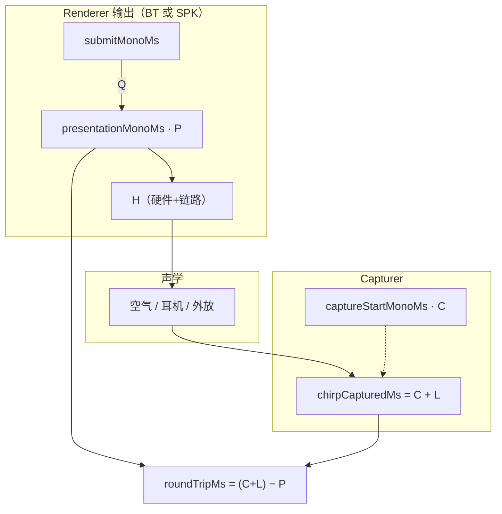
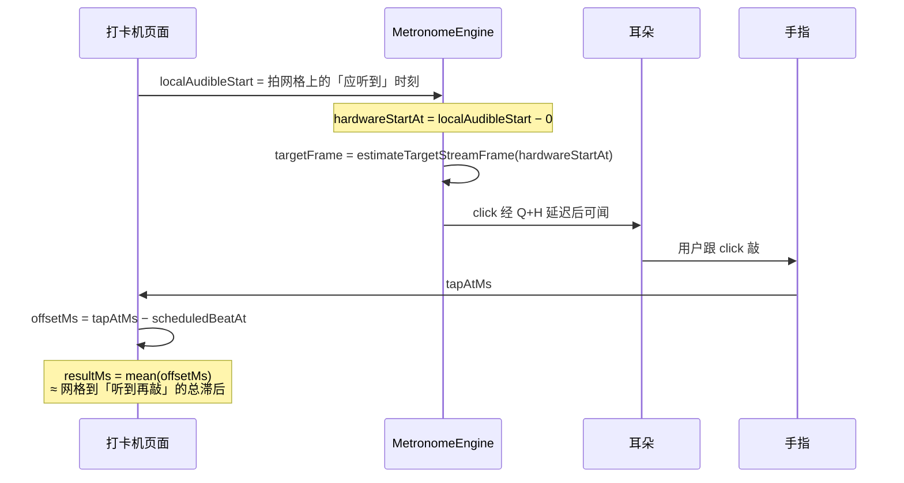
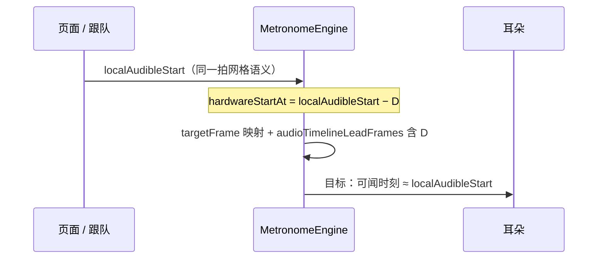

# 蓝牙耳机时延校准调试记录

> 记录 OneBeat 蓝牙耳机（A2DP）相对外放**节拍提前 >200ms** 的问题定位过程、已采纳的改进、已回退的错误改进，以及当前对问题的理解。
>
> 关联模块：`MicLoopbackCalibrator`、`MetronomeEngine`、`AudioOutputMonitor`、`AudioLatencyPersistence`。

> **当前状态（2026-10-14）**：最终验收与退出结论见 [§9.13](#913-最终取证仍早约-200ms停止提供-mic-校准2026-10-14)。AirPods 同一流三次真实声学比较仍早约 200ms；正式 BT 桥相对保存只变化约 1–4ms，SPK 桥约 51–59ms，未出现可用于修正的 200ms 帧偏移。**按用户预先授权停止提供 mic 校准：已撤下入口、页面路由与录音权限，保留打卡机和调查实现/记录。** 不硬改耳机常数或共享播放时序；既有补偿因没有来源标记保留，曾用 mic 保存的设备需重新打卡覆盖。历史记录保留。


## 本轮调查过程与结论速查（2026-10-13～14）

本文按调查顺序保留历史判断。早期的公式、根因推断和“已修复”表述只代表当时阶段；最终产品决定与证据边界以 **§9.13** 为准，旧的复测步骤不再是当前功能使用说明。

| 阶段 | 实际工作与观察 | 结果 / 详细记录 |
|---|---|---|
| 确认并恢复打卡基线 | 用户确认 Git 已提交版本能对齐，回归来自未提交的 debug 改动；恢复 `56c9e55` 的共享播放行为，隔离 mic 与打卡/试听路径 | 用户复测打卡机基本对齐，偶发一次未归入本轮 mic 根因；§9.8 |
| 尝试救援 mic 参考系 | chirp 使用 raw 硬件帧参考，正式播放使用 legacy 映射；增加同一流内只读桥 `m`，保存 `D=rawRT−I_v3+m_final`，只使用实际最后存活的 Renderer | 公式和保存一致性通过软件测试；尚需声学验收；§9.9 |
| 处理测完后的时钟失效 | 四声后校验失败；日志见同流在释放后 0/500ms 暂停推进、约 2 秒恢复；增加最多 4 秒恢复验证和保存前后的身份检查 | 保留新鲜度、速率、帧/写入推进及桥稳定门槛；没有把暂时冻结或猜测值保存为补偿；§9.10 |
| 处理下一声前的时钟失败 | 又出现播放前“未取得稳定硬件时间戳”；将约 800ms 的立即失败策略改为同流最多 4 秒重新取完整窗口，并补拒绝原因和取消门控 | 后续真机测量、验证及保存成功；§9.11 |
| 验收第一次声学结果 | FreeBuds 的 D=370.3ms 首次早约 200ms、暂停恢复后基本对齐；AirPods 的 D=298.2ms 首次早 233ms、恢复后早约 200ms | 稳定往返不能证明输出准确；两组交换过手机，需固定角色查生产参考；§9.12.1 |
| 最后一轮定向取证 | 只读记录两端既有时间戳的流身份、物理 start 次数、raw/legacy 映射及计划目标；固定 AirPods 队长 / 外放队员，重测保存 D=286.2ms | 三次同强拍/首声仍早约 200ms；无对应的流重启、200ms 桥漂移或 SPK 205ms 帧偏移；§9.12.4～§9.13.2 |
| 按约定退出产品功能 | 现有观测不能分离真实声学输出、输入链差异、Capturer 开关影响等未测量项；没有证据充分的数值修正 | 撤下 mic 入口、路由和录音权限，保留打卡与研究代码；§9.13.3 |

**最终结论：** 本轮修好了测量流程与已知参考系/时钟门控问题，但当前单机 mic 方案仍未通过实际声学对齐验收。停止提供该功能是产品可靠性决定，不等于证明所有未来 mic 方案不可行，也没有把约 200ms 唯一归因于某个尚未测量的链路。后续不继续硬加/减耳机常数；曾保存 mic 值的设备需重新打卡覆盖，其他已有补偿不批量清空。

---

## 1. 问题

多设备同步节拍时，用蓝牙耳机播放的设备，其「可闻节拍」比用手机外放的设备**提前超过 200ms**（实测，非理论估算）。

校准链路走的是麦克风回环：先测「输出 + 输入」往返，再扣掉输入侧，得到输出补偿。补偿之后仍提前 >200ms，说明补偿值偏高（补偿偏大 → 节拍写得太早 → 提前出声）。

---

## 2. 校准链路与代数

### 2.1 三个量

| 量 | 含义 | 来源 |
|---|---|---|
| `roundTrip_speaker` | 外放回环：chirp 写入渲染流 → 外放出声 → 麦克风采到 | 实测（gapMs + onsetMs） |
| `resultMs` | 蓝牙回环：chirp 写入渲染流 → 蓝牙出声 → 麦克风采到 | 实测 |
| `getLatency_speaker` | 外放输出侧时延 | `renderer.getLatency(LATENCY_TYPE_ALL)` 静态平台值 |

### 2.2 输入时延的构成

```
inputLatency = median₃( roundTrip_speaker − getLatency_speaker )
```

`roundTrip_speaker` 的分解（`[LatencyProbe]` 日志）：

```
roundTrip = gapMs + onsetMs
gapMs   = captureStartMonoMs − renderStartMonoMs
onsetMs = onsetSamples / 44100 * 1000
```

### 2.3 输出补偿的代数（关键）

```
calibrated = resultMs − inputLatency
           = resultMs − (roundTrip_speaker − getLatency_speaker)
           = getLatency_speaker + (resultMs − roundTrip_speaker)
```

而 `resultMs − roundTrip_speaker` 里，**输入时延相互抵消**：

```
resultMs − roundTrip_speaker
  = (BT_output + input) − (speaker_output + input)
  = BT_output − speaker_output
```

因此：

```
calibrated = getLatency_speaker + (BT_output − speaker_output)
```

**结论**：`calibrated` 的正确性**不依赖输入时延**，也不依赖 onset 检测的共同系统偏差（该偏差同时出现在 `resultMs` 和 `roundTrip_speaker`，相减抵消）。要让 `calibrated == BT_output`，唯一条件是 `getLatency_speaker == speaker_output`。

也就是说，`calibrated` 的误差只能来自两个地方：

1. `getLatency_speaker`（静态平台值）相对真实外放输出时延的偏差；
2. `resultMs` 与 `roundTrip_speaker` 的**差异**没有正确反映 `BT_output − speaker_output`（例如两次测量条件不一致）。

### 2.4 时间点总表与示意图

本节把两种校准方法用到的**全部命名时刻**放在同一张时间轴上。后文用 **P** 表示
`presentationMonoMs`，**C** 表示 `captureStartMonoMs`，**L** 表示互相关 `onsetMs`。

#### 2.4.1 三个时钟域

| 域 | 典型 API / 字段 | 用途 |
|---|---|---|
| **业务单调时钟** | `MonotonicClock.nowMs()` | 页面排程、打卡机 `scheduledBeatAt` / `tapAtMs`、chirp 请求的 `targetAtLocalMonoMs` |
| **Touch 时钟** | `TouchEvent.timestamp → touchMonoMs` | 打卡机敲击；与业务时钟差 ≤2s 时直接采用 |
| **Renderer 硬件帧时钟** | `getAudioTimestampInfoSync()` 的 `framePos` + `timestamp`（经 STARTUP−ACTIVE 转到业务域） | 插值 **P**、正式播放 `estimateTargetStreamFrame()` |

队长同步时还有 **leader 时间轴**：`leaderAudible = localAudibleStart + offsetMs`（`ClockSync` 的
`offsetMs = leader − client`）。本机可闻目标在代码里一律先落到 `localAudibleStart`。

#### 2.4.2 输出链路上的时刻（submit → presentation → 可闻）

这些时刻对 **mic chirp** 与 **打卡机 click** 共用同一个 `AudioRenderer`，语义相同。

```text
  业务单调时间 →

  submitMonoMs          presentationMonoMs (P)              audibleMonoMs
       │                         │                                │
       │◄────── Q ────────────────►│◄────────── H ─────────────────►│
       │   软件队列 / 未进硬件      │   HAL / A2DP / DAC / 耳机       │  物理可闻（不可直接读表）
       │                         │                                │
  writeData 首帧回调        framePos 首次 ≥ targetFrame          耳朵 + 空气
  （仅诊断，mic 不用作锚点）   反插得到 P（mic 锚点）            （概念时刻）
```

| 符号 / 代码名 | 含义 | 如何得到 |
|---|---|---|
| **Q** | `presentation − submit` | `[CalibAnchor] submitToPresentationMs` |
| **H** | `audible − presentation` | 平台 `getLatency(LATENCY_TYPE_HARDWARE)` 近似；输入校准时从回环里扣掉 |
| **submitMonoMs** | chirp 进入 `writeData` 的时刻 | `PendingCalibrationSignal`，日志 `[CalibAnchor]` |
| **scheduledPresentationMonoMs** | crossing **之前**按 CalibClock 估算的 P | `[CalibDiag] schedule … scheduledPresentationMonoMs` |
| **presentationMonoMs (P)** | crossing **之后**实测首帧 presentation | `waitForCalibrationFrameCrossing` → `firstCrossSample` 反插 |
| **targetFrame** | chirp/click 首样本在流上的帧号 | `scheduleCalibrationSignal` 或 `estimateTargetStreamFrame(hardwareStartAt)` |
| **renderedFrames / framePos** | 硬件播放头报告帧 | `getAudioTimestampInfoSync()` |
| **localAudibleStart** | 本机「希望 click 可闻」的拍点 | `scheduleFromLeaderStart` → `startAudioStream(..., localAudibleStart, …)` |
| **hardwareStartAt** | 帧映射用的目标时刻 | `localAudibleStart − outputCompensationMs`（日志 `[SyncDiag] hardware=`） |
| **outputCompensationMs** | 写入流前的提前量 | 打卡机测量时 **强制 0**；正式播放 / 预览 = 已保存的 `outputCompensationMs` |
| **audibleMonoMs** | 声波到达耳朵 | 无传感器；打卡机用 **tapAtMs** 间接感知 |

正式播放时 `estimateTargetStreamFrame(hardwareStartAt)` 用 **当前 `framePos` + (hardwareStartAt − now)**
把「希望 presentation 落在何时」换成 **targetFrame**，因此可变队列 **Q 主要被吸收在帧映射里**，
保存的补偿 intended 只覆盖 **H**（见 §8.9.2）。打卡机在 **comp=0** 下测到的偏移则把「网格到耳朵」
整段经验值（常含 Q 与 H 的合成效果）一次性记入 `resultMs`。

#### 2.4.3 采集链路上的时刻（mic 专用）

| 符号 / 代码名 | 含义 | 如何得到 |
|---|---|---|
| **captureStartMonoMs (C)** | 当前采集 buffer 第 0 样本对应的业务时刻 | 首个 `readData`：`nowMs − bufferDuration`（`[CaptureAnchorDiag]`） |
| **onsetMs (L)** | chirp 在 buffer 内相关峰位置（毫秒） | `findOnsetByCrossCorrelation` → `onsetSamples/44100` |
| **chirpCapturedMs** | 检测到 chirp 起点的业务时刻 | `C + L` |
| **gapMs** | 采集锚相对 P 的差 | `C − P`（与 L 反向漂移时在求和中抵消） |
| **roundTripMs / latencyMs** | 回环往返 | `chirpCapturedMs − P = gapMs + L`（`[LatencyProbe]`） |

#### 2.4.4 打卡机专用时刻

| 符号 / 代码名 | 含义 | 如何得到 |
|---|---|---|
| **audioStartAtMs** | 启动 transport 的本地时刻 | `now + AUDIO_START_LEAD_MS`（1300ms） |
| **measurementStartAtMs** | 正式敲击段第 1 拍网格 | `audioStartAtMs + COUNT_IN_BEATS × 500ms` |
| **scheduledBeatAt** | 第 `tapCount` 拍的理想时刻 | `measurementStartAtMs + tapCount × BEAT_INTERVAL_MS` |
| **tapAtMs** | 用户按下时刻 | `onTapTouch` → `touchMonoMs` |
| **offsetMs** | 单次敲击偏差 | `tapAtMs − scheduledBeatAt` |
| **resultMs（打卡机）** | 保存值 | 全部 `offsetMs` 的均值（≥0 取整）→ `outputCompensationMs` |

测量调用链：`scheduleLatencyTapMeasurement(..., outputCompensationOverrideMs = 0)`，因此
`hardwareStartAt = localAudibleStart`，**不**使用已保存补偿。页面网格 `scheduledBeatAt` 与
transport 的 `localStart`（count-in 后）对齐设计为同一 120 BPM 轴。

预览 / 保存后试听：`scheduleLatencyPreview(..., compensationMs)`，此时
`hardwareStartAt = localAudibleStart − compensationMs`，与 §6 正式跟队相同公式。

#### 2.4.5 mic 回环 + 输入侧：测量时间线



**蓝牙回环（耳机阶段）**

- 参考：**P**（`timing.presentationMonoMs`）。
- 量：`resultMs ≈ median(roundTripMs)` ≈ **H_BT + I_BT**（§8.9.2）。
- 页面大字显示该 **resultMs**；保存前另测输入侧。

**输入侧（外放阶段，同 P 语义）**

- 参考：仍是 **P**（外放 chirp 的 presentation）。
- 量：`roundTripMs ≈ H_SPK + I_SPK`；`inputLatencyMs = roundTripMs − hardwareLatencyMs`，其中
  `hardwareLatencyMs = getLatency(HARDWARE)`，故 **inputLatencyMs ≈ I_SPK**。

**保存**

```text
outputCompensationMs = resultMs_BT − inputLatencyMs
                     ≈ H_BT + (I_BT − I_SPK)   （I 相近时 ≈ H_BT）
```

#### 2.4.6 打卡机：测量 vs 预览

**测量（comp = 0）**



**预览 / 正式播放（comp = 已保存 D）**



#### 2.4.7 两种方法用到的时刻对照

| 时刻 | mic 回环 | 输入侧 | 打卡机测量 | 打卡机预览 / 正式 BT |
|---|:---:|:---:|:---:|:---:|
| MonotonicClock `now` | 排 chirp 请求 | 同左 | `audioStartAtMs` 等 | 同左 |
| **P** presentationMonoMs | **回环参考** | **回环参考** | 不读 P；click 仍过 P 轴 | 不读 P；帧映射同引擎 |
| submitMonoMs | 诊断 | 诊断 | 一般不解析 | 一般不解析 |
| **C** captureStartMonoMs | 是 | 是 | 否 | 否 |
| chirpCapturedMs / L | 是 | 是 | 否 | 否 |
| roundTripMs | **resultMs** | 推 **inputLatency** | 否 | 否 |
| hardwareLatencyMs | 随 timing 返回 | 扣 **H_SPK** | 否 | 平台 latency 仅诊断 |
| localAudibleStart | 否（单次 chirp 用 targetAt） | 否 | 是（transport 网格） | 是 |
| scheduledBeatAt | 否 | 否 | **tap 参考** | 预览 UI 脉冲近似对齐 |
| tapAtMs | 否 | 否 | **是** | 否 |
| hardwareStartAt | chirp 排程隐含 | 同左 | **−0** | **−D** |
| 保存字段 | `resultMs − inputLatency` | 持久化 `inputLatencyMs` | **mean(offset)** | 使用已存 **D** |

#### 2.4.8 为何 mic「保存 ~58」与打卡机「~216」数字不同但仍能各自对齐

数字不在同一行公式里直接比较：

- mic **保存值**刻意对齐正式播放的 **P + H** 模型（§8.9），**不把 Q 再写进** `outputCompensationMs`。
- 打卡机 **resultMs** 在 **comp=0** 下用 **scheduledBeatAt ↔ tapAtMs** 标定，量级上常接近
  「网格到耳朵」的**端到端滞后**，与「P 到麦克风」的 **roundTripMs（~100ms 级）** 不是同一个数。

两者写入同一偏好键 `outputCompensationMs`，但估计器不同（§8.9.1）。各自结果页的试听都用**本方法刚测出的 D**
做 `scheduleLatencyPreview`，因此都能与外放做 A/B；**跟队只生效最后一次保存的 D**。

#### 2.4.9 日志与字段速查

| 想看哪个时刻 | 日志关键字 / 字段 |
|---|---|
| P | `[CalibAnchor] presentationMonoMs=` |
| Q | `[CalibAnchor] submitToPresentationMs=` |
| 排程估计 P | `[CalibDiag] scheduledPresentationMonoMs=` |
| C | `[CaptureAnchorDiag] captureStartMonoMs=` |
| roundTrip 分解 | `[LatencyProbe] gapMs onsetMs latencyMs=` |
| 输入侧 | `[MicInputCalibration]` / `hardwareLatencyMs` |
| 打卡机网格 vs 引擎 | `[SyncDiag] audible= hardware= compensation=`（测量时 compensation=0） |
| 保存 | `[LatencyDiag] route=BT calibrated=` |

---

## 3. 已采纳的改进

1. **方案一：分块异步互相关**（`findOnsetByCrossCorrelation` 分块 + `yieldToEventLoop`）
   避免互相关阻塞主线程；只让出事件循环，**不改变锚点语义**，不引入速率问题。

2. **每探针重锚 `nowMs − bufferMs`**
   采集流第 0 帧的墙上时刻由首个 `readData` 回调时刻减一个缓冲时长确定。`gapMs` 与 `onsetMs` 会反向漂移，在 `latencyMs = gapMs + onsetMs` 里正确抵消，结果稳定（~400ms）。

3. **queueDepth 分析**
   确认不存在「未上报 266ms 硬件缓冲」：`rendered` 增速精确等于 44100Hz（无漂移），BT 与 SPK 的 queueDepth 差值落在平台时延差附近，未出现额外队列膨胀。

4. **SNR 阈值 + 中位数**
   校准采样仅在高 SNR 时采信，多次取中位数，避免低 SNR 下互相关检错峰污染结果。

---

## 4. 已回退的错误改进

1. **方案二：样本计数时钟**
   曾尝试用 `captureSampleCount / 44100 * 1000` 换算墙上时刻，以「彻底摆脱 nowMs 依赖」。实测累计样本推进速率与墙上时钟对不上（约 -33%/秒），`latencyMs` 越漂越负、测不出结果。已回退，恢复 `nowMs − bufferMs` 重锚。

2. **「未上报 266ms 硬件缓冲」假设**
   曾假设 A2DP 有块 ~266ms 硬件缓冲未被 `getAudioTimestampInfo` 上报，导致 `rendered` 滞后。queueDepth 数据不支持该假设（见 3.3），已排除。

---

## 5. 对问题的理解（含两次纠正）

### 5.1 两次口径纠正

- **误差量级**：早期曾把蓝牙提前量估成 40ms，实际实测**提前 >200ms**。40ms 只是某一轮中间推算值，不代表真实误差。
- **API 名称**：早期误以为 `AudioLatencyType` 有 `FAST / NORMAL / ALL` 三档。实际枚举只有：

  | 名称 | 值 | 说明 |
  |---|---|---|
  | `LATENCY_TYPE_ALL` | 0 | 软件 + 硬件整体链路时延 |
  | `LATENCY_TYPE_SOFTWARE` | 1 | 软件侧时延（含软件音效） |
  | `LATENCY_TYPE_HARDWARE` | 2 | 硬件侧时延（HAL、驱动、硬件） |

  因此三粒度分解应打印 `ALL / SOFTWARE / HARDWARE`，而非 `FAST / NORMAL / ALL`。

### 5.2 当前理解（随数据迭代）

- 三粒度分解实测 `getLatency(ALL)=45 = software(5) + hardware(40)`，**自洽且正常**。这推翻了「getLatency 高估真实外放输出」的早期假设——外放输出时延就是 45ms 左右。
- 关键线索转向 `delta = calibrated − platform`：实测蓝牙输出（172.8ms）比平台蓝牙 `getLatency`（285ms）**低 112ms**。
- 反推发现：`input_BT = resultMs − platform = 417.8 − 285 = 132.8ms`，而外放路由测得的 `input_SPK = 245ms`。**两者差 112ms，正好等于 delta**。说明麦克风输入侧时延**随输出路由变化**，当前「输入时延路由无关」的复用假设不成立。

### 5.3 方向冲突（待解）

- 按补偿代数，`calibrated=172.8 < platform=285` 意味着蓝牙应**晚 112ms**，而不是「早 >200ms」。因此「早 >200ms」不能单靠补偿值解释。
- 三个候选方向：输入时延路由相关性、补偿值落地到写帧时刻的链路、设备间时钟同步偏置。

---

## 6. 待办（三个调查方向 + 日志关键字）

| 方向 | 关键字 | 日志关键字段 |
|---|---|---|
| 1. 输入时延路由相关性 | `[LatencyDiag-InputRoute]` | `inputSPK` / `inputBT` / `diff` / `resultMs` / `platform` |
| 2. 补偿落地到写帧链路 | `[SyncDiag]`（已有） | `route` / `compensation` / `delta` / `frameLeadMs` / `queueDepth` |
| 3. 时钟同步偏置 | `[LatencyDiag-Clock]` | `offsetMs` |

1. **方向 1**：确认 `inputBT` 是否稳定偏离 `inputSPK`（约 −100ms 量级），坐实「输入时延路由无关」假设不成立。
2. **方向 2**：确认蓝牙路由下 `[SyncDiag]` 的 `compensation` 是否等于 172.8、`delta` 是否为负。
3. **方向 3**：确认设备间 `offsetMs` 量级，是否接近「>200ms 早」。

### 触发方法

- **方向 1**：完成一次蓝牙耳机校准（回环测量 → 保存），或切换输出路由到蓝牙触发 `refreshOutputLatency`。
- **方向 2**：蓝牙路由下正常播放节拍（开始/持续播放）。
- **方向 3**：组网（队长/队员建立连接）后开始/停止播放，触发 `setOffsetMs`。

---

## 7. 三方向调查结果（第二轮实测）

### 7.1 方向 1（输入时延路由相关性）—— 确认，真 bug

```
inputSPK=217 inputBT=104.8 diff=112.2   (第一次校准)
inputSPK=217 inputBT=122.2 diff=94.8    (第二次校准)
```

`inputBT` 稳定比 `inputSPK` 低 ~95~112ms。「复用外放 inputSPK 给蓝牙」的假设不成立。

⚠️ 注意：`inputBT` 是用 `platform=285` 反推的（`resultMs − platform`），所以这个结论**依赖「平台 getLatency(285) 准确」这个前提**。若平台值不准，方向会变。这是当前最大的未决点。

### 7.2 方向 2（补偿落地）—— 正常

- 蓝牙：`compensation=190.2ms delta=-94.8ms`，补偿值确实作用到写帧时刻。
- 外放：`compensation=45ms delta=0ms`，外放直接用 getLatency(45)。

补偿链路无问题。

### 7.3 方向 3（时钟同步）—— 正常，-11.7 天是开机时间差

- 蓝牙设备（队长）：`offsetMs=0`。
- 外放设备（队员）：`offsetMs≈-1014547985`（≈ -11.7 天）。

这个 -1014547985ms 是**两台设备单调时钟的开机时间差**，不是 bug。它稳定（漂移 ~60ppm，正常）且被正确抵消：

```
外放 audible 1169295572 − 1014547985 = 154747587 ≈ 蓝牙 audible 154747586   (对齐到 1ms)
```

### 7.4 核心矛盾与下一步

- 输入时延路由相关性（inputBT < inputSPK）按代数会让蓝牙**晚 ~95ms**，不是「早」。
- 时钟同步正确、补偿落地正确，三者都没解释「早 >200ms」。

**最可疑的新方向**：外放设备（队员）未做校准，直接用 `getLatency(45)`；若其**实际外放输出远超 45ms**，外放会晚出声，蓝牙相对就显得「早」。本质可能是「外放晚」而非「蓝牙早」。但该假设需要两设备外放时延不同才能成立（对称性约束），需实测验证。

**下一步**：用 `getAudioTimestampInfoSync` 帧映射，或声学实测，独立测两台设备的**实际输出时延**，打破「getLatency 准不准」与「inputBT vs inputSPK」的循环。

### 7.5 新增日志：独立实测输出时延

**关键字**：`[LatencyDiag-Actual]`

**关键字段**：`getLatency`（平台值）/ `actualOutput`（由 `queueDepthFrames` 换算的写→放真实时延）/ `diff`（`actualOutput − getLatency`，正数 = getLatency 低报）/ `compensation` / `queueDepthFrames`

- 纯只读，不改变任何写入/补偿时序。
- 若 `diff` 稳定为正且量级大，即坐实「getLatency 低报实际输出时延」，进而解释「外放/蓝牙晚出声 → 蓝牙相对显得早」。

**触发**：蓝牙/外放路由下正常播放节拍（与 `[SyncDiag]` 同处触发）。

### 7.6 实测结果（`[LatencyDiag-Actual]`）

蓝牙设备（新代码）单次实测：

```
[LatencyDiag-Actual] route=BT getLatency=285ms actualOutput=439.6ms diff=154.6ms compensation=163.2ms queueDepthFrames=19387.8
```

- `getLatency=285` 低报实际输出（439.6）约 **154.6ms**。
- `compensation=163.2` 比实际输出低 **276.4ms** → 蓝牙**绝对晚 276ms**（不是「早」）。
- 「第三设备实测蓝牙比外放早 ~300ms」是**相对**结果，反推外放实际输出 ≈ 621ms、晚 ~576ms，正好是低功耗渲染器 1000ms 缓冲量级。

关键结论：

1. **getLatency 严重低报实际输出时延**（蓝牙低报 154ms，外放疑似低报 ~576ms）。
2. **外放设备跑的是旧代码**（其 `[SyncDiag]` 缺 frame 映射字段、无 `[LatencyDiag-Actual]`），极可能仍走 `STREAM_USAGE_MUSIC` 低功耗大缓冲。
3. **实际输出时延在漂移**：校准 `resultMs=389.2`（22:35:01）→ 播放 `actualOutput=439.6`（22:36:43），A2DP 缓冲随时间增长，静态补偿值会很快失效。

下一步：先更新外放设备代码拿到它的 `actualOutput`，并确认其是否仍用 `STREAM_USAGE_MUSIC`。

### 7.7 补偿模型纠正 + 日志精简

**补偿模型纠正（重要）**：`compensation` 对应的是「**播放 → 出声**」的硬件时延（DAC/A2DP），不是「写 → 播放」的缓冲时延。依据代码：

```ts
actualAudibleMs = now + (targetFrame - playedFramesNow) * 1000 / SAMPLE_RATE + outputCompensationMs
```

其中 `(targetFrame - playedFramesNow)` 是「现在 → 播放」时长，加上补偿才到「出声」。所以：
- `queueDepthFrames`（actualOutput = 219.8/439.6ms）是「写 → 播放」缓冲，**由缓冲自动吸收，不需要补偿**。
- 之前「补偿应该用 219.8/439.6」「蓝牙晚 100ms」均比错对象，作废。
- 方向：补偿偏大 → 早；补偿偏小 → 晚。蓝牙早 → 补偿（163.2ms）偏高。

**日志精简**：
- 移除 `[LatencyDiag-Clock]`（offsetMs 已并入 `[SyncDiag]`）。
- 移除 `[LatencyDiag-Actual]`（actualOutput/diff 已并入 `[SyncDiag]`）。
- `[SyncDiag]` 新增字段：`beat`、`leaderAudible`（= `localAudibleStart + offsetMs`，队长时间）、`offsetMs`、`actualOutput`、`actualDiff`。

**下一步**：用 `leaderAudible` 对比两台设备同一 `beat` 的队长时间，确认「计划出声时刻」是否对齐（排除时钟同步问题）。

### 7.8 根因：输入侧时延被缓冲污染 + 缓冲测量与 chirp 冷启动不一致

**实测（两轮）**：
- 第一轮：`回环 389.2ms − 输入测 397ms = −7.8ms`，补偿为负被拒。
- 第二轮（只减缓冲）：`inputLatencyMs` 在 −52~+112ms 间跳动，最终钳到 0ms —— 不正常。

**两层根因**：

1. `getLatency(ALL)` 只报 `software + hardware`（45ms = 5 + 40），**不计入实时缓冲（队列深度 ~257ms）**，所以 `inputSPK = roundTrip − getLatency(ALL)` 会把缓冲污染进输入侧。

2. 直接减「实时缓冲 + 硬件」又**过度校正**：chirp 在渲染流**冷启动**时写入，其「写入→播放」只有启动延迟（~90ms），远小于稳态队列深度（~257ms）。于是 `roundTrip(255.8) ≈ buffer+hardware(276.8)`，两者相减把麦克风链（~165ms）也抵消掉，得到 ~0ms。

**修复（完整版）**：
- `runLoopback` 正式 chirp 前**连续喂 1000ms 静音预热**（`LOOPBACK_WARMUP_MS`），让渲染流达到稳态，chirp 的「写入→播放」才等于稳态 `buffer + hardware`；
- 新增 `chirpSubmitMonoMs` 作为 chirp 首帧真正「提交」锚点（预热结束后的写时刻），`analyzeCaptured` 改用它（替代 `renderStartMonoMs`）；
- 输出侧时延 = `hardware + bufferMs`（`submittedFrames − framePos` 实测队列深度）；
- `inputLatency = roundTrip − (hardware + bufferMs)` → 纯麦克风链。

**预期**：`inputLatencyMs` 稳定在 ~165ms（麦克风链），`calibrated = resultMs − 165` 为正值可保存。

---

## 8. 蓝牙持久探针：flush 冷启动 + mic 消失（当前进度）

### 8.1 现象

蓝牙持久探针（`runPersistentProbe`，复用会话 Renderer/Capturer）实测：

```
[LatencyProbe] latencyMs=544.8 = gapMs(-927.7) + onsetMs(1472.5)
[LatencyProbe] latencyMs=416.6 = gapMs(-485.2) + onsetMs(901.8)
[LatencyProbe] latencyMs=410.6 = gapMs(-396.1) + onsetMs(806.7)
[LatencyProbe] latencyMs=408.0 = gapMs(-288.0) + onsetMs(696.0)
[LatencyProbe] latencyMs=411.9 = gapMs(-302.0) + onsetMs(713.8)
```

`latencyMs` 收敛到 ~411ms，恰好等于稳态队列深度量级，**mic 那一段（~232ms）没被吃到**。于是 `calibrated = resultMs − inputLatency` 等于把 mic 又减了一遍（双倍扣减），calibrated 偏小 ~232ms。

### 8.2 根因一：flush 冷重启 → 队列半空

`scheduleCalibrationSignal` 的 `ensureSilentRendererRunning()` 做 stall 检测：`lastWriteProgressMs` 距现在超过阈值则 `haltRendererNow()` 冷重启（清空 `audioSubmittedFrames`）。随后 chirp 立即按 `targetFrame` 排入，此时队列还是空的：

```
[CalibDiag] renderer NOT healthy, flush+restart, state=3 lastWriteAge=30376ms
[CalibDiag] schedule targetFrame=25313 playedFrames=0 submittedFrames=0 leadMs=574.0
[CalibDiag] renderer healthy, keep buffer, queueDepthFrames=0 submittedFrames=110592
[CalibDiag] schedule targetFrame=127294 playedFrames=101010 submittedFrames=110592 leadMs=596.0
```

队列从 0 慢慢追（0 → 217 → 297 → 430ms），chirp 始终落在「半空队列」里，`resultMs` 只反映队列深度、吃不到 mic。

**修复**：`scheduleCalibrationSignal` 在 `ensureSilentRendererRunning()` 之后、排 chirp 之前，插入 `await this.warmUpRenderQueueForCalibration()`，固定暖机 1200ms（与输入侧 `LOOPBACK_WARMUP_MS=1000` 同思路），让 writeData 先把 dither 队列填到稳态，再推进一次 `queueDepthFrames` 测量。关键字 `[CalibDiag] warm-up done`。

### 8.3 根因二：mic 消失（待查）

数学上 `latencyMs = gapMs + onsetMs`，`captureStartMonoMs` 在两者之和里**精确抵消**——锚点错只会改 gapMs/onsetMs 的分配，不会改变它们的和。所以 `resultMs` 缺 232ms mic，只可能是 `gapMs`（submit 锚）或 `onsetMs`（互相关检测）之一本身测错：

- H1：`chirpSubmitMonoMs`（submit 锚）偏晚 ~232ms；
- H2：`findOnsetByCrossCorrelation` 锁到真峰前 ~232ms 的副峰（电串扰/早反射）。

**判别**：双 chirp 间距法——两 chirp 固定间隔 800ms，其 onset 位置差是锚无关声学真值。若间距 ≈800ms 则 onset 检测准（→ H1），否则 onset 检测有系统偏置（→ H2）。

### 8.4 新增诊断日志

| 关键字 | 位置 | 作用 |
|---|---|---|
| `[CaptureAnchorDiag]` | `readDataCallback` | 打印首个 readData 回调的 `nowMs / bufferMs / n / captureStartMonoMs`，验证「首帧 = 回调时刻 − 缓冲时长」锚定是否被 mic 流水线时延破坏 |
| `[CorrPeaksDiag]` | `findOnsetByCrossCorrelation` | 打印相关序列前 3 强峰（粗域 lag），判断真峰前 ~232ms 是否有副峰（H2） |
| `[LatencyProbe]`（扩字段） | `analyzeCaptured` | 新增 `lenSamples / tailMs / capStart / chirpSubmit`，检查 chirp 是否被 1300ms 采集窗口截断、submit/capture 锚绝对时刻 |

**验证目标（重跑一轮）**：看暖机后 `queueDepthFrames` 是否到稳态、`tailMs` 是否 >50ms（未被截断）、`[CorrPeaksDiag]` 是否在真峰前 ~232ms 出现副峰。

### 8.5 数据判读（暖机后第一轮）

**暖机生效**：`queueDepthFrames` 从 0/217/297 → 18416/22512/23394（≈417–530ms 稳态）。

**但 mic 消失未解决，且暴露更硬的证据**：稳态 `latencyMs ≈ 384–400ms < queueDepth ≈ 510ms`——回环比输出队列还短，物理不可能；chirp 被「采到」的时刻在它出声前 ~110ms。

- `[CorrPeaksDiag]` top3 峰都在 ±20ms 内（单一主瓣）→ H2（锁副峰）**排除**。
- `tailMs ≈ 900ms` → 截断**排除**。
- `[CalibDiag] schedule leadMs=509–510ms` 是独立已知量（chirp 提交后 ~510ms 才出声），submit 锚 `calibrationSignalSubmitMonoMs` 正确 → 结论：**capture 锚 `capStart = firstReadDataTime − bufferMs` 偏早 ~340ms**。

**顺带发现第二个 bug**：`runLoopback` 的 `rendererInfo = { usage: STREAM_USAGE_GAME, rendererFlags: 0 }`，未指定路由，临时 renderer 继承当前默认路由 = 蓝牙而非外放。证据：输入侧 `outputLatencyMs=267ms`（外放平台值才 45ms）。这让 `inputLatency = roundTrip − 267` 也混进蓝牙量，基准不干净。

**下一步**：用 `AudioCapturer.getAudioTimestampInfoSync()`（返回 `framePos` + `timestamp`）独立锚定采集流，替代 `now − bufferMs` 估算，直接验证 capStart 偏早量。

### 8.6 数据判读（第二轮：拿到 capture 锚日志）

**capture 锚 buffer 尺寸假设没问题**：`[CaptureAnchorDiag] firstReadData bufferMs=20.0 n=882`——`bufferMs = 882/44100 = 20ms` 正确，`capStart = nowMs − 20ms`。之前「偏早由 bufferMs 高估导致」的猜测**排除**。

**核心矛盾依旧，且更硬**：稳态 `latencyMs ≈ 410ms`（异常稳定），但 `queueDepth ≈ 524ms`。回环比输出队列还短 ~114ms，声学上不可能。

**两个候选解释**：
- (a) **电/数字串扰**：loopback 采到的是 renderer→capturer 的非声学串扰（~410ms 是串扰路径延迟，不是声学往返）。
- (b) **queueDepth 高估**：`renderedFrames`（`getAudioTimestampInfoSync().framePos − audioTimestampBaseFrame`）被低估 → `queueDepth = submitted − rendered` 被高估。真实 output ≈ 180ms，则 `410 = 180 + 230(mic)` 其实**是对的**，`calibrated = 178.5ms` 也近似真实输出。

**判别实验（决定性）**：把耳机音量调到 0 重跑一轮。
- 相关峰仍在 ~410ms → (a) 串扰，loopback 不可信；
- 峰消失/大幅变弱 → (b) 声学，`latencyMs=410` 可信、`queueDepth` 诊断错，校准值本身可能没问题，问题在外放侧（外放 `calibrated=0`、只补偿 45ms，其真实输出 ~378ms → 外放晚 ~333ms，蓝牙相对就显得「早 333ms」）。

**顺带确认的第二个 bug**：`runLoopback` 的 `rendererInfo = { usage: STREAM_USAGE_GAME, rendererFlags: 0 }`，未指定路由 → 临时 renderer 走蓝牙默认路由（输入侧 `outputLatencyMs=267ms`，外放平台值才 45ms），`inputLatency` 被蓝牙量污染。

### 8.7 音量=0 判别实验（决定性）+ 路由修复受限

**音量=0 重跑结果**：相关峰**消失**——`snrDb` 从 64dB 掉到 17dB、`peak` 从 0.02 掉到 0.0036、`[CorrPeaksDiag]` 峰位四处乱跳（108/467/647/1055/1521…ms）、`latencyMs=-662.7`（负值=噪声）。

**结论**：loopback 采到的是**声学信号**，不是电串扰。`latencyMs≈410ms` 是真实声学往返，`calibrated = resultMs − inputLatency = 178.5ms` 即真实蓝牙输出（≈180ms）。**串扰假设（8.6-a）排除，queueDepth 高估假设（8.6-b）成立**：`queueDepth=524ms` 是 `renderedFrames` 低估导致的诊断虚高，真实输出只有 ~180ms。

**路由修复受限（已回退）**：想在蓝牙连接时强制输入侧走外放，
- `setDefaultOutputDevice(SPEAKER)`（API 12）只改「无外设时的默认」，蓝牙接入后**蓝牙仍优先** → 无效；
- 真正能强制外放的是 `setMediaOutputDevice(SPEAKER)`（**API 26**），但工程 target 是 API 20 → **不可用**。

即：在当前 SDK 上，普通应用**无法**在蓝牙连接时把输入侧临时 renderer 强制切到外放。

**真正的结论与下一步**：~~蓝牙侧 `calibrated=178.5ms` 基本正确，「蓝牙比外放早 ~333ms」实质是外放侧晚 ~333ms~~ **（此结论错误，见 8.8 更正）**。

### 8.8 更正：外放不晚，蓝牙是真提前（关键数学矛盾）

**用户澄清**：外放设备没有校准逻辑，`platform=45ms` 就是准的，天然音画同步 → 外放**不会晚**。所以「蓝牙早 333ms」是蓝牙**真的提前了**，8.7 的「外放晚」结论不成立。

**关键数学矛盾**：补偿应用为 `hardware = audible − compensation = audible − 178.5ms`。即使蓝牙输出为 0ms（瞬时出声），最多也只能提前 **178.5ms**，到不了 333ms。要「早 333ms」，必有一笔 ~155ms 的额外提前量，不是补偿值本身能产生的。

**代码已埋线索**（MetronomeEngine 414 行附近注释）：`calibrated = resultMs − inputLatency` 会把 mic 双倍扣减，导致蓝牙比外放快——作者早知道此症状。

**真正要查的**：不是「外放为何晚」，而是蓝牙的 `localAudibleStart` / `offsetMs`（leader-follower 时钟对齐）本身是否提前了 ~333ms，或 `estimateTargetStreamFrame` 帧映射是否有偏移。需对比两台机器完整 SyncDiag 的 `leaderAudible` 与 `offsetMs` 字段。

### 8.9 根因修正：submit 队列被重复补偿

> 各命名时刻（含 **presentationMonoMs**）的总表与时间线图见 **§2.4**。

> 状态：**代码已修正，待真机复测**。本次只改 mic 回环及它的输入侧辅助校准；
> 打卡机的测量、保存和正式播放入口均未改。

#### 8.9.1 已定位的参考系错误

打卡机正常而 mic 回环异常，差异不在保存或正式播放链路。两者都写入
`outputCompensationMs`，但旧 mic 测量以 chirp 进入 `writeData` 的 **submit 时刻**为起点，
正式播放却以 Renderer 的 **presentation/frame 时钟**调度。

记：

- `Q = presentation − submit`：已提交、尚未写入硬件的可变队列；
- `H = audible − presentation`：HAL / 驱动 / 蓝牙链路 / 耳机的真正可闻时延；
- `I`：麦克风输入处理到 `readData` 的时延。

旧耳机回环实际测得：

```text
chirpCaptured − chirpSubmit = Q_BT + H_BT + I_BT
```

正式播放的 `estimateTargetStreamFrame()` 已经把 Q 吸收在「当前播放帧 → 目标帧」映射中，
应用层只需补偿 H。把 `Q + H` 存进 `outputCompensationMs` 会在正式播放时又提前一次 Q。
A2DP 的 Q 会随暖机、路由重连和队列水位变化，因此这个错误同时解释：

1. 校准后耳机比外放早 200ms 以上；
2. 每次测量的提前量都不同；
3. 增加 1200ms 暖机只能稳定队列，不能修正参考系。

#### 8.9.2 最终修复

`MetronomeEngine.scheduleCalibrationSignal()` 仍等待 chirp 真正进入 `writeData`，但 submit
时刻只用于诊断。返回值改为 `targetFrame` 在 Renderer 帧时钟上的
`presentationMonoMs`。耳机回环现在测：

```text
headphoneRoundTrip = chirpCaptured − chirpPresentation
                   = H_BT + I_BT
```

这个 presentation 锚必须来自有效的 Renderer hardware timestamp。若暖机后连续查询仍拿不到
`framePos + timestamp`，本轮直接失败并提示重试；不能退回墙钟加 `queueDepthFrames` 猜测，因为
新路由的 queue depth 可能仍是 0 / 旧值，fallback 会再次把 Q 混入结果。

旧的独立 `runLoopback()/measure()` Renderer 路径已删除，避免以后误调用时又回到 submit 基准。
当前页面只能通过 `AppSession.scheduleMicLoopbackSignal()` 使用会话持久 Renderer。

输入侧校准也通过 `AppSession.metronome` 的持久 Renderer 播放外放 chirp，使用同一
presentation 帧时钟。`AudioTimestampInfo` 的帧已经过软件处理并写入硬件，
所以这里只扣 `LATENCY_TYPE_HARDWARE`，不扣包含已经过去的 SOFTWARE 段的 `ALL`：

```text
inputLatency = speakerRoundTrip − H_SPK
             = (H_SPK + I_SPK) − H_SPK
             = I_SPK

savedCompensation = headphoneRoundTrip − inputLatency
                  = H_BT + (I_BT − I_SPK)
```

当外放与蓝牙下的 MIC/AEC 处理链相同时，`I_BT ≈ I_SPK`，保存值就是正式播放需要的
`H_BT`。

#### 8.9.3 路由切换不得复用旧帧基准

mic 流程会主动经历 `BT 断开 → SPK 输入校准 → BT 重连 → 耳机回环`。
同一 Renderer 可以跨路由存活；若只看 Renderer 已运行时长，重连后的第一个探针会错误地
认为旧路由已暖好，并继续使用旧 `audioTimestampBaseFrame`。

现在 `AudioOutputMonitor` 用首选输出的 `deviceType + deviceId` 组成路由签名；`AppSession` 检测到
签名变化后会标记 mic 校准帧纪元失效。因此不只 SPK↔BT，A2DP↔SCO/NearLink 以及同类型的
耳机 A↔耳机 B 也会失效。新路由上的第一个 mic 探针必须：

1. stop 并 flush 旧路由队列；
2. 重置 Renderer timestamp/frame 映射；
3. 重启并完成 1200ms 暖机；
4. 至少观察到两个 hardware timestamp 样本且 `framePos` 确实前进，再选 chirp 的
   presentation target。

stop / flush 任一步失败都会中止本轮，不能只清本地计数后继续；否则物理旧队列仍在，Q 又会被
伪装成输出时延。硬件时间戳连续查询仍未推进时也同样失败关闭，而不是猜测 queue depth。

输入校准期间若用户提前连回蓝牙，本次输入结果直接丢弃。
输入侧开始前和完成后还会确认首选输出确实是手机内置 `SPEAKER`；有线、USB、听筒或查询失败
都不能冒充“手机外放”。
耳机回环完成后、保存前若蓝牙断开，尚未保存的结果也立即作废；重连后必须重新测，不能把旧路由
结果绑定到新连接。保存的 preferences flush 期间也会二次核对 measurement token；若路由在异步
保存中变化，则恢复保存前的共用输出补偿，不激活本次旧路由结果。

#### 8.9.4 无效输入值不得被伪装成 0

旧 UI 会把负的 `inputLatencyMs` 用 `Math.max(0, value)` 钳成 0 并保存。这会把整段真实
MIC 输入时延留在 `savedCompensation` 里；若 MIC 链路约 200ms，恰好会再造成约 200ms 早出声。

现在输入侧：

- 3 次探针至少 2 次必须同时定位成功、得到 `1..1000ms` 的物理可行值，并形成极差不超过
  30ms 的稳定簇；3 次中只允许剔除 1 个明显离群值；
- 负值、0、非有限数或过大值只记 `[MicInputCalibration] reject`，不进入中位数；
- UI 不再 clamp；持久化层也拒绝 `<= 0` 的值。

输入/输出持久化都改为 preferences `flush()` 成功后才更新内存与页面状态，避免磁盘保存失败时
本会话却继续使用一个只存在于 UI / 内存中的新补偿。

输入侧持久化语义版本升为 **3**。旧值使用 submit/队列估算或 `ALL` 扣减，升级后
自动视为未校准，必须断开蓝牙用手机外放重测一次。只失效 mic 的输入侧值，
**不清除共用的输出补偿**，因此不会破坏已经正常的打卡机结果。

#### 8.9.5 新诊断与真机验收

新增 `[CalibAnchor]`：

```text
submitMonoMs=... presentationMonoMs=... submitToPresentationMs=...
```

`submitToPresentationMs` 就是旧算法会多算的 Q。它可以随 A2DP 队列波动，但修复后保存的
mic 补偿不应再跟着它同幅漂移。

路由切换后的首个探针还会出现
`[CalibDiag] renderer NOT healthy, flush+restart, routeReset=true ...`，用来确认 SPK / BT
没有复用同一套 timestamp/frame 基准。

真机复测顺序：

1. 升级后确认输入侧显示为未校准；
2. 断开蓝牙，用手机外放重测输入侧；
3. 重连同一耳机，连续做 3 轮 mic 回环；
4. 对比每轮 `[CalibAnchor].submitToPresentationMs`、`[MicLoopback] selected/spread` 和最终保存值；
5. 与同路由上的打卡机结果及外放实际听感交叉检查。

验收重点不是要求 Q 不变，而是：Q 变化不再被写入补偿，且校准后不再出现
`>200ms` 的早出声。

#### 8.9.6 仍保留的限制

公式中仍有 `I_BT − I_SPK`。即使两步都固定使用 `SOURCE_TYPE_MIC`，系统在外放和蓝牙路由下
仍可能采用不同的 AEC / 降噪 / 输入缓冲。本次修复去掉了可变的 submit 队列和无效 0 值，
但不能从理论上保证 `I_BT == I_SPK`。

当前采集首帧仍以 `first readData callback time − buffer duration` 估算，因此 `I` 也包含
readData 投递与 ArkTS 调度项。每个探针重新取首个新鲜缓冲、两阶段使用相同 MIC 配置并各自取
中位数，可以压低其随机影响；但这部分不会在单次 `gapMs + onsetMs` 内自动抵消，路由间差异仍会
留在 `I_BT − I_SPK` 中。

若复测后 mic 与打卡机仍存在「稳定、可重复」的差值，且该差值已不再跟
`submitToPresentationMs` 变化，下一调查对象应是 `AudioCapturer.getAudioTimestampInfoSync()` 的输入帧映射，
或同路由下的输入侧测量；不应再把 Renderer 队列 Q 加回补偿。

---

## 9. 验收问题

### 9.1 验收问题一：输入侧校准往返时延锚点漂移

按 8.9.5 真机复测顺序第 2 步「断开蓝牙，用手机外放重测输入侧」，页面稳定报
`未定位到输入侧时延，请把手机麦克风对准外放出声点后重试`。日志：

```text
[LatencyProbe] latencyMs=338.5 = gapMs(-1312.3) + onsetMs(1650.8) ... snrDb=62.2 peak=0.566
[LatencyProbe] latencyMs=11.2  = gapMs(-629.0) + onsetMs(640.2)  ... snrDb=62.8 peak=0.566
[LatencyProbe] latencyMs=-61.2 = gapMs(-626.0) + onsetMs(564.8)  ... snrDb=63.0 peak=0.562
[MicInputCalibration] reject inputLatencyMs=-28.8  roundTripMs=11.2  hardwareLatencyMs=40
[MicInputCalibration] reject inputLatencyMs=-101.2 roundTripMs=-61.2 hardwareLatencyMs=40
[MicInputCalibration] samples=298.5ms selected=298.5ms
```

判读：

1. `snrDb=62~63dB`、`peak≈0.56`：chirp 被稳定锁定，**排除**「蓝牙未断开 / 外放未出声 /
   麦克风未对准」等物理原因。
2. 三次 `roundTripMs` 剧烈漂移（338.5 → 11.2 → -61.2），而 `hardwareLatencyMs` 固定 40ms。
   `inputLatencyMs = roundTrip − hardware` 两次为负（-28.8 / -101.2）被判无效，仅第一次
   298.5ms 有效。有效样本 = 1 < 2 → `detected: false`。
3. `gapMs`（采集锚→参考）第一次 -1312.3、后两次 ~-628：暖机后首拍锚点错位。
4. `onsetMs`（chirp 在采集缓冲内位置）1650.8 → 640.2 → 564.8，第 2、3 次 onset 落在
   参考时刻之前（+11.2 / -61.2ms），真实外放声学往返不可能为 0 或负——互相关锁到错误峰，
   或 presentation 锚与采集时钟未对齐。

后续连续重试提供了决定性证据：

```text
gapMs    -788.7  -944.8  -1020.3  -991.4  -1110.2  -1127.8  -1110.1  -1118.9  -1118.9
onsetMs   386.0   323.1    302.7   415.3    312.0    312.0    432.1    310.1    310.1
latency  -402.6  -621.8   -717.6  -576.1   -798.1   -815.7   -678.0   -808.8   -808.8
snrDb      62.4    59.1     65.0    63.0     65.9     65.9     62.9     63.1     64.1
```

记 `C=captureStartMonoMs`、`L=onsetMs`、`P=presentationMonoMs`，则：

```text
roundTrip = C + L - P
P - C     = -gapMs
```

每轮在拿到新采集 buffer 后只请求 `now + 600ms`，而 `C≈now−20ms`，所以暖机完成后的
`P−C` 应在约 620ms 附近。实际却从 789ms 继续涨到 1119ms。与此同时，相关峰稳定出现在
`C+310~432ms`，SNR 一直为 59~66dB。也就是说代码一边已经录到了当前 chirp，一边却声称
该 chirp 还要 400~800ms 才呈现，违反因果。问题在 Renderer 的 `P` 晚报，不在声学检测。

先前“把 target 从 `now()` 改绑到 `probeCaptureStartMonoMs`”的初步结论因此作废：两者只有
一个约 20ms 的采集 buffer 差，无法解释数百毫秒且持续增长的误差。

#### 9.1.1 根因

旧校准复用了正式播放的启发式 Renderer 帧映射：

```text
baseFrame = rawFramePos - min(submittedFrames, rendererRunningElapsedFrames)
played    = rawFramePos - baseFrame + timestampAgeFrames
target    = max(submittedFrames, played + requestedLeadFrames)
P         = queryNow + (target - played) / 44100
```

这里有三处不满足校准精度要求：

1. 路由切换只对同一 Renderer 做 stop / flush，随后用“运行墙钟经过量”猜 `baseFrame`。这个
   guess 不等于硬件实际播放帧数；一旦偏小，`submitted−played` 就表现为不断膨胀的假队列。
2. 稳定性只检查两次 `raw framePos` 有增长，没有检查
   `ΔframePos / Δtimestamp ≈ 44100Hz`；错误坐标仍会被当成稳定硬件时钟。
3. 音频 timestamp 使用 ACTIVE monotonic 时钟，业务调度使用包含深睡的 STARTUP uptime。
   旧代码把第一个音频 timestamp 强行对齐到查询 `now`，会吞掉 timestamp 的真实 age；之后再以
   query time 插值 `P`，不是以 timestamp 对应的硬件帧插值。

假队列一旦超过请求的 600ms lead，`max(submittedFrames, desiredFrame)` 就把 chirp 排在队尾，
并用膨胀后的 `submitted−played` 计算 `P`，因此 `P` 越报越晚，产生本次负往返时延。

固定 1300ms 采集窗口还是一个独立问题。chirp 自身长 500ms；当 `P−C` 已到 1119ms 时，若按
第一次合理往返约 338ms 计算，至少要约 `1119+338+500=1957ms` 才能录完整当前 chirp。
旧窗口会在当前 chirp 尚未完整到达时结束，使错误帧映射进一步演变成截断或旧峰风险。

#### 9.1.2 修复（只作用于麦克回环）

1. 路由切换后的首个 mic 探针不再复用旧 Renderer：stop 后 release，并按同一
   `STREAM_USAGE_GAME / 44.1kHz / mono` 配置重建。新 Renderer 后续仍由正式播放复用；
   `framePos` 与 `audioSubmittedFrames` 从同一流原点开始。非路由切换但需要重建校准时钟时，
   也会先 flush，再把两侧计数同时归零。
2. 新增严格的 `[CalibClock]` 校验（稳态门参数后由 **§9.2** 放宽为 400ms / ±8%）。初版至少跨
   100ms、±2%；失败时不回退到墙钟猜队列。同一路由探针失败是否 rebuild 见 **§9.3.2**。
3. 使用同时读取的 `STARTUP−ACTIVE` 差把硬件 timestamp 转到业务单调时钟，再直接从
   `(framePos, timestamp)` 插值 chirp 的目标帧：

   ```text
   presentationMonoMs = timestampMonoMs + (targetFrame - framePos) / 44100
   ```

   query `now` 只用于诊断 timestamp age，不再充当 presentation 时刻。
4. 探针采集截止时刻改为相对已验证的 `presentationMonoMs` 动态计算，覆盖最大预期往返、完整
   500ms chirp 和 150ms 尾部余量，不再使用固定 1300ms。

打卡机的测量、保存、补偿公式和页面均未改。改动只发生在
`scheduleCalibrationSignal()` / `runPersistentProbe()` 这条麦克回环链路。

#### 9.1.3 复测判据

输入侧重新测 3 次时应同时满足：

- `[CalibClock] rateHz` 接近 44100，`queueMs` 不再逐轮单向膨胀；
- `[LatencyProbe]` 的 `roundTripMs` 为正，且不再出现“onset 已发生、presentation 仍在未来”的
  负因果关系；
- `[MicInputCalibration] samples` 至少有 2 个值，所选稳定簇极差不超过 30ms；
- 首轮若发生 Renderer 暖机可以比后续更慢，但不能改变同一路由的测量值。

当前仍保留 `first readData callback − buffer duration` 的 Capturer 锚。它会把 readData 投递和
ArkTS 调度并入输入侧基线，但 SPK / BT 两阶段使用相同 MIC 配置并分别取中位数，现阶段仍按
`I_BT−I_SPK` 相消。若 Renderer 修复后仍剩“稳定且可重复”的路由差，下一步才是用
`AudioCapturer.getAudioTimestampInfoSync()` + 从 capturer start 起不重置的全局帧游标重建输入帧
时钟；不能只把某个 callback buffer 生硬绑定到即时 `framePos`，也不能继续沿用 `<=0` 必为无效
的“输入时延”语义。

### 9.2 验收问题二：输入侧第一步被过严的 `[CalibClock]` 门控误杀

按 8.9.5 第 2 步在 Pura X / Mate 80 Pro 上用手机外放测输入侧，页面报：

- `输入侧校准失败：未取得稳定的音频硬件时间戳，请保持当前输出设备后重试`
- `输入侧校准失败：未确认校准音越过硬件播放头，请重试`

日志（两台机同一形态）：

```text
[CalibDiag] renderer NOT healthy, flush+restart, routeReset=true micRebuild=true exactClock=true
[CalibDiag] warm-up done queueDepthFrames≈7600–8100 submittedFrames=61440
[CalibClock] framePos=54464 submittedFrames=65536 rateHz=37k–54k ageMs≈-0.3 queueMs=231–271
[CalibClock] crossing rate rejected rateHz=40369 targetFrame=65536 framePos=57110
```

#### 9.2.1 判读

1. `queueMs` 稳定在 231–271ms，不单向膨胀。这不是 9.1 的假队列。
2. `framePos` 按 882 帧台阶跳动（54464 / 53582 / 55346 / 57110 / 57992）。
   `882 / 44100 = 20ms`，即华为 `getAudioTimestampInfoSync()` 的 `framePos` 按约 20ms
   量化更新，不是时钟坏了。
3. 暖机后 `submitted=61440`、`framePos≈54464`（约 1.23s），差 251ms，和 `leadMs=251`
   对得上。渲染器在走，playhead 只是还没到 `targetFrame=65536`。
4. 9.1.2 的门控是「跨 100ms、速率必须在 44.1kHz ±2%」。20ms 量化下，100ms 窗口只覆盖
   约 5 个台阶；少/多一个台阶就把观测速率打到 37–54kHz，正好对应日志。
5. 偶发 `rateHz=44305`（误差 0.5%）过了稳态门，66ms 后 `framePos` 从 54464 到 57110
   （+60ms 音频 / +66ms 时间戳 = 40369Hz）。crossing 对这一下短窗直接 `return undefined`，
   playhead 还差 ~170ms 才到 65536。于是出现第二条报错。
6. 失败后会置 `routeReset + micRebuild`，下一轮又 flush+重建，所以日志里健康检查
   永远过不了，看起来像渲染器坏了，其实是门控把自己打进重建循环。（**§9.3.2** 已改为同路由
   时钟/crossing 失败不再触发 rebuild；仅真实 SPK/BT 切换仍置位。）

#### 9.2.2 修复（校准时钟门，已实现）

只改 `MetronomeEngine` 的校准时钟门，不改补偿公式、打卡机和保存语义。代码常量：

| 常量 | 值 | 含义 |
|------|-----|------|
| `CALIB_CLOCK_MIN_RATE_WINDOW_MS` | 400 | 速率观测最短墙钟窗 |
| `CALIB_CLOCK_MIN_FRAME_DELTA` | `round(44100×0.3)` | 最短累计帧差 |
| `CALIB_CLOCK_MAX_RATE_ERROR_RATIO` | 0.08 | ±8% 速率容差 |

- 速率窗口改为至少 400ms，且至少累计 0.3s 的帧差（约 15 个 20ms 台阶），再判速率。
- 容忍从 ±2% 放宽到 ±8%：用来排除半速/冻结/乱跳，不再当晶体精度检查。
- crossing：playhead 先越过 target 再等 400ms 长窗验收 rate；未到 target 时不因长窗 rate 误杀
  （**§9.3.2** 细化量化台阶与 presentation 锚）。

`[CalibClock] rateHz` 过门后应落在约 40.6–47.6kHz。`queueMs` 仍应稳定，不应再逐轮膨胀。

#### 9.2.3 复测

同一套 8.9.5 顺序，输入侧第一步应能排到 chirp 并打出 `[CalibClock] crossed`。
之后仍看 9.1.3 与 **§9.4.3**。若时钟过了但往返仍漂，回到 9.1 / Capturer 锚，不要再收紧本门控。

### 9.3 实机 follow-up：crossing 锚点、失败路径与诊断日志（已实现）

在 §9.2 门控放宽后，Pura X / Mate 80 Pro 上仍可能出现：**三次 chirp 已播出**，但页面
「未定位到输入侧时延」；或 `[CalibClock] crossed` 正常而 `[MicInputCalibration]` 凑不够 2
个有效样本。下列改动均在 `MetronomeEngine.ets`，打卡机公式与保存语义不变。

#### 9.3.1 判读摘要

| 现象 | 含义 |
|------|------|
| `crossed` 后 `readFramePos` 远大于 `anchorFramePos`（差多个 882 帧台阶） | 等 rate 窗期间 `framePos` 量化跳变；用末次读数反插会把 `presentationMonoMs` 提前数百 ms |
| `roundTripMs` 接近 0 或为负，多次 `onsetSamples` 相同 | 相关峰锁在因果窗边缘或**上一段 chirp**，非当前 presentation |
| `submittedFrames` 探针间持续累加（77824→212992→…） | 同路由未重置 epoch，leadMs 漂移，加重误相关 |
| 探针间仅 `flush()` 后出现 `queueMs≈-3600` | 华为上 `flush` 未与 `framePos` 对齐，软件 `audioSubmittedFrames` 归零而硬件 playhead 未归零 |

#### 9.3.2 `MetronomeEngine` 改动

1. **同路由失败不再 rebuild**
   `readStableCalibrationClock` / `waitForCalibrationFrameCrossing` 失败时**不再**置
   `calibrationRouteResetPending` 与 `micCalibrationRendererRebuildPending`。仅
   `refreshOutputCalibration(routeChanged: true)`（真实输出路由切换）仍要求 release 重建。

2. **882 帧量化与 crossing 行为**（`CALIB_CLOCK_FRAME_POS_QUANTUM = round(44100×20/1000)`）
   - 相邻读数 `framePos` 回退 **≤882 帧**视为量化噪声，不判 regression；超过一步才失败。
   - **未到 `targetFrame`**：长窗 rate 超 ±8% 只打 `crossing pre-target rate ignored`，不 abort。
   - **已过 target**：长窗 rate 仍超 ±8% 或 timestamp 明显回退才失败。
   - **presentation 锚**：rate 验收通过后，用**第一次** `framePos >= targetFrame` 的样本
    （`firstCrossSample`）反插 `presentationMonoMs`，不用 rate 窗末尾的滞后读数（避免 overshoot
     数千帧把往返时延压成负值）。

3. **crossing 失败原因日志**
   凡 `waitForCalibrationFrameCrossing` 失败，应出现 `[CalibClock] crossing failed: …`（renderer
   替换、epoch、signal 被覆盖、timestamp/frame 回退、超时等），便于与 Toast 对照。

#### 9.3.3 日志示例（crossing 成功）

```text
[CalibClock] crossed targetFrame=77824 anchorFramePos=78278 readFramePos=85334 rateHz=42233.7 …
[CalibAnchor] presentationMonoMs=… scheduleCorrectionMs=… submitToPresentationMs=…
```

`anchorFramePos` 与 `readFramePos` 可差多个台阶；保存锚以 `anchorFramePos` 为准。

### 9.4 输入侧三连探针：epoch 重置与样本验收（已实现）

改动文件：`MicLoopbackCalibrator.ets`、`AppSession.flushMicCalibrationProbeBoundary()`、
`MicLoopbackCalibrationPage` 传入探针边界 hook；契约见 `scripts/tests/mic-loopback-timing-contract.cjs`。

#### 9.4.1 探针间 epoch 重建

- 每完成一次输入侧 `runPersistentProbe`，调用 `MetronomeEngine.flushCalibrationStreamBetweenProbes()`：
  **stop → release → createRenderer → start**，与路由切换后 mic 重建同型，保证
  `getAudioTimestampInfo().framePos` 与 `audioSubmittedFrames` 同一原点。
- **不能**仅用 `flush()`：实机已出现 `queueMs` 为负、`readStableCalibrationClock` 长时间不过门。
- 日志：`[CalibDiag] input probe boundary rebuild, frame epoch realigned`；下一轮探针仍会
  ~1200ms 暖机（`rendererStartedAtLocalMs` 重置），属预期成本。
- 探针间隔：边界 rebuild 后再 `wait` 350ms。

#### 9.4.2 样本过滤与页面语义

| 规则 | 值 / 行为 |
|------|-----------|
| `MIN_INPUT_ROUND_TRIP_MS` | 60；更小视为误相关（旧 chirp / 因果窗边缘），不入 `samples` |
| 有效 input | `roundTrip − getLatency(HARDWARE)` ∈ [1, 1000] ms |
| 稳定簇 | 与打卡机相同：3 次中若极差 >30ms 取最紧 2 个；至少 **2** 个才 `detected: true` |
| 失败诊断 | `[MicInputCalibration] failed: … correlationDetected=… accepted=…` |

页面「未定位到输入侧时延」= `measureInputLatency.detected === false`（与 crossing Toast 无关）。
三次 chirp 均响且 `[LatencyProbe]` 正常时，仍可能因 reject / 簇不足而显示该文案。

#### 9.4.3 复测判据（2026-10-13 外放实机）

- 每探针：`queueMs` 约 220–250ms（重建后），无 `-3600` 级负队列。
- 三次均有 `[LatencyProbe]`，`roundTripMs` 建议 60–400ms；`onsetSamples` 不应三次完全相同。
- `[MicInputCalibration] samples=… selected=…` 至少 2 个数，极差 ≤30ms（或算法丢弃离群后仍 ≥2）。
- 典型 input 中位数约 **50–60ms**（减 HARDWARE 40ms 后），与 `[LatencyProbe]` 166/96/101ms
  量级一致时属正常。
- 开测前会调用一次 boundary rebuild（与探针间相同），避免上一轮结束后深队列上的第一轮探针。

#### 9.4.4 代码索引

| 能力 | 位置 |
|------|------|
| 校准时钟门 / crossing / boundary rebuild | `entry/src/main/ets/audio/MetronomeEngine.ets` |
| 输入侧 3 探针、roundTrip 下限、失败日志 | `entry/src/main/ets/audio/MicLoopbackCalibrator.ets` |
| 页面 hook | `entry/src/main/ets/pages/MicLoopbackCalibrationPage.ets` → `flushMicCalibrationProbeBoundary` |
| 静态契约 | `scripts/tests/mic-loopback-timing-contract.cjs` |

### 9.5 验收问题三：耳机回环 epoch 未对齐导致「未取得稳定硬件时间戳」（已实现）

#### 9.5.1 现象（Pura 80 Pro，切回 BT 后开测）

页面立即报「测量失败：未取得稳定的音频硬件时间戳…」，**未听到 chirp**。按时间排序的典型片段：

```text
12:23:12.796 [CalibDiag] renderer healthy, keep buffer … submittedFrames=843776
12:23:12.797 warm-up skipped …
12:23:13.218 [CalibClock] framePos=1649316 submittedFrames=860160 rateHz≈44100 queueMs=-17894.7
（无 schedule / crossed / CalibAnchor）
12:23:17.624 [CalibClock] … queueMs=-17816.5
```

`readStableCalibrationClock()` 要求 `queueMs ∈ (−50, 2500]`。**负队列约 −17.9s** 时直接拒，
抛出与输入侧相同的 Toast，但根因不是 §9.2 速率门，而是 **软件 `audioSubmittedFrames` 与硬件
`framePos` 不在同一 epoch**（playhead 比提交计数超前约 789k 帧）。

常见前置：外放输入侧校准在同一持久 Renderer 上跑完（或长时间 dither 暖机），再切 BT 开耳机回环，
但 **`routeChanged` 未触发 rebuild** 或仅 `healthy, keep buffer`，`submittedFrames` 仍为小计数，
而 BT 路由上 `getAudioTimestampInfoSync().framePos` 已很大。

#### 9.5.2 修复（与 §9.4 对称）

- `measureWithPersistentRenderer(..., probeBoundary)`：**开测前**、定位探针之间、进入正式 4 次前、
  正式探针之间，均调用 `AppSession.flushMicCalibrationProbeBoundary()` →
  `MetronomeEngine.flushCalibrationStreamBetweenProbes()`（**release + 新建 Renderer**，非仅 flush）。
- boundary rebuild 结束时清除 `calibrationRouteResetPending` / `micCalibrationRendererRebuildPending`，
  避免下一探针 `ensureSilentRendererRunning` 在 `routeReset=true、micRebuild=false` 时误走 **flush** 再次错位。
- `ensureSilentRendererRunning(exact=true)` 在 **routeReset** 时也强制 **release** 重建，不用 flush-only。
- 稳态门拒时增加 `[CalibClock] stable clock rejected … queueMs=…` 便于与 crossing 失败区分。

#### 9.5.4 现象：第一声 chirp 正常，第二声「未取得稳定时间戳」

按时间排序时，第一探针常为 `boundary rebuild` + `crossed` + `[LatencyProbe]`；数秒后
`renderer NOT healthy, routeReset=true micRebuild=false` 后 **无 chirp**。原因是测量过程中
`AudioOutputMonitor` 触发 `refreshOutputCalibration(routeChanged)` 置位 `routeReset`，而 boundary
rebuild 未清标志；下一次 `scheduleCalibrationSignal` 内 `ensureSilentRendererRunning` 对
mic 路径做了 **flush+restart**，在华为上再次产生负 `queueMs` / 稳态门失败。修复见 §9.5.2 末两项。

#### 9.5.3 复测判据

- 开测第一条 `[CalibDiag]` 应为 `input probe boundary rebuild, frame epoch realigned`，随后
  ~1200ms `warm-up done`，`submittedFrames≈61440`，`queueMs≈230–250`。
- 不应再出现 `queueMs < -50` 且立刻无 chirp。
- 深队列形态（`submittedFrames` 百万级、`leadMs>1s`）仅允许在**未打新包**的旧版本上出现；
  新包应在每次探针边界回到 ~77824 量级后再 `schedule`。

### 9.6 验收问题四：校准与正式播放使用了不同的帧原点（已实现，待真机复测）

#### 9.6.1 两副耳机的决定性证据

第一副耳机的 mic 回环结果很稳定（`72.3/72.4/72.7/86.2ms`，最终补偿 `20.6ms`），但第三设备
测得蓝牙比外放晚约 **333ms**。网络时钟不是原因：两端 beat 0 / beat 36 的
`leaderAudible` 完全相同。把同一轮的启发式播放头和原始硬件帧折算到同一时刻：

```text
13:19:05.156 heuristic rendered = 61440 - 5080.2 = 56359.8 frames
13:19:05.566 raw framePos = 59756
raw rewound to warm-up = 59756 - 0.410s × 44100 ≈ 41675 frames
mapping offset = 56359.8 - 41675 ≈ 14685 frames ≈ 333.0ms
```

第二副耳机的正式样本为 `118.7/119.2/122.8ms`（spread `4.1ms`），输入侧 `66ms`，最终补偿
`53.2ms`。第三设备已看不到明显双峰，只能听出外放略早；但帧原点误差仍存在，只是量级变了：

```text
14:08:41.190 heuristic rendered = 61440 - 5874 = 55566 frames
14:08:41.594 raw framePos = 63284
raw rewound to warm-up = 63284 - 0.404s × 44100 ≈ 45468 frames
mapping offset = 55566 - 45468 ≈ 10098 frames ≈ 229ms
```

其余正式探针按同样方法约为 **213–254ms**。这说明偏移随耳机和 Renderer 启动状态变化，不能
硬编码 `−333ms` 或根据本轮听感再加一个固定微调。第二副耳机相对接近同步，可能包含两台设备各自
映射误差的偶然抵消，不能证明参考系问题已经消失。

#### 9.6.2 根因

- mic 校准的 `readStableCalibrationClock()` / crossing 使用原始 `framePos`，且 probe boundary 已通过
  release + create 证明 `framePos` 与 `audioSubmittedFrames` 共用零点。
- 正式播放的 `readRenderedStreamFrames()` 旧实现仍用
  `framePos − (elapsed wall time 推出的 playedEstimate)` 建立 `audioTimestampBaseFrame`。
- 在已经精确对齐的 epoch 上再次做这层启发式 rebasing，会凭空把播放头向前推 200–333ms；
  `estimateTargetStreamFrame()` 随之把目标帧排晚相同量级。
- `[SyncDiag].actualOutput/actualDiff` 是提交队列深度诊断，不是声学输出时延，不能用来给补偿加减。

#### 9.6.3 修复

仅修改 `MetronomeEngine.readRenderedStreamFrames()` 的精确 epoch 分支：

1. 当 `calibrationFrameOriginExact=true`，且无 `calibrationRouteResetPending` /
   `micCalibrationRendererRebuildPending` 时，继续调用与 mic 校准相同的 `readCalibrationClockSample()`。
2. 直接以 `sample.framePos + timestampAge × 44100` 作为当前播放头；只做已提交帧上限和单调性保护，
   **不再计算 `audioTimestampBaseFrame`**。
3. 若原始帧回退超过一个 20ms 硬件量化步长，视为 epoch 已丢失，撤销 exact 状态而不偷偷按墙钟重基准。
4. 普通 Renderer 仍保留原 elapsed-time 启发式兜底。打卡机页面、`0ms` override、测量公式和保存逻辑
   均未修改。
5. `[ClockDiag]` 新增 `frameMap=exact rawFrame=… rendered=…`；`[SyncDiag]` 新增
   `frameMap=exact|heuristic`，用于确认正式播放到底走哪套坐标。

#### 9.6.4 复测判据

- 最后一次 mic 探针结束后直接进入正式播放，应先看到
  `[ClockDiag] frameMap=exact ...`，之后 BT `[SyncDiag]` 必须带 `frameMap=exact`。
- 同一 exact epoch 不应再出现带 `playedEstimate/baseFrame` 的旧 `[ClockDiag]`。
- BT 与 SPK 相同 beat 的 `leaderAudible` 仍应在约 1ms 内一致，证明画面/网络主时间轴未被改动。
- `queueDepth` 可以随 A2DP 缓冲变化；它不再改变帧原点，也不应再对应 200–333ms 的稳定声学错位。
- 第三设备不应出现百毫秒级双峰。剩余误差主要受 20ms `framePos` 量化、校准 spread 和声学距离影响，
  目标是稳定在几毫秒到二十几毫秒，而不是通过固定常数追求单次 0ms。

### 9.7 验收问题五：FreeBuds 仍慢约 233ms，AirPods 热切换后表现反转（诊断版已实现）

> 状态：**2025-10-13 诊断版 log：§9.7.5–§9.7.7**。**AirPods**：mic ~50 ms 恶化第三机，
> **打卡 clamp→0 + 行进可对齐**（§9.7.6）。**FreeBuds**：mic ~43 ms 第三机 **晚 ~266 ms**；
> 打卡 **363–378 ms** 第三机仍 **早 ~266 ms**（§9.7.7），与 AirPods **不对称**。下一动因：
> **固定角色 + comp 扫参 / 统一 frameMap**；非耳机常数补丁。

#### 9.7.1 当前证据能确定什么

1. **两副耳机各自的 mic 结果很稳定**

   | 耳机 | 上一轮 `resultMs` | 本轮 `resultMs` | 输入侧 | 最终补偿 |
   |------|------------------:|----------------:|-------:|---------:|
   | AirPods Pro | `median(104.3,113.2,133.2,133.6)=123.2` | `median(121.3,121.6,122.6,123)=122.1` | 51 / 51 | 72.2 / 71.1 |
   | FreeBuds | `median(66.8,67.9,72.1,72.9)=70.0` | `median(66.8,67.3,69.4,75.6)=68.35` | 51 / 57 | 19.0 / 11.4 |

   AirPods 两轮补偿只差 **1.1ms**，FreeBuds 只差 **7.6ms**。AirPods 从「基本同步」变为
   「领先外放」不可能由这 1.1ms 解释；变量在相关/保存值之外。

2. **FreeBuds 的约 233ms 偏差可以在同一组外放参考中闭环还原**

   14:33 AirPods 用 72.2ms 基本同步，14:37 FreeBuds 用 19ms 却实测晚 233ms，
   两次复用同一外放参考进程。设正式播放 presentation 后的物理链路为 `H`：

   ```text
   AirPods 同步  => H_Air  - H_SPK ≈ 72.2 - 45 = 27.2ms
   FreeBuds 晚233 => H_Free - H_SPK ≈ 233 + 19 - 45 = 207ms
   所以 H_Free - H_Air ≈ 179.8ms
   应用两补偿后的相对偏差
     ≈ 179.8 + (72.2 - 19) = 233ms
   ```

   这不是网络时钟或画面轴问题：同 beat 的 `leaderAudible` 一致，且 BT 已走
   `frameMap=exact`。`actualOutput/actualDiff` 仍只是提交队列诊断，不是声波到达时间。

3. **热切换不是复用 FreeBuds 的旧 `AudioRenderer` 对象**

   每个 `input probe boundary rebuild` 都会 stop → release → create 新 Renderer，所以 AirPods 最后
   校准/正式播放并没持有 FreeBuds 那个 JS Renderer 对象。但「不退队」仍可能是触发条件：
   更底层的 AudioSession、蓝牙 profile/codec/offload 和 HAL 队列可以跨 Renderer 重建继续存在。

4. **校准态与生产态存在一个确定的生命周期差异**

   所有正式 chirp 的 Renderer 都在 `AudioCapturer=RUNNING` 时创建和测量；测量返回前才
   stop/release Capturer，正式播放继续复用最后一个 Renderer。因此 exact frame epoch 只证明
   帧坐标连续，不证明释放录音后的 A2DP/HAL 物理时延不变。FreeBuds 在采集态得到
   `H≈11.4ms`，与正常无线媒体链路的三方实测差约 233ms，是当前最强的嫌疑点。

#### 9.7.2 本轮已做的改动

1. **消除已确认的路由并发竞态**

   `AudioOutputMonitor` 回调旧逻辑在路由变化且正在校准时，同时 fire-and-forget
   `flushMicCalibrationProbeBoundary()` 和 `maybeWarmUpRendererForPlayback()`。两者都可能在
   `release/create/ensureRenderer` 周边操作，会使路由切换的 Renderer 代际不确定。现改为互斥分支：
   校准活动期间（包括同一路由的重复回调）都不再另外起普通 warm-up。`[AudioRouteDiag]` 会打印 old/new 路由、
   `routeEpoch` 和实际 action。

2. **补齐 Capturer 输入路由与硬件采集时钟**

   - `[MicRouteDiag]` / `[CaptureAnchorDiag]` 增加 `inputDevices=[type:id]` 和 `audioScene`。
     手机内置麦克风的 `DeviceType.MIC=15`；若耳机阶段不是 `15:*`，说明系统可能选了
     耳机麦克风/双工路由。
   - 保留原 `heuristicStart = firstReadData - bufferDuration`，同时读 Capturer
     `getAudioTimestampInfoSync()` 并打印 `clockMinusHeuristicMs`。本轮仅诊断，尚未用新时钟改写测量值。

3. **比较 Capturer 释放前后的同一 Renderer**

   `[OutputPathDiag]` 在 `probe-capturer-active`、`capturer-released+0ms/+500ms/+2000ms`
   打印 `rendererEpoch` / `streamId`、实际输出设备、`audioScene`、原始 `framePos`以及
   `getLatency(ALL/SOFTWARE/HARDWARE)`。正式 `[SyncDiag]` 也带同一组字段。

4. **让相关副峰可见**

   `[CorrPeaksDiag]` 从打印主峰相邻几个样本，改为峰间至少 50ms，并打印相对主峰的
   `rel=+Nms` 和 `level=NdB`。这才能验证是否长期有一个约 +180–260ms 的真实声学峰，
   而算法选到了更早的 AEC/电信号泄漏峰。

5. **修正仅用于判读的诊断语义**

   mic 补偿从 renderer presentation 帧起算，不含已经过去的 SOFTWARE 队列。
   `[LatencyDiag-InputRoute]` 现改为 `resultMs - HARDWARE`，不再用 `resultMs - ALL`反推输入侧。
   该处只改日志判读，不改实际补偿值。

#### 9.7.3 验收步骤（含 §9.7.5 已跑通的路径）

**推荐路径（与 2025-10-13 一致）**

1. 诊断版包：外放输入侧 → 蓝牙耳机 mic 回环 → 保存 → **进入行进页**（正式跟队 transport，
   非 mic 页 preview）。
2. 第三设备在中途某一**稳定小节**上反复听 **BT 可闻 click 相对外放参考机** 的早/晚（毫秒）。
   与 beat 0 相比，中途小节会多带一点队列稳态，但**解释不了** 200ms 量级；若只试一两次，
   注意 ±1 拍（120 BPM 下 500ms）听错拍风险。
3. 换耳机时若已**退出队伍大厅再组队**（非同 session 热切），仍算有效验收；只是无法单独证明
   「热切不改底层 profile」——该条需 §9.7.3 原第 4 步热切 A/B。

**日志过滤**

```text
AudioRouteDiag|MicRouteDiag|CaptureAnchorDiag|OutputPathDiag|CorrPeaksDiag|
LatencyProbe|MicLoopback|MicInputCalibration|CalibAnchor|SyncDiag|LatencyDiag
```

每副耳机至少保留：

- `probe-capturer-active`；
- `headphone-capturer-released+0ms/+500ms/+2000ms`；
- 行进页上与第三机对照**同一 beat** 的 BT / SPK 各一条 `[SyncDiag]`（`leaderAudible` 应一致）；
- 第三设备记录的 `BT − SPK`（早为负、晚为正，或文中直接写「早 N ms / 晚 N ms」）。

#### 9.7.4 下轮日志的决策表

| 日志结果 | 结论 | 下一个修复 |
|----------|------|------------|
| `inputDevices` 在耳机阶段不是 `15:*` | 实际用了耳机麦/双工路由，两阶段 input 不可相减 | 优先强制并验证内置 MIC（目标 API 支持后），然后重测 |
| `clockMinusHeuristicMs` 稳定接近最终声学误差 | `firstReadData-bufferDuration` 漏掉了输入交付积压 | 将采集硬件 timestamp 正式用作 C 锚 |
| 同 `rendererEpoch/streamId` 下，释放 Capturer 后 `HARDWARE`/设备/场景跳变约 180–260ms | 校准在双工/低时延态，正式播放回媒体态 | 让校准在生产态测量，或将可证明的 profile 差值纳入估计 |
| `CorrPeaksDiag` 重复出现可信的 `rel=+180…+260ms` 后峰 | 早峰可能是 AEC/电信号泄漏，后峰才是空气声学到达 | 先 A/B `SOURCE_TYPE_UNPROCESSED`，再制定有因果约束的选峰规则 |
| 上述都无异常，但只有热切 AirPods 反转 | 更底层的会话/codec 状态未被当前 API 暴露 | 做热切 vs 退队冷启 A/B，再决定是否在设备切换后重建完整音频会话 |

在获得 §9.7.5 结论前，不应给 FreeBuds 硬加 233ms，也不应用 AirPods 的定性听感反向修正
公式；两种做法都会让另一副耳机回归到「只是偶然抵消」的状态。

#### 9.7.5 真机复测记录（2025-10-13，诊断版）

**环境与路径**

| 项 | 说明 |
|---|---|
| 日期 / 包 | 2025-10-13，含 §9.7.2 全部诊断 tag 的版本 |
| BT 测试机 | 进程 `48875`（hilog 同进程） |
| 外放参考机 | 进程 `33228`，媒体路由 `2:1`（SPEAKER） |
| 耳机路由 | AirPods Pro `8:87`；FreeBuds `8:90` |
| 用户流程 | 进队 → mic **输入侧** → mic **回环** → 保存 → **行进页**跟队 |
| 换耳机 | **退出大厅再组队**（非同 session 内热切） |
| 第三设备 | 在**中途小节**听 BT 机 vs 外放参考机；非仅 beat 0 |

**mic 与保存（BT 机 log 摘要）**

| 耳机 | 输入侧 `inputLatencyMs` | 回环 `resultMs`（median / spread） | 保存 `outputCompensationMs` | 平台 BT `latencyHardware` |
|------|------------------------:|-----------------------------------:|----------------------------:|--------------------------:|
| AirPods | 59（2/3 次 58.8–59.1，一次 123.6 离群未选） | 119.3 / spread **17.7** | **60.3** | **200**（ALL 205） |
| FreeBuds | 54（2/3 次 53.4–54.6，一次 134.1 离群未选） | 97.1 / spread **3.4** | **43.1** | **280**（ALL 285） |

保存行（原文）：

```text
[LatencyDiag] save outputMs=60.3 = resultMs=119.3 - inputLatencyMs=59    # AirPods
[LatencyDiag] save outputMs=43.1 = resultMs=97.1 - inputLatencyMs=54     # FreeBuds
```

**第三设备（主观，中途小节）**

| 耳机 | BT 相对外放 |
|------|-------------|
| AirPods | **早 ~233 ms** |
| FreeBuds | **晚 ~266 ms** |

两副耳机 mic 回环都在 **~97–119 ms** 且 spread 小，但保存补偿仅 **43–60 ms**，比同路由
`getLatency(HARDWARE)` **低 ~140–237 ms**（见 `[LatencyDiag] deltaHardware`）。

**正式跟队 `[SyncDiag]`（时钟轴）**

- 同一 beat 上 BT 机与外放机 **`leaderAudible` 一致**（例：AirPods beat 0
  `306620102.00 ms`；FreeBuds beat 0 `307062479.00 ms`），`offsetMs` 为 ClockSync 常数项。
- BT 行进页：`frameMap=**exact**`**，`compensation=` 已保存值，`rendererEpoch=19` 与校准末轮
  同一 `streamId` 延续。
- 外放参考机：`frameMap=**heuristic**`**，`compensation=45`（平台 `getLatency`）。多机对比时
  存在 **exact vs heuristic** 不对称，但单靠它难以解释两副耳机第三机 **符号相反** 的摆幅。

**§9.7.4 决策表（本轮回放）**

| 判据 | AirPods | FreeBuds | 判定 |
|------|---------|----------|------|
| 耳机阶段 `inputDevices` 非 `15:*` | 全程 `[15:2]` | 全程 `[15:2]` | **排除** 耳机麦/双工麦 |
| `clockMinusHeuristicMs` ≈ 声学误差 | 稳定 **~25 ms** | 稳定 **~24–25 ms** | **排除** C 锚漏百 ms |
| Capturer 释放后 API 上 `HARDWARE`/场景跳变 | `headphone-capturer-released +0/+500/+2000`：**200/205 不变**，`audioScene=0` | **280/285 不变**，`audioScene=0` | **未触发**表第 3 行；**不能排除**真实 A2DP 变而 API 不变 |
| `CorrPeaksDiag` 可信 `rel=+180…+260 ms` 后峰 | 正式探针副峰 **+52～+110 ms**，**−34～−55 dB**；偶发 +220 ms 极弱 | 正式 **+57～+172 ms** 极弱；定位第 1 次 **1215 ms / snr 26** 离群未进 median | **不支持**稳定锁第二空气峰 |
| 路由竞态 | `[AudioRouteDiag] action=calibration-boundary` 与 `playback-warmup` 互斥，未见双 warm-up 交错 | 同左 | §9.7.2(1) 生效 |

**`[OutputPathDiag]` / `[LatencyDiag-InputRoute]` 要点**

- `probe-capturer-active`：AirPods `latencyHardware=200`；FreeBuds `280`。
- Capturer 释放后 **0 / 500 / 2000 ms**：上述 ALL/SOFTWARE/HARDWARE **无跳变**，输出设备仍为
  `[8:87]` / `[8:90]`。
- `[LatencyDiag-InputRoute] inputBT` 为负（例 AirPods **−80.7**，FreeBuds **−182.9**）：
  `resultMs − latencyHardware` 在 presentation 锚语义下**只作诊断**，表示保存值与平台 H 分解
  不一致，**不是**输入路由测错。

**相关峰（节选）**

AirPods 耳机正式探针（snr 64–66 dB，peak 低但稳定）：

```text
[CorrPeaksDiag] #1 lag=2089ms rel=+0ms …  #2 rel=+52ms level=-38.6dB …
[LatencyProbe] latencyMs=98.7 … chirpReference=44650452.1 …
[MicLoopback] detected=105,117.5,121,122.7ms spread=17.7ms
```

FreeBuds 定位离群 vs 正式簇：

```text
[LatencyProbe] latencyMs=1215 … snrDb=26.1   # 定位第 1 次，未进 median
[MicLoopback] detected=94.6,96.5,97.6,98ms spread=3.4ms
```

**结论（本轮回放）**

1. **诊断 tag 齐全**，可按 §9.7.3 过滤；§9.7.2 代码改动在 log 中可见。
2. **FreeBuds**：第三机 **晚 ~266 ms** 与 `latencyHardware≈280`、保存 **43.1** 的 **欠补偿 ~240 ms
   量级**一致；mic 回环 **~97 ms** 与正式可闻延迟 **不是同一量级** 的问题仍在。
3. **AirPods**：mic 同样稳定（**~119 ms** → 存 **60.3**），平台 **H=200**，按欠补偿模型应偏**晚**，
   第三机却 **早 ~233 ms**——**符号与 FreeBuds 相反**，不能仅用「少补了 platform H」统一解释；
   需同小节多拍复核、或同耳机 **打卡机** 与 mic 保存值对照。
4. 两副耳机第三机摆幅差 **~499 ms**（233 + 266），mic 保存只差 **17 ms** → **跟队用的
   `outputCompensationMs` 无法解释跨耳机巨大听感差**；嫌疑仍在 **校准态（Capturer 开）vs
   行进态（Capturer 关）真实 A2DP 延迟**，而 **`getLatency` 在释放前后不变**（§9.7.1(4) 仍成立）。
5. **仍禁止**：给 FreeBuds 硬加 233/266 ms 常数；用 AirPods「早」反向改公式——会再次变成「仅偶然对齐」。

**建议下一步（未实施）**

1. 第三机对照时记下 **小节 + beat index**，并截取 BT/SPK 同 beat 的 `[SyncDiag]` 各一条。
2. 同一副耳机：**打卡机** `resultMs` vs mic 保存值（预期打卡机更接近端到端百 ms～两百 ms 量级）。
3. FreeBuds 优先：§9.7.4 第 4 行方向做 **`SOURCE_TYPE_UNPROCESSED`** A/B（需代码开关）。
4. 若继续怀疑 profile 切换：释放前后用第三设备/示波器测**真实** A2DP 延迟，不能只看
   `[OutputPathDiag]` 的 `getLatency`。

#### 9.7.6 AirPods 补充：mic 49.8 ms vs 打卡机 0 ms（2025-10-13 17:18–17:36）

**设备**：BT 机 `13878`，路由 `8:96`；外放参考 `2916`；与 §9.7.5 同诊断包。

**A. mic 回环后行进（17:18–17:19）**

| 项 | 值 |
|----|-----|
| 输入侧 | 60.7 / 64.1 → 存 **62** |
| 回环 | 95–127 ms，spread **32.0**，median **111.8** |
| 保存 | **`outputMs=49.8`** |
| `[SyncDiag]` | beat **0 / 4** 与外放 **`leaderAudible` 一致**；BT `compensation=49.8`，`frameMap=exact` |
| 第三机 | 同一小节同一拍（四声对齐）→ BT **早 ~200 ms** |

**B. 打卡机（17:28 预览段 + 17:34 正式打卡）**

- 测量/预览：`scheduleLatencyTapMeasurement(..., compensation **= 0**)`，`[SyncDiag] compensation=0`，
  `calibrated=**0**`（此前 mic 保存已被覆盖或未再写入非零值）。
- 保存后全程 log 仍为 **`calibrated=0`**，`resultMs=62` 仅表示 `0 + inputLatency(62)` 的诊断反推，
  **不是**打卡机测得 62 ms 输出补偿。
- 17:34 行进：beat **0 / 16** 上 BT 与外放 **`leaderAudible` 相同**（例 beat 0：`310982483.00 ms`）。
- **第三机：BT 与外放一致，无双峰**（用户主观，与 A 段早 200 ms 对照）。

**C. 如何理解「打卡机 saved=0 却对齐」**

打卡机定义（`AudioCalibrationPage`）：

```text
offsetMs = tapAtMs − scheduledBeatAt
resultMs = max(0, round(mean(offsetMs)))   // 负偏移 clamp 为 0
```

测量时 **compensation=0**，若可闻 click **早于**页面网格（与第三机「早 200 ms」同向），用户仍
按听到的 click 敲 → **offset 为负** → 合法敲击中若均值为负则 **保存 0**，而不是平台
`latencyHardware≈200` 那种正延迟。

因此：

- **saved=0 不是「测出零延迟」**，而是 **「相对网格偏早，clamp 后写入 0」** 或 **未产生正均值**；
- 与 mic 存的 **+49.8 ms**（在 `hardwareStart = audible − compensation` 下 **再提前** 调度）叠加，
  第三机从 **早 200 → 早 133（17:28）→ 对齐（17:34，comp=0）** 与 **补偿越大越早** 的方向一致；
- **不能**用「打卡机应存 ~200 ms」去判这次失败——在 **早出声** 场景下，打卡机语义本来就会
  倾向 **0**，真正的问题是 **谁该写入 `outputCompensationMs`** 以及 **是否允许负补偿**。

**D. 与 §9.7.5 结论的修正**

| 耳机 | mic 保存 | 第三机（同流程对照） | 更新理解 |
|------|----------|----------------------|----------|
| AirPods | ~50 ms | 早 ~200 ms → **0 ms 可齐** | **mic 保存有害**；行进页 **exact + 低补偿** 可与 SPK **heuristic+45** 对齐 |
| FreeBuds | ~43 ms | §9.7.5：**晚** ~266 ms | mic 像欠补偿；见 **§9.7.7** 打卡 **~363–378 ms** 仍 **早** ~266 ms |

**E. 当前可执行方向（仍不改常数补丁）**

1. **产品/策略**：AirPods 路线在验证前 **勿用 mic 保存值跟队**；或 mic 页保存前增加
   「第三机早出声则不应保存正补偿」类门禁（待设计）。
2. **工程 A/B**：同一 `leaderAudible` 上对比 BT `frameMap=exact` vs `heuristic`、以及
   `compensation=0` vs mic 保存值，用第三机量化（已证明 49.8 vs 0 差 ~200 ms 量级）。
3. **打卡机增强（可选）**：log 每次 `acceptTap` 的 **mean offset（clamp 前）** 与
   `resultMs`，避免「saved=0」误判为未测量。
4. **FreeBuds**：见 **§9.7.7**（打卡正补偿 ~360 ms 仍早；与 mic **43 ms** 形成括号）。

**F. 日志锚点（17:34 对齐段）**

```text
[LatencyDiag] route=BT calibrated=0 … latencyHardware=200 …   # 保存补偿为 0
[SyncDiag] route=BT beat=0 leaderAudible=310982483.00 … compensation=0ms frameMap=exact
[SyncDiag] route=SPK beat=0 leaderAudible=310982483.00 … compensation=45ms frameMap=heuristic
```

#### 9.7.7 FreeBuds 打卡机：saved ~363–378 ms，第三机仍早 ~266 ms（2025-10-13 17:48–17:54）

**设备**：BT 机 `13878`，路由 **`8:99`**；外放参考 `2916`。本段 **未**走 mic 页回环，
`rendererEpoch=1`，BT/SPK 均为 **`frameMap=heuristic`**（与 §9.7.5 mic 后 **`exact`** 不同）。

**角色**：BT 侧 `[SyncDiag] offsetMs=0.0`，外放机 `offsetMs≈−261930207` → 本段 BT 机为 **队长 /
本地 leader 轴**（与 §9.7.5 队员跟队不同）。第三机仍可比「同一 `leaderAudible` 的可闻 click」，
但 **与 mic 段直接数值对比时需记住角色/帧映射差异**。

**A. 第一次打卡（17:48，保存 378 ms）**

| 项 | 值 |
|----|-----|
| 预览/保存后 | `[LatencyDiag] calibrated=**378**`，`platform=285`，`latencyHardware=280`，`deltaHardware=+98` |
| `[SyncDiag] beat=0` | `leaderAudible=49844509`，BT `compensation=**378**`，SPK 同 `leaderAudible` |
| 第三机 | BT 比外放 **早 ~266 ms** |

**B. 第二次打卡（17:53–17:54，保存 363 ms）**

- 测量段：`compensation=0` 的多次 `[SyncDiag] beat=0`（`calibrated=378` 为**尚未覆盖**的旧值显示于
  `calibrated=` 字段时需注意时序；保存前已有 `compensation=363` 的预览点）。
- 保存：`[LatencyDiag] calibrated=**363**`，`resultMs=425`（=363+62 诊断反推），`deltaHardware=+83`。
- 行进预览：`compensation=**363**`，`leaderAudible=50196439` 与外放一致。
- **第三机：仍早 ~266 ms**（与 378 ms 段 **同量级**）。

**C. 与 mic（§9.7.5）对照**

| 来源 | 写入 `outputCompensationMs` | 第三机（用户测） | `frameMap` |
|------|------------------------------:|------------------|------------|
| mic 回环 | **~43** | **晚 ~266 ms** | exact（校准后） |
| 打卡机 | **~363–378** | **早 ~266 ms** | heuristic（本段） |

同一副 FreeBuds、同一第三机方法，**mic 极低 vs 打卡极高**，第三机误差 **量级相近 (~266 ms)** 但
**符号相反（晚 vs 早）**。可能因素（并存，暂不断言哪条主导）：

1. **补偿括号**：43 太小 → 晚；378 太大 → 早；真值或在 **~100–280 ms**（近 platform H）区间，
   需第三机扫 **comp preview** 或多次保存中间值验证（尚未做）。
2. **帧映射/角色**：mic 后 **exact + 队员** vs 打卡 **heuristic + BT 为 leader**，第三机符号
   可能部分来自 **调度路径差**，而非单一「真实 A2DP 延迟」。
3. **早/晚符号**：两次打卡均报 **早 266**；§9.7.5 mic 报 **晚 266**。应用 **同一小节、同一
   四声对齐法** 再各复测一次，确认 mic 段符号是否稳定。

**D. 与 AirPods（§9.7.6）对照**

| 耳机 | 打卡保存 | 第三机 | 模式 |
|------|----------|--------|------|
| AirPods | **0**（负 offset clamp） | **可对齐** | 早出声 dominant → **低补偿** |
| FreeBuds | **~360+**（正 offset） | **仍早 ~266** | 打卡测得「晚」但存很大正补偿后 **仍早** → **tap 网格与跟队/第三机未闭环** 或 **378 仍不足/过度需扫参** |

**E. 结论（FreeBuds 打卡段）**

1. 打卡机 **能** 给出 **数百 ms 正补偿**（与 mic **~43 ms** 差一个数量级），说明 FreeBuds 上
   **tap（comp=0）与 mic（presentation 锚）不是同一标量**。
2. 保存 **363–378 ms** 后第三机 **仍早 ~266 ms**，**不能** 得到「打卡机已修好 FreeBuds」——与
   AirPods「saved=0 可对齐」**不对称**。
3. 下一步（文档级，仍不补丁）：  
   - 在 **同一角色**（建议固定队员跟队）下，对 FreeBuds 做 **comp 扫参**（0 / 43 / 200 / 280 / 363）
     + 第三机；  
   - 或 **打卡机 log 增加 clamp 前 mean offset**；  
   - mic 与打卡 **统一 `frameMap` 策略** 后再比第三机。

**F. 日志锚点**

```text
# 保存 378 ms，第三机仍早
[SyncDiag] route=BT … compensation=378ms … frameMap=heuristic leaderAudible=49844509.00
[LatencyDiag] route=BT calibrated=378 … latencyHardware=280 deltaHardware=98ms

# 保存 363 ms
[LatencyDiag] route=BT calibrated=363 … resultMs=425 … deltaHardware=83ms
[SyncDiag] route=BT beat=0 leaderAudible=50196439.00 compensation=363ms frameMap=heuristic
[SyncDiag] route=SPK beat=0 leaderAudible=50196439.00 compensation=45ms frameMap=heuristic
```

### 9.8 代码审查与打卡机回归（2026-10-13）

#### 9.8.1 用户确认的正常基线与本轮范围

用户进一步明确：**「提交到 git 的版本是可以对齐的，后面是工作区内的哪次改动引入的不能确定。」** 因此当前 `HEAD=56c9e55`（`fix: stop rejecting healthy speaker clocks on quantized timestamps`）是用户确认的正常打卡机基线。调查应优先比较 HEAD 与工作区，恢复共享播放行为，再验证剩余 mic 问题；不能把全部异常归为 mic 输入估计，也不能继续用新的平台时延常数抵消现象。

`d3ae72e`（`feat: mic calibration debug`）首次同时加入打卡机和大批诊断/音频链路改动，但不能据此把它当作回归起点；用户确认的是已提交版本可用，异常发生在后续工作区改动。旧版本 `2071d9e` 没有打卡机，直接回退不符合这条正常基线。

下面的代码恢复用于减少工作区对已验证路径的干扰。**哪项改动实际导致打卡机回归、恢复后能否重新对齐，以及 mic 历史早/晚约 200–266ms 的原因，均尚待真机声学验证。**

#### 9.8.2 本轮代码基线恢复与模式隔离

**A. 优先恢复 HEAD 的共享播放路径**

文件：`entry/src/main/ets/audio/MetronomeEngine.ets`。

恢复 `startAudioStream()`、`lockAudioStartToPresentationClock()`、`settleOutputLatency()`、`readOutputLatencyOffsetMs()` 等共享播放入口的 HEAD 行为，普通打卡机/行进播放回到原有 API 调用节奏；新增的完整 latency、设备和场景查询保留在 mic 专属诊断里，不继续占用普通播放的启动热路径。

工作区新增的「mic 后 exact 映射延续到共享播放」改为显式实验开关 `EXPERIMENTAL_EXACT_PLAYBACK_FRAME_MAP`，默认 **false**。mic 自己的原始 presentation 时钟、目标帧 crossing 以及回环测量保持原语义；关闭的是把这一映射策略带入共享播放的实验行为。普通播放的 `[SyncDiag]` / `[LatencyDiag]` 日志也恢复 HEAD 文本及查询节奏；其中历史 `inputBT` 反推字段不作为新的 mic 输入侧证据，完整硬件分解继续查看 mic 专属 `[OutputPathDiag]`。

这首先是恢复已验证基线，**不构成 exact 策略就是根因的断言**。§9.7.7 失败段 BT/SPK 本身都为 `heuristic`，所以去掉 exact 也不能解释全部历史现象。

**B. 打卡机误用 mic 专属 Renderer 边界**

文件：`entry/src/main/ets/app/AppSession.ets`。

打卡测量、试听和 mic 探针都使用 `latencyCalibrationActive`。路由回调以 `routeChanged && latencyCalibrationActive` 触发 `flushMicCalibrationProbeBoundary()` 时，打卡机同样会进入 mic 专属的 release/create 流程，虽然它没有 mic 探针生命周期。此前互斥 warm-up 的修复消除了并行入口，但没有消除这个模式误判。

本轮用独立的 `micCalibrationActive` 标识 mic 测量/探针边界，仅该模式触发 mic Renderer 重建；打卡机继续保留通用校准活动标记及自己的播放生命周期。该改动用于恢复模式隔离，不把 mic 重建策略推广到打卡机。

**C. 共享相位锁缺陷留作单独工作**

代码审查发现 `measurePhaseErrorFrames()` 要求 `audioClockLocked=true`，但建立锁的 `readAudioPlayheadMs()` 入口已从视觉路径移除，形成无法自行启动的控制流闭环。**这在正常基线 HEAD 中已经存在，没有证据证明它引入了本轮工作区回归。** 本轮不改变相位校正原行为，撤回为此尝试的锁启动/插丢帧记账修复，避免同时激活此前未运行的校正器。后续独立修复时必须验证播放头锁以及累计插/丢帧只计入一次，防止重复校正；该工作不与当前基线恢复混在一起。

#### 9.8.3 需要降级的历史推理

以下修订只约束如何使用旧证据，不改写 §9.7.5–§9.7.7 的用户观察。

1. **早/晚符号可能包含拍周期混叠。** §9.7.5 的 AirPods `−233ms` 与 FreeBuds `+266ms` 相差 `499ms`，几乎恰好是 120 BPM 的 `60000/120=500ms` 一拍。它们可能属于相邻拍配对；不能把 499ms 直接当作两耳机物理延迟差。即使日志 beat 相同，也还要证明第三机录音配对的是该序号的两声 click。
2. **AirPods 的补偿变化未满足同路径算式。** 在同一路径及状态下，设真实声学误差为 `e(D)=K−D`，正数表示 BT 晚。如果 `e(49.8)=−200`，就应有 `e(0)=−150.2`，不能仅通过去掉 49.8ms 补偿得到 0。§9.7.6 的「方向一致」可以保留为观察；「已证明 49.8 vs 0 差约 200ms」不能作为单变量因果结论。角色、映射、流状态或配对方式至少还有一项未受控。
3. **FreeBuds 暂未形成有效的补偿括号。** mic 段 `e(43.1)=+266` 推出 `K≈309.1`；打卡段 `e(363)=−266` 推出 `K≈97`，`e(378)=−266` 推出 `K≈112`。两组隐含基准相差约 `197–212ms`，且角色/frameMap 不同。因此 §9.7.7 的「真值在约 100–280ms」只是待检验猜测，不能直接据此选择中间常数。
4. **打卡 saved=0 不证明音频早 200ms。** `AudioCalibrationPage.ets` 第一拍早于网格 80ms 会被忽略，接受的敲击偏移下限为 −120ms。按稳定早 200ms 的声音敲击不会自然完成并得到 0：可能被忽略、失败或跟到后一拍。成功保存 0 只说明接受样本的均值被 clamp 到 0；还需排除未保存、人体跟拍偏置等情况，不能据此推出应允许负补偿。

两个一般证据边界也应保留：`rendered` 按 44100Hz 推进及 API 队列自洽，不能排除固定声学截距偏差；`ALL=SOFTWARE+HARDWARE` 只证明 API 分解自洽，不能独立证明真实外放延迟为 45ms。两设备相同 beat 的 `leaderAudible` 一致，证明的是计划网格/换算一致；同一 leader payload 经 `localStart+offset` 反推本就可以得到相同值，不能单独证实 ClockSync 的真实误差为 0，更不是声学对齐。下一实验先固定角色和时钟状态，不继续扩散新的时钟假设。

mic 与打卡的原始观测量可以不同，但**二者写入同一个 D 并作用于同一正式播放路径时，最终必须估计同一个使 `e(D)=0` 的补偿量**；打卡另含人体偏置。§2.4.8 的「数字不同但仍能各自对齐」不能仅靠测量锚不同来证明，仍需要相同生产状态下的声学闭环。

#### 9.8.4 首要下一实验：固定生产路径，检验补偿响应

本轮代码恢复后，先做一个可否证的实验，暂不继续增加平台 API 日志或修改耳机常数。

**固定条件**：同一副耳机（优先 FreeBuds）、同一 BT 队员角色、同一外放参考和补偿、同一 Renderer epoch/streamId、同一 `frameMap` 策略；两轮之间不换设备、不走 mic 页、不重建 Renderer。BT 本机 Capturer 始终 **OFF**，使用正式 click 播放路径。

**声学信号与取证**：在持续运行的生产流中安排有限、非周期且可辨认序号的 click（例如不同间隔并带可识别音色/重音的短序列），由第三设备在固定距离下录下 BT 和外放的声音，按相同序号求 `e=BT−SPK`。这不是本机麦克风回环 chirp，也不依靠重复 500ms click 的最近邻配对。每档至少记录数个可识别事件及其 spread。

**只改变补偿**：同一流内依次使用 `D=0→50→200→0ms`，每档先进入稳定段再比较。目标事件必须有足够 lead，确认目标帧晚于已提交帧、没有被 `Math.max(audioSubmittedFrames, targetFrame)` 卡在队尾；否则实际提前量已被限制，不能用来检验斜率。该保护出现在 `estimateTargetStreamFrame()` / `scheduleRunningTransition()` 等入口。

预期关系：

```text
e(D) = K − D
e(50)  − e(0_first) ≈ −50ms
e(200) − e(0_first) ≈ −200ms
e(0_last) − e(0_first) ≈ 0ms
```

- **斜率或回到 0 的复原失败**：优先查共享状态、帧映射、实际插/丢帧和目标帧限制；此时 mic 结果尚不能解释生产播放，不继续用输入校准值拟合。
- **斜率和复原成立**：生产路径的补偿作用可用单个 K 描述，再比较声学零点 `D*=K` 与 mic 保存值，集中查 mic 锚/采集态与生产态是否测得同一输出量。

**验收边界**：控制流修复、构建通过或静态检查通过，都不等于耳机早/晚 200ms 已解决。必须有上述生产路径的第三机声学结果，再确认两副耳机的真机回归。

#### 9.8.5 本轮软件验证与真机复测顺序

- `scripts/tests/metronome-playback-baseline.cjs`：54 组实际 Engine 运行与 `56c9e55` 对照通过，覆盖两副耳机/外放、mic epoch 标记开/关、打卡 0 补偿/结果试听/正式保存值，以及持续流、启动锁定和 latency 稳定入口。目标帧、实际 PCM 首 click、播放头原点、API 调用序列及日志文本一致；另验证补偿 200ms 移动约 8820 帧、mic 原始硬件时钟仍可用。
- `scripts/tests/latency-calibration-routing.cjs`：实际 AppSession 入口测试通过；打卡/预览保留普通暖机、不会进入 mic 重建，mic 测量及首探针前边界仍可重建，退出路径清理 mic 模式。
- `scripts/tests/mic-loopback-timing-contract.cjs`：通过；默认播放映射不得由 mic 历史自动切换，mic presentation/HARDWARE 测量约束保留。
- DevEco bundled Hvigor：ArkTS 编译、`assembleHap` 打包及签名通过。

先安装本轮包，冷启/重新进队后**只做打卡 → 保存 → 行进跟队**，保持原来的耳机、角色和外放参考，确认正常基线能否恢复；随后再做 **mic → 打卡 → 保存 → 行进**，检查前序 mic 测量是否仍污染打卡。两条均恢复后，再执行 §9.8.4 的 mic 判别实验。以上软件测试不替代这两条真机验证。

### 9.9 打卡恢复后的 mic 参考系桥接候选（2026-10-13）

#### 9.9.1 用户反馈与本轮边界

用户真机反馈：**「打卡机路径验证基本上可以对齐了，偶现一次对不齐可能是另外的问题。先看看有没有希望把 mic 回环路径也对齐，如果实在对不齐的话就不要这个功能了。」** 因此本轮继续保护已验证的打卡/正式播放路径，只给 mic 测量结果补参考系换算及稳定性门控；不把正常播放重新切回 exact，不凭历史早/晚数值增加耳机常数。

正式播放默认仍使用 `heuristic`，`EXPERIMENTAL_EXACT_PLAYBACK_FRAME_MAP=false`。§9.8 的 54 组 HEAD 对照是需要保留的播放行为约束。mic 的原始 `rawRoundTrip` 仍从目标帧的原始 Renderer presentation 时刻 `Praw` 起算；输入侧版本 3 仍是 `I_v3=rawRoundTrip_SPK−HARDWARE_SPK`。本轮不切换 `SOURCE_TYPE_UNPROCESSED`，也不要求语义未变的 v3 输入侧缓存强制失效；真机验证时推荐重测输入侧，减少旧样本状态对本轮判断的干扰。

#### 9.9.2 原始回环与生产补偿之间的只读桥

恢复 heuristic 后，mic 与生产路径为同一个目标帧赋予的时刻可能不同。原始回环直接减输入侧得到的是 `Praw` 下游的输出量；共享生产路径需要的是 `Plegacy` 下游的输出量。仅把两者直接写入同一个持久化补偿 `D`，仍可能漏掉帧原点差。

在同一 Renderer epoch/streamId、同一读时刻 `t`，记当前 raw 帧位置为 `Fraw(t)`，生产 heuristic 估计的已渲染帧位置为 `Flegacy(t)`。只读采样两者，不改变播放锁、帧原点、队列或 normal playback 的 API 查询节奏：

```text
m = (Flegacy(t) − Fraw(t)) / 44100 × 1000 ms
  = Praw(Ftarget) − Plegacy(Ftarget)

D = median(rawRoundTrip_BT) − I_v3 + m_final
```

其中 `m` 是**参考系换算项**，不是额外一遍平台 latency，也不是耳机固定声学时延。Engine 在 BT chirp 的 Renderer 事务解锁前绑定生产参考，AppSession 在异步返回后复核同一 epoch/stream，防止排队的路由重建把旧 chirp 绑定到新流；外放输入侧不附加这个桥，继续保持原始 `Praw−HARDWARE` 契约。否则会把原始输入估计也换到 legacy 参考系，混淆其 v3 语义。

以下是符号验算示例，**不是本轮真机结果**：

| 同一目标帧的关系 | 原始输出量 `rawRoundTrip_BT−I_v3` | 桥 `m` | 正式保存 `D` | 含义 |
|---|---:|---:|---:|---|
| `Praw=1000ms`，`Plegacy=850ms`；同一时刻 legacy 帧比 raw 帧领先 6615 帧 | 60ms | +150ms | 210ms | heuristic 把该帧的参考时刻放早 150ms，生产补偿要增加 150ms |
| `Praw=1000ms`，`Plegacy=1080ms`；同一时刻 legacy 帧比 raw 帧落后 3528 帧 | 150ms | −80ms | 70ms | heuristic 把该帧的参考时刻放晚 80ms，生产补偿要减少 80ms |

这两个例子都满足同一实际声音到达时刻 `O` 下 `O−Plegacy=(O−Praw)+m`。不能交换减法方向，也不能给输入侧额外加减一次 `m`。

#### 9.9.3 只使用实际最后一个 Renderer 的参考

当前 mic 探针边界会重建 Renderer。正式播放保存后复用的是**最后一次实际探针的 Renderer**，不是原始时延稳健簇中任意一个 epoch。因此原始时延可以在有效样本中取 median，但不能把多个不同 epoch 的 `m` 一起取 median 后用于生产。

Calibrator 返回实际最后一个探针的生产参考，即使这个探针的 raw 时延后来被稳健簇判为离群。`m_final` 必须对应真实最后存活的 epoch/streamId；把最后 raw 离群样本排除，不能顺便退回前一个 Renderer 的桥。缺少最后生产参考，或最后探针后的重建令 epoch/streamId 改变，都应拒绝保存。

Capturer stop/release 完成后，于 **0 / 250 / 500ms** 读取当前桥，确认 epoch/streamId 一致且桥的 spread **≤30ms**。保存前再次校验同一参考；持久化完成后再校验。相对已验收参考漂移 **>30ms**，或 Renderer 身份改变，拒绝生效；若发生在写入后，回滚原有输出补偿。Capturer release 失败不得走成功保存路径。原始回环簇最终 spread **>30ms** 也拒绝保存，不能只依靠高 SNR 把系统偏差当作可靠值。

这些门控证明的是当前可观测帧参考保持一致，不是 Capturer 关闭后真实声学输出没有改变。

#### 9.9.4 页面、保存值与诊断

页面的输出补偿预览和最终保存必须使用同一个公式 `rawRoundTrip−I_v3+m_final`，同时展示原始回环、输入侧与桥接项，避免大字显示原始回环而保存另一个无从核对的数值。负的最终补偿、缺少参考、不稳定的原始簇或桥都不能被 clamp 成看似有效的保存结果。

新增 `[MicPlaybackBridge]` 日志用于核对探针参考、Capturer 释放后的稳定性以及保存前后校验。取证时将它与 `[LatencyProbe]`、`[MicLoopback]`、`[MicInputCalibration]`、`[OutputPathDiag]` 和 `[SyncDiag]` 一起保留：关注最后实际 epoch/streamId、桥 `m`、原始测量簇 spread、最终 `D`、保存后正式播放的 compensation，而不是仅对比平台 `HARDWARE`。

#### 9.9.5 本轮仍不能从本机日志消掉的误差

桥接只修正已知的 raw/legacy 帧参考差。最终残余仍可能包含 `I_BT−I_SPK`、外放平台 `HARDWARE` 与真实输出量的差，以及 Capturer 释放前后真实 A2DP 输出链的变化。相同 MIC 配置、输入设备仍为内置麦克风、Renderer epoch 不变或平台 latency 不跳，都不能独立证明这些项为 0。

旧日志里 `clockMinusHeuristicMs` 约 24–25ms，且两副耳机相近，不支持它单独漏掉百毫秒积压。改 Capturer 时钟可能令两阶段共同平移并在差分中抵消；本轮不以盲改输入锚点作为主要救援方向。官方 AudioCapturer 契约承诺录制位置及录制到该位置的 timestamp，并不把首个 `readData` 回调减 buffer 时长定义为物理采样时刻。[OpenHarmony 官方 AudioCapturer 文档](https://github.com/openharmony/docs/blob/master/zh-cn/application-dev/reference/apis-audio-kit/arkts-apis-audio-AudioCapturer.md#getaudiotimestampinfo19)

#### 9.9.6 最短真机验证与退出标准

两副耳机各做 **2 轮**，固定 BT 队员角色、同一外放参考机及其补偿、距离和音量；每轮流程为：**外放输入侧（推荐重测）→ BT mic 回环 → 保存 → 直接跟队**。保存后不主动重建 Renderer，不换耳机、不换角色。把桥接保存值与此前可对齐的打卡补偿作为交叉检查，但最终结论仍以同一 beat 的实际声学效果为准，打卡包含的人体跟拍偏置不能当作严格真值。

量化时优先用第三设备录制有限、非周期、可辨认序号的声音事件，按相同序号求 `e=BT−SPK`。连续 120 BPM click 的最近邻可能把早约 233ms 配成晚约 266ms，不能继续将约 500ms 的拍周期混叠解释为耳机 profile 差。建议候选验收目标是保存后声学偏差稳定在约 **±20ms**，同时记录每轮 spread 和明显离群；软件门控通过不替代该验收。

若这一版桥接后仍出现可重复的百毫秒级声学差，最多再做一次有判别力的试验，不继续逐轮猜公式或耳机常数：

- **两阶段一起切到 `SOURCE_TYPE_UNPROCESSED` 的 A/B**，并更新输入侧持久化版本、重测输入侧；官方定义该音源 API 14 起系统不做算法处理，但这仍不保证跨输出路由的输入缓冲相同。[OpenHarmony 官方 SourceType 文档](https://github.com/openharmony/docs/blob/master/zh-cn/application-dev/reference/apis-audio-kit/arkts-apis-audio-e.md#sourcetype8)
- 或固定已打卡对齐的 `D`、同一 Renderer、同一正式序列，用第三设备连续录 **Capturer OFF → ON → release 后 2 秒/OFF**。期间不 flush/重建，比较各段同序号的 `BT−SPK` 中位值。稳定的 ON/OFF 声学变化支持校准态与生产态不同，不能只凭 `getLatency` 不跳予以排除。

若仍不能可靠对齐，或关闭 Capturer 后的生产状态不能被当前单机测量可靠预测，**按用户意图移除 mic 功能入口，保留已经基本验证可对齐的打卡机**。不硬加 233/266ms 等耳机常数，不宣称低 spread 的 mic 原始回环即为准确生产补偿。

#### 9.9.7 软件验证索引

本轮验证需覆盖只读桥的正负方向、最终 epoch 的选择、Capturer 释放失败、原始簇/桥不稳定拒绝保存、保存前后身份/桥漂移以及输出补偿回滚。相关新增测试：

- `scripts/tests/mic-playback-reference.cjs`
- `scripts/tests/mic-calibration-save.cjs`

本轮实际执行结果：以上两个行为测试、§9.8.5 的 **54 组播放 HEAD 对照**、路由隔离/释放后参考验证，以及 mic 时间契约检查全部通过。测试运行实际 Engine/Calibrator/页面业务源码，包含合成录音的相关检测与生产目标帧声学反算，以及保存前后失效回滚。DevEco bundled Hvigor 的 ArkTS 编译、签名 `assembleHap` 构建通过；安装包为 `entry/build/default/outputs/default/entry-default-signed.hap`。

**尚未获得这一候选版的真机 mic 对齐结果。** 软件中的合成声学闭环成立，不证明真机在 Capturer 释放后仍保持相同输出量；按 §9.9.6 复测，再决定保留或移除。

### 9.10 chirp 测完后的播放时钟失效（2026-10-13）

用户在耳机回环四次 chirp 完成后看到「麦克回环播放时钟已失效，请保持当前输出设备后重新测量」。本轮附件包含两次测量：

| 轮次 | 最后保留流 | 原始样本及选簇 | 释放后 0 / 500ms 的 rawFrame | 释放后约 2000ms 的 rawFrame |
|---|---|---|---:|---:|
| A | epoch 19，stream 100295 | 116.7 / 123.9 / 126.6 / 128.3ms，spread 11.6ms，median 125.3ms | 两次均 167970 | 230592 |
| B | epoch 29，stream 100301 | 97.4 / 122.8 / 125 / 135.7ms；选 122.8 / 125 / 135.7，spread 12.9ms，median 125ms | 两次均 167970 | 227946 |

两轮释放后 0 / 500ms 的 `submittedFrames` 也都为 200704，约 2000ms 时增至 262144。设备、epoch、streamId 和平台 latency 保持一致。A 轮 2011ms 内硬件帧只推进 1420ms，B 轮 2004ms 内只推进 1360ms；提交帧两轮均推进约 1393ms，存在约 600ms 的推进缺口。

这证明原始声学测量已形成稳定簇，测量后存在短暂流推进停顿。附件没有失败时的 raw/legacy timestamp age，尚不能判定究竟是旧时间戳、未来时间戳还是回退分支触发；也不能把停顿唯一归因 Capturer release，相关运算后的回调调度和音频状态过渡仍可能参与。旧验证在第一次同步读取报错时立即结束，后面的稳定性采样不会发生。

**本轮修复范围：mic 专属恢复等待，保持正常播放基线。**

- Engine 用 `MicPlaybackClockPendingError` 标识时间戳不可取得或 age >250ms；旧样本仍被拒绝，250ms 门槛不放宽。未来时间戳、严重帧回退、范围越界和无效基准仍为永久失败；读取时间戳前先校验 expected epoch/stream，不能在等待时重绑新流。
- AppSession 在最多 4000ms 内每 250ms 等待，只重试 pending。每次 pending 清空稳定窗口；恢复后重新取得至少三个新鲜样本，查询跨度至少 500ms，硬件时间戳跨度至少 400ms、帧差至少 13230，速率在 44100Hz ±8% 内，提交帧也必须前进。新鲜时间戳但帧/写入不推进，同样不能保存。
- 任意相邻有效帧严重回退、epoch/stream/路由变化、m 偏离原参考超过 30ms 或稳定窗口的 m spread >30ms，立即失败。恢复过程不重建 Renderer、不修改生产 base/clockOffset、不重算声学输入侧。
- 保存前也执行恢复验证，并在等待结束后复核页面、路由和 measurement token；保存完成后的检查保持立即且严格，失效即回滚原补偿。新 `[MicPlaybackBridge] state=pending/invalid` 与 `stage=verify` 日志包含拒绝/等待原因以及 age、帧差和速率，便于下一次确认具体分支。

行为测试已覆盖 500ms/2s 冻结后恢复、恢复后重新计算完整稳定窗口、时间戳新鲜但帧/提交冻结、异常速率、4 秒超时、等待期间换流/换路由以及保存前取消。mic 数值/保存测试、时间契约检查及 54 组打卡播放基线对照全部通过；ArkTS 编译、签名 HAP 构建通过。

这次无需因恢复等待重测语义未变的输入侧，可安装新包直接重试耳机回环第二步。通过校验并保存后仍需直接跟队验证真实声学对齐；本轮时钟恢复修复不等于 mic 已通过声学验收，也不改变 §9.9.6 的有限验证与移除条件。


### 9.11 下一轮 chirp 播放前未取得稳定硬件时间戳（2026-10-14）

用户 10 月 13 日 22:49–22:51 的附件中，测量听到数次 chirp 后提示「未取得稳定的音频硬件时间戳，请保持当前输出设备后重试」。该文本只来自 `scheduleCalibrationSignalExclusive()` 的 **pre-chirp 稳态门**，发生在下一声尚未排入 Renderer 时，与 §9.10 的测量完成后播放桥验证属于不同阶段。

**本次证据及限制：**

- 已成功的探针每轮换成新 epoch/stream，探针时 `exact=true`；输出始终为 `8:165`，输入 `15:2`，`audioScene=0`，平台 latency 为 ALL 205 / SOFTWARE 5 / HARDWARE 200ms。成功时硬件帧为 62402–65048，提交帧 77824–81920，差约 310–383ms，未显示 §9.5 的多秒负队列。
- 多数已分析的原始往返为 95.4–125.2ms，但首轮也出现 **1130.3 / 1163.3ms**。1163.3ms 那次的副峰早 1043ms、只低 0.3dB，不能视为声学值已稳定，也不能凭高 SNR 接受约 1 秒的偏差。原始样本最终 spread ≤30ms 的门控保持不变。
- 每次中止的最后记录是下一探针的 `CaptureAnchorDiag`，之后没有新的 `OutputPathDiag / CalibAnchor / LatencyProbe`。附件未包含 `[CalibClock]`、`[CalibDiag]` 或 `[MicPlaybackBridge]` 的失败原因，无法判断具体是 timestamp unavailable、帧回退、速率异常还是队列越界。

**实现：修复过早结束的等待策略，并补齐取证。**

旧 `readStableCalibrationClock()` 在最多 40×20ms 的查询中等待 400ms 速率窗口；遇到首个错误速率或任何帧回退直接结束。这不足以区分暂时启动/调度过渡和无法恢复的时钟。新实现只影响 mic 校准：

- 总恢复期限 **4000ms**，每 **20ms** 查询；正常时仍在首个约 400ms 的有效窗口通过。等待期间不 rebuild、flush 或 rebase，也不改变生产帧映射。
- 时间戳无法取得、age >250ms、首个窗口速率异常或提交帧未推进，均清除或重新开始稳定窗口。最终样本仍需 age ∈[−50,250]ms，硬件时间戳跨度 ≥400ms、帧差 ≥13230、速率 44100Hz ±8%，且同期提交帧确实前进。不能把冻结期间平均进恢复后的速率。
- 最多一份 882 帧量子的旧读数只会使当前窗口作废；相对整段读取最高帧值回退 >882 帧，或时间戳回退 >1ms，仍立即失败。未来时间戳、队列小于 −50ms/大于 2500ms、无效数字、Renderer/epoch/stream/路由状态变化立即失败；原先的负队列 epoch 错位不会被等待掩盖。
- 在自己的 `pause()` 之后、暖机之前记录 run token。暖机或等待期间页面退出/路由取消引发的 token 变化，禁止之后继续插入 chirp。四秒期限不能让已取消的测量晚到播放。
- `[CalibClock] stage=pre-chirp` 明确记录 `waiting / rejected / timeout / stable`、reason、epoch/stream、age、framePos/submittedFrames、速率、queueMs 和耗时。下一次失败需同时保留 **`[CalibClock]`、`[CalibDiag]`、`[MicPlaybackBridge]`**，以及现有的 `[LatencyProbe]`、`[MicLoopback]`、`[OutputPathDiag]`，才能确定根因。

本轮未调整输入侧测量语义或持久化版本，可保留已有输入侧基线并直接重试耳机回环第二步。软件门控通过后仍需保存并实际跟队听/录音验证；暂未宣称 mic 已对齐。若四秒恢复仍不能完成一次完整测量，依据新增失败分支决定是否还有一个有判别力的修复方向；若仍不能可靠预测生产声音，按 §9.9.6 移除 mic 功能。

**软件验证：** 新增 `scripts/tests/mic-calibration-clock.cjs` 运行实际 Engine 时钟读取及调度方法，覆盖 500ms/2s 冻结恢复、新鲜时间戳但帧冻结、错误速率、写入冻结、pending 重置完整窗口、4 秒超时、量子/严重/累计回退、未来时间戳、队列越界、身份/路由失效、暖机及等待期间取消，并验证时钟失败时不会插入 chirp，已通过。现有 mic 桥接、保存/回滚、路由隔离与时间契约测试，以及 54 组 `56c9e55` 正式播放对照均通过。ArkTS 编译和签名 HAP 构建通过，包路径仍为 `entry/build/default/outputs/default/entry-default-signed.hap`。代码/测试范围的 `git diff --check` 通过。


### 9.12 流程通过但正式播放相对外放早约 200ms（2026-10-14）

#### 9.12.1 本轮实际结果

用户提供 10 月 14 日 06:36–07:02 的两组比较；第三台机器按**同一个可识别强拍或首声**配对，已排除最近邻周期 click 把早/晚倒置的解释。

| 项目 | FreeBuds | AirPods |
|---|---:|---:|
| 原始回环样本 | 93.2 / 94.7 / 96.6 / 101.6ms | 119 / 120.2 / 126.8 / 128.4ms |
| median / spread | 95.7 / 8.4ms | 123.5 / 9.4ms |
| 输入侧基线 | 52ms | 53ms |
| 实际最后参考 | epoch 11 / stream 100021，m=326.6ms | epoch 11 / stream 100342，m=227.7ms |
| 保存、正式播放 D | 370.3ms | 298.2ms |
| 第一次同拍比较 | BT 比外放早约 200ms | BT 比外放早约 233ms |
| 同行进页暂停恢复后的同拍比较 | 基本对齐 | BT 比外放早约 200ms |

两轮 Capturer 释放后、保存前后的桥均通过稳定性验证。保存公式和生产 compensation 完全对应：`95.7−52+326.6=370.3`，`123.5−53+227.7=298.2`。因此 §9.10/9.11 的时钟恢复已让流程跑通，原始簇也稳定；但稳定与流程成功不代表生产声学校准准确。

两组均为 **BT 机任队长、外放机任队员**，但 AirPods 组交换了两台手机：FreeBuds 组 BT 为 PID 58601，外放为 PID 2910；AirPods 组 BT 为 PID 2910，外放为 PID 58601。角色、手机和外放物理参考不应混成耳机型号差异。外放实际使用的 compensation 都是 **45ms**；外放日志中的 `calibrated=93/370.3` 为保存的 BT 值，没有被应用到 SPK。

#### 9.12.2 支持继续查生产参考的证据

- 同一个 FreeBuds 保存值在未重新校准的描述下，从首次早 200ms 变为暂停恢复后基本对齐。这不支持把问题简单归结为 mic 固定多补了 200ms。
- FreeBuds 第二次生产 `rendered≈4.606M`，若从第一次持续推进到该时刻，按日志时间差应约 29M 帧。期间可能发生物理重启、硬件暂停或计数变化；现有 `SyncDiag` 无 epoch/stream，不能确认哪一种。已有实现的 D 包含校准 epoch 的 m，而正常物理重启会重新建立 heuristic base，之后 D 未被自动重测。
- AirPods 在 06:56:45.435 的 raw 查询约 373002.5 帧，13.377 秒后正式播放 `rendered=973142`。若期间没有未记录的停止/重建，推得生产 m 约 231.6ms，与保存的 227.7ms 只差约 4ms，远小于声学 233ms。首次到第二次生产坐标增加约 344660ms，日志时间差约 344677ms，也基本连续。这一推算仍依赖同流连续和日志时间对应，不能替代同一样本诊断；它使“AirPods 的桥在保存后直接漂移了 200ms”缺少支持。
- 外放首次走冷启动 lock/settle，暂停恢复后走持续 Renderer 排程；目前缺少其原始时钟与生产帧参考信息。`actualOutput / actualDiff` 来自 `submitted−legacyRendered` 的队列估算，**不是声学延迟实测**；不能因 `actualDiff≈206.2ms` 恰好近似录音偏差，就认定外放真实晚了 206.2ms。
- legacy 读取对任何 rawFrame 后退都会重建 base，尚未采用 mic 的单量子容忍。一次 −882 帧读数可使后续 m 向正方向移动约 20ms。这是值得观察的实际代码路径，不能只凭方向便认定它造成本轮约 200ms。

#### 9.12.3 当前模型边界：外放本身也有生产参考

同一 raw/提交帧原点已经证明时，生产声音相对目标时刻的误差为：

`E = H_true + m_now − D`。

mic BT 使用 `D_BT = R_BT − (R_SPK_cal − HW_SPK_cal_API) + m_BT_save`。在输入侧与蓝牙下的输入链相等、声学输出状态未改变的假设下，它留下的是校准手机外放真实 H 与平台 HW 的差，而不是自动消掉另一台外放参考机的生产 m。一般形式还包括输入差和桥漂移：

`e(BT−SPK_ref) = (H_SPK_cal_true−HW_SPK_cal_API) − (H_SPK_ref_true+m_SPK_ref−D_SPK_ref) + (I_SPK_cal−I_BT) + (m_BT_now−m_BT_save)`。

若恰好是同一外放物理基线、输入相同且 BT 桥不漂移，可简化为 `D_SPK−HW_SPK_API−m_SPK`。例如 45−40−205=−200ms，说明共同约 200ms 的相对提前也可能来自外放的生产帧参考。**205ms 只是可证伪模型例子，附件没有提供可信的生产 SPK m，不能据此减 BT 的 D，也不能据此宣称外放就是根因。** 两台不同手机的真实 H 相等也未得到证明。

普通 stop/flush 后 raw 硬件计数可能延续，软件提交计数却重置；此时 `raw−legacy` 含未知原点，不能解释为 m。新建 Renderer 的第一次物理 start 才允许本轮只读诊断输出数值 m；否则明确标为 `unproven`。

#### 9.12.4 本轮代码仅增加取证

新增 `[ProductionClockDiag]`：

- 在原有 `readRenderedStreamFrames()` 的同一硬件查询后缓存只读诊断样本。在已提交目标的 `continuous-play / cold-lock / cold-settle` 输出 epoch、stream、物理 start 次数、base 初始化/保留/回退原因、raw/legacy age、帧值、当前目标和 compensation。**没有新增 audio timestamp / latency / route 查询**。
- create Renderer 将诊断 start 次数归零；每个原有物理 `start()` 只增加该计数，不改变 stop/start 顺序。正常暂停恢复不会增加次数。
- 利用 uptime 只为日志转换已取得 raw timestamp 的 ACTIVE→STARTUP；时间戳和样本新鲜、两端 frame 原点有依据时才输出 m 与计划 raw target 换算。旧流身份、物理 start 次数不匹配、路由 dirty、停止、旧时间戳或未知原点均不声称数值 m；生产 raw 帧出现 >882 帧的未解释回退，也会使本轮诊断持续标记原点丢失，直到新建 Renderer。此标记不改变原有 legacy 回退处理。`coordinateDeltaMs` 在未知原点时仅是诊断坐标差。
- `rawTargetMonoMs` 明确是按当前样本外推的**计划目标估计**，不是硬件 crossing 的确认，更不是声音已到达的实测。原有排程、PCM、保存公式、SPK 45ms 补偿和 legacy 回退重建策略本轮均未调整。
- 任意既有 raw-frame regression 重建 base 都追加 `stage=frame-map state=base-update`，以免下一次正常读取覆盖该事件的原因。

#### 9.12.5 最小复测

两台手机都安装本轮包并重新进入同一队伍，固定 **AirPods 机为队长、另一机为外放队员**，避免本轮换角色/换耳机/转后台。保留输入侧基线，只在 AirPods 机重新完成第二步并保存，使新包的校准 m 与本次实际保留的 Renderer 对应。安装/重启会建立新流，不能假定旧 D 内的 m 仍属于它。

第三机只录同一轮的 **首次开始 → 暂停 → 恢复开始**，按同一强拍/首声比较。两端同时保留 `[ProductionClockDiag]`、`[ClockDiag]`、`[SyncDiag]`，AirPods 端再保留 `[MicPlaybackBridge]` 和保存那条 `[LatencyDiag] save`。此轮即可判别：两端是否同一 Renderer、外放能否取得有依据的 m、BT 的 m 是否偏离保存值、暂停期间是否发生物理 restart/base 重建。

这是一轮有明确判别目标的生产参考取证，不继续猜耳机常数。若它指出可验证的生产参考缺陷，单独修复并保护打卡基线；若仍无法形成可靠的 mic 修正方向，按用户原意移除 mic 功能。当前未宣称 mic 可准确对齐，也未在没有证据时硬减 200ms。

**软件验证结果：** `production-clock-diagnostics.cjs` 运行实际 Engine，验证同一样本的 raw/legacy 转换、只读与零新增音频 API、原点/新鲜度门、缓存失效、严重帧回退后持续失去原点证明，以及冷启动/暖机/逻辑恢复/物理重启/mic 新建边界；已通过。54 组 HEAD 播放对照仍验证相同目标帧、PCM、播放原点、音频 API 及原有日志，仅从日志对照中过滤新增 `[ProductionClockDiag]`。mic 桥接、保存与回滚、路由隔离、pre-chirp 恢复、时间契约测试通过。ArkTS 编译和签名 HAP 构建通过，包路径为 `entry/build/default/outputs/default/entry-default-signed.hap`。本轮是取证包，尚未修正声学约 200ms 的偏差。


### 9.13 最终取证仍早约 200ms，停止提供 mic 校准（2026-10-14）

#### 9.13.1 已执行最后一轮有判别目标的复测

用户安装 §9.12 的双端诊断包，固定 AirPods 为队长、另一手机为外放队员，重新完成第二步并保存；随后首次开始与两次同行进页暂停恢复均按同一个可识别强拍/首声比较。第三机三次测得 AirPods 比外放早约 **200ms**。

本轮正式回环为 `96.7 / 104.7 / 115.8 / 121ms`，median **110.3ms**，spread **24.3ms**，输入侧 **53ms**；最终参考 **epoch 11 / stream 100349，m=228.9ms**。保存与生产使用 `D=110.3−53+228.9=286.2ms`，无计算或保存值不一致。

| 正式播放 | BT 流 / m / 计划 raw 目标相对 T | SPK 流 / m / 计划 raw 目标相对 T | 同拍声学差 |
|---|---|---|---|
| 首次，beat 0 | epoch 11，stream 100349；m≈230.0ms；−57.3ms | epoch 1，stream 100023；cold-settle m≈50.7ms；+5.7ms | BT 早约 200ms |
| 第一次恢复，beat 268 | 同流；m≈232.9ms；−57.3ms | 同流；m≈57.4ms；+6.4ms | BT 早约 200ms |
| 第二次恢复，beat 536 | 同流；m≈232.9ms；−57.3ms | 同流；m≈59.1ms；+6.1ms | BT 早约 200ms |

两端三次均为 `physicalStartCount=1 / originProven=true / rawOriginLost=false / sampleFresh=true`，base 保留：BT −10010.2 帧、SPK −2205 帧。附件没有这几次正式排程的流重建或回退重建证据；BT 在测量前的出口确认试音曾为 startCount=2 / unproven，但随后的 mic 边界已新建流，不能把那次旧试音状态带入本轮正式结果。

正式日志的 m 在 −50ms 允许未来 age 和 legacy 负 age clamp 下会有数毫秒的查询差异，所以这些 m 是近似诊断值；这不影响它们与约 200ms 的量级区分。`rawTargetMonoMs` 仍是计划目标的线性估计，不能等同硬件真正 crossing 或真实声音已经到达。

#### 9.13.2 取证排除了什么，仍未识别什么

- BT 保存时 m=228.9ms，到正式播放只差约 **1.1–4.0ms**；本轮约 200ms 的误差没有表现为保存后参考漂移或物理流重启。
- SPK 当前 m 约 **51–59ms**，不是 §9.12 模型举例中的 205ms。该“外放生产帧偏移本身就解释全部 200ms”的假设未得到支持，不能据此修改 SPK 的共享补偿。
- BT 与 SPK 计划 raw 目标之差约 **−63ms**，并非 −200ms。若这些计划估计实际兑现，声学差仍有约 −137ms 来自未测量项；由于没有两端实际声学目标时刻，该差额也不能直接作为代码修正量。
- 可观测参考稳定并不能分离真实 timestamp→声学输出量、Capturer ON/OFF 的输出变化、`I_BT−I_SPK`、两台手机外放真实 H 的差，或实际跨设备时钟误差。相同 source/device/scene、平台 latency 不跳和 offset 稳定都不足以证明这些项为零。

**最终判断：当前单机 mic 方案能得到稳定往返值，却没有通过生产声学对齐验收，也没有从这轮取证得到一个证据充分的数值修正。** 这不证明所有未来 mic 方案必然不可行；它满足当前产品的退出条件。按用户“实在对不齐就不要这个功能”的预先授权，以及上一轮限定的一次生产参考取证，停止提供 mic 校准，不再继续猜 200ms 常数或逐轮更改公式。

#### 9.13.3 已落实的产品退出范围

- `AudioCalibrationPage` 撤下“其他方式 / 麦克风回环”入口及导航方法；打卡机测量、试听、保存与头部左侧定位保持原有实现。
- `main_pages.json` 移除 mic 路由；调查组件去掉 `@Entry`，不再是产品页面。
- `module.json5` 移除 `ohos.permission.MICROPHONE`，删除仅该功能使用的权限理由字符串。Wi-Fi、蓝牙、相机、后台播放等权限不变。
- 保留当前未提交的 mic 组件、Calibrator、共享引擎调查分支和行为测试作为工程证据。当前没有可达产品入口会调用它们；共享播放、打卡测量及输出持久化算法未因停用再做改动。

`outputCompensationMs` 没有记录来源，无法可靠区分旧打卡值与旧 mic 值。因此不批量删除、不按数值范围猜测，也无法自动恢复已经被 mic 覆盖的旧打卡结果。用户本轮 AirPods 的 **286.2ms** 属于 mic 结果，应通过打卡机重新测量并保存覆盖；曾保存 FreeBuds mic 值的设备同样需要打卡覆盖。`inputLatencyMs` 目前只参与旧研究与日志，不作为正式输出计算量，保留存储不会自动产生 mic 补偿。

此后产品校准验收以打卡机为主。若另有独立的共享播放/外放/跨机时钟问题，按它自身的证据另行处理，不再用 mic 固定常数掩盖。

**退出验证：** `mic-calibration-retirement.cjs` 已通过，确认仅 mic 产品入口/路由/权限/理由字符串退出，其他页面和权限保持，打卡测量/试听/保存/生命周期与 `56c9e55` 一致，共享持久化源文件未改。54 组播放基线、正式播放诊断、路由隔离及保留的 mic 保存行为测试通过。ArkTS 编译和签名构建通过；直接检查最终 signed HAP 中的 module/profile 描述，确认不声明麦克风权限，注册打卡页而未注册 mic 页。包路径为 `entry/build/default/outputs/default/entry-default-signed.hap`。


#### 9.13.4 原始证据索引与未执行方案

| 记录 | 原始来源 | 文档中的用途 |
|---|---|---|
| 10 月 13 日 19:35～19:37，四声后校验失败 | [日志附件](/Users/lizhe/.codex/attachments/40f51f99-367d-41ff-ba96-78b99fe50ea5/已粘贴的文本.txt) | §9.10 的暂停推进与恢复证据；附件缺少失败时 age，不能唯一证明哪条时钟分支触发 |
| 10 月 13 日 22:49～22:51，下一声前失败 | [日志附件](/Users/lizhe/.codex/attachments/886a367d-26a8-456a-9275-7c0a4702412e/已粘贴的文本.txt) | §9.11；同时保留约 1 秒异常峰，未把所有高 SNR 探针说成稳定结果 |
| 10 月 14 日 06:36～07:02，两副耳机第一次生产声学验收 | [AirPods 侧附件](/Users/lizhe/.codex/attachments/af38b68b-f4eb-45e0-b4fa-a612356b17d5/已粘贴的文本.txt)，其余 FreeBuds、外放、暂停恢复日志及第三机结果来自同条用户消息 | §9.12；用户另行确认按同一个可识别强拍/首声配对，排除最近邻拍周期混叠解释 |
| 10 月 14 日 07:22～07:33，最后一轮双端生产帧诊断 | [AirPods 测量与首次播放附件](/Users/lizhe/.codex/attachments/31f02ea9-65c7-4a6e-b532-a24e8b108d98/已粘贴的文本.txt)，外放及两次恢复日志、三次声学结果来自同条用户消息 | §9.13.1 的保存值、双端同流状态及三次验收表；本轮退出决定的直接依据 |

历史讨论中的“两阶段一起改 `SOURCE_TYPE_UNPROCESSED`”以及“固定已打卡对齐的 D，在同一 Renderer 上用第三机连续记录 Capturer OFF→ON→OFF”均为**未执行的备选实验**，不能当作已排除的原因。本轮实际选择并完成的是双端生产参考取证；在该轮仍未找到可靠修正后，依用户意图停止产品 mic 功能，未继续追加实验。

研究源文件和测试保留用于复现本轮工程行为；产品退出验证见 §9.13.3。若以后重新设计 mic 方案，需要重新验证输入与真实声学输出在测量态、生产态下的关系，不能仅凭相关 SNR、低 spread 或帧桥稳定宣称准确。

### 9.14 蓝牙出口确认偶尔只有一声（2026-10-14）

用户反馈出口确认应播放「嘀、嗒」两声，偶尔只听到一声。本轮没有该次真机音频日志，定位依据是代码与可复现的实际 PCM 模拟，不能把某一项认定为该次耳机表现的唯一原因。

旧试音虽然已使用有限两拍序列，但开始、结束仍依赖墙钟：先选未来首拍时间，经普通 `scheduleFromLeaderStart` 排程，再在固定时刻 pause。Renderer 的创建/启动与写入回调可能晚到，普通排程会追赶已过期首拍，有限序列可能只剩弱拍；固定 pause 也可能在第二声完整提交前结束。出口回调的普通暖机还可能重启当时正在输出的流。关闭重开弹窗时，旧 finally 会复位新 Playing 状态，旧 stop 完成时可能用队伍循环配置覆盖新两拍。

已修正：

- `MetronomeEngine.playRouteProbeClickPair` 使用普通持久 Renderer，等待真实 `writeData` 与 300ms 静音预热，再从当前 submitted frame 后 200ms 安排从第 0 拍开始的完整两拍，不使用共享时钟的追拍逻辑或 UI 拍点定时器。等有限序列完整提交后，再按队列估计、平台延迟与余量等待缓冲播放。准备最多 4 秒、提交最多 6 秒，写入停滞 1.5 秒或流身份变化均不能标记成功。
- Renderer 创建共享在途 Promise；试音准备检查取消归属，未完成的 native create/start 保留串行准备归属。取消不能撤回已交给 native 的调用，但晚完成的准备不会重新安装旧试音或清掉新 transport。
- `AppSession` 在两拍活跃时跳过普通出口暖机；真实出口变化立即取消该次试音。旧 stop 的异步完成不能恢复配置到新的试音或测量上。打卡、试听、mic 研究调用接管时也清除旧试音归属。
- 大厅弹窗用请求 token 隔离旧成功、错误及 finally；播放中不允许确认，关闭/离页取消在途试音。成功进入新版打卡页继续保留暖 Renderer。

验证：`route-probe-playback.cjs` 运行真实 ClickSound、RhythmTimeline 与 Engine PCM，证明强声在前、弱声在后，相隔 **22050 samples / 500ms**，没有第三声；覆盖延迟冷启动、写回调延迟、较深队列、墙钟晚到、取消重开、普通暖机重叠、取消后真实打卡 transport 接管、native 准备超时、提交/排空停滞与流身份变化。`route-probe-dialog.cjs`、`latency-calibration-routing.cjs` 验证实际弹窗及 Session 的请求归属、出口取消、迟到 stop 与新测量隔离。普通行进 **54 组**目标帧、PCM 原点及音频 API 轨迹仍与 `56c9e55` 一致；配置与 300 小节生命周期回归通过。旧生命周期/配置测试的依赖 mock、dither 计数与等待阶段断言同步到现有持久 Renderer 契约，未为通过测试修改生产排程。

ArkTS 编译与签名 HAP 构建成功（5.749 秒），包为 `entry/build/default/outputs/default/entry-default-signed.hap`，未安装到设备。原 `AudioCalibrationPage.ets` 本轮内容 hash 未变。顺带执行的 `time-card-calibration.cjs` 在纸面可见宽度断言失败；当前纸面参数为用户调整后的 `PAPER_PERSPECTIVE=0.0029`，本轮未改动该页面、参数或该测试。

软件验证证明两声完整排入 PCM，并不证明耳机实际声学输出已验收。真机应复测首次连接、连续重播、关闭重开与确认后进入打卡；如仍只听到一声，保留 `[RouteProbeDiag]` 与 `[AudioRouteDiag]`，区分准备/提交失败、出口取消与完整提交后的耳机行为。

### 9.15 行进中蓝牙与外放双向切换重排（2026-10-14）

用户询问行进中切换蓝牙→外放时，已保存的蓝牙校准是否仍生效。核对后发现：外放分支已经改用平台 `getLatency`，保存值也不会被删除；但旧 `refreshOutputCalibration` 只刷新 `outputLatencyMs`，没有重排正在输出的 PCM，所以当前一轮仍可能保留旧校准形成的相位。暂停恢复会重新排程，持续播放的普通路由事件则不会自动重排。用户授权修复双向切换，接受为了追上队长而跳过来不及播放的拍，并要求队长自己切换时不能改变队伍时间线。

处理方式是**只修复切换设备自己的音频相位**，不重开队伍：

- 实际出口变化且正式 transport 正在播放/倒数时，`AppSession` 调用 `rescheduleForOutputRouteChange`。队长和队员使用相同本机路径；不发送 `TRANSPORT/PAUSE/RESUME`，不改队伍起始时间、BPM、拍号或成员时钟。重复设备通知不重排，正式播放期间也不再触发可能清掉新排程的普通蓝牙暖机。
- 立即停止继续提交旧节拍，后续回调写 dither；已交给系统的 PCM 不可撤回，允许切换期间短暂静音或漏拍。健康 renderer 保留队列和帧映射，停止/停滞的 renderer 才恢复。等待真实写回调及 160ms 稳定期后，在原拍网格选取不早于 `now + queueMs + max(oldCompensation,newCompensation) + 80ms` 的拍点；来不及的拍直接跳过，不能把过去的拍 clamp 到队列末端补播。
- 蓝牙使用已有打卡校准（未校准用原平台兜底），外放使用平台延迟；新拍按该补偿反推提交帧。重排带上相对于原 transport 的经过帧数：`lead = targetFrame + compensationFrames − elapsedTransportFrames`，避免保留共享起点却把音频 playhead 清零，导致相位校正误判整个行进时长。
- 在原 `activeSequence` 定位后续拍，保留倒数强弱次序、多小节鼓机段落和尚未到共享生效边界的编辑。采用逻辑 transport revision 判断 sequence 归属，避免快速来回切换产生的本机 token 更新误把旧有效 sequence 当作新程序。
- 本机 token 更新仅取消旧 native start/lock/settle 并续接同一 UI 拍网格；不重置画面时间线或重播倒数。共享暂停优先，切换时保留原暂停 deadline，不能用 route play 覆盖暂停。route 准备期间的额外 focus-resume 不再重复恢复；已等待 route target 时恢复仍走原时间线的重排路径。
- 试音、打卡与结果试听的 compensation override，以及 mic 保留的研究分支，不进入正式播放重排。native 准备等待和后续写入恢复窗口各有 4 秒截止；超时保留 UI 时间线、音频保持静音并提示暂停重开。native 调用无法撤回，但迟到的旧准备不能补播旧排程。

`metronome-route-transition.cjs` 运行实际 Engine、ClickSound、RhythmTimeline 与 PCM，验证双向新拍帧/音色、原共享网格和音频 playhead 原点、预备弱拍无新增强拍、多小节续位、快速往返、active/pending 编辑隔离、共享暂停、旧 native start 迟到、native 永久挂起及写入超时。`latency-calibration-routing.cjs` 验证队长与队员只发生本机重排，controller 的起点相关状态/BPM/beat/offset 不变，队伍 start/pause/resume 指令与普通 shared start 调用均为空，重复通知不暖机，校准不介入。普通播放 54 组目标、PCM 原点和 API 轨迹仍与 `56c9e55` 一致；试音 PCM、配置和 300 小节生命周期回归通过。

最终 ArkTS 编译和 signed HAP 构建成功（5.932 秒），包为 `entry/build/default/outputs/default/entry-default-signed.hap`，未安装到设备。改动代码和新增测试的空白检查通过。

本轮尚未完成真机声学验收。复测应保持其他队员持续播放，分别让队员、队长执行「蓝牙→外放→蓝牙」，再做短时间连续切换；用同一个可识别强拍比较恢复后声音，不把切换期间跳过的拍按最近波峰配对。保留 `[AudioRouteDiag] action=playback-rephase`、`[RouteRephaseDiag] stage=scheduled/applied` 以及 `[SyncDiag]`，检查恢复拍号与队长一致、补偿值随路由切换，其他设备不重新倒数。已入队声音的系统迁移与耳机实际建链时间仍属于真机边界，不能仅凭软件 PCM 通过宣称切换瞬间无声学误差。

### 9.16 新拍排好后写回调冻结，恢复时补播过期拍（2026-10-15）

用户要求继续上一轮工作，补查了「准备已成功、新目标已排好，但真正提交新拍前 writeData 又停顿」的边界。使用 §9.15 的实际源码 VM 复现，以下时间均为模拟单调时钟，并非新增真机日志：新请求在 `10180ms` 已返回 true，计划第 20 拍在 `11200ms` 可听；此时目标帧 `227336`、submitted `207938`，`audioStreaming=false`。停止写入 2 秒后 UI 已到第 22 拍，旧目标仍未失效；恢复写入后在约 `12620ms` 应用了旧第 20 拍，较原计划晚约 `1420ms`，UI 此时已到第 23 拍。

原因是上一轮只等到新目标安装就结束请求。等待目标的静音阶段不在旧 `checkAudioProgress` 的监控范围，恢复回调也只检查目标帧，没有检查该拍的绝对期限。这与用户接受的「错过就跳拍」不同：尚未提交的旧拍不应在恢复时补播。

本轮修复限定为这一边界：目标安装后继续持有请求归属直到真正应用；监控写入停顿和目标期限，并在写入回调内同步拒绝过期目标。过期后保持静音，沿同一队伍时间线重新选择未来拍。必须同时验证定时监控先醒，以及恢复 writeData 先醒而 timer 尚未执行的两种顺序，避免仅靠异步定时器仍抢不过恢复回调。切换反向、共享暂停、新 transport 或退出接管时，旧监控不能清理新请求或重新启动播放。

已落实：`PendingAudioTransition` 为 route target 记录 `hardwareAtLocalMs = audibleAt − compensationMs`；`fillAudioData` 在应用目标或复制 PCM 前检查该期限，已过期则清掉该目标并继续写 dither。请求保留原本的本机 token、逻辑 transport revision 和共享起点，由同一 owner 等待写入恢复、重新选后续拍，直到 `writeData` 真正应用目标才返回 true。额外 focus-resume 不接管正在等待应用的请求；共享暂停和快速反切接管后，旧监控只能清理自己保存的目标引用。首次目标的 hardware deadline 再加 4 秒构成应用截止时间，重试不会延长总预算；超时保持静音并提示暂停后重新开始。准备阶段原有的 4 秒截止仍保留。

验证：`metronome-route-transition.cjs` 运行真实 Engine、ClickSound、RhythmTimeline 与 PCM，两种 2 秒冻结顺序均跳过旧拍并在同一共享网格选择未来拍；callback 先恢复时，跨过旧 target 的第一缓冲区全部为 dither。验证了 API 在真正应用前不返回成功、恢复后真实 PCM/音色与 playhead 原点正确、focus 不抢占 pending owner、共享暂停接管时旧监控不清新 pause，以及快速反切保留原有效 sequence。修复前源码在 API 提前返回和恢复回调补播旧 PCM 两项均能复现失败。`latency-calibration-routing.cjs`、300 小节生命周期、配置、两声试音回归通过；普通播放 54 组目标帧、PCM 原点和音频 API 轨迹仍与 `56c9e55` 一致。相关代码及新增测试空白检查通过，原 `AudioCalibrationPage.ets` 内容 hash 未变。

最终 ArkTS 编译与 signed HAP 构建成功（6.498 秒），包为 `entry/build/default/outputs/default/entry-default-signed.hap`，未安装到设备。本轮是软件边界复现与回归验证，尚无新增真机声学验收；继续按 §9.15 的队长/队员双向切换步骤复测，冻结恢复日志可额外观察 `[RouteRephaseDiag] stage=retry`。队伍时间线及其他成员的播放不因本机重试而重置。

### 9.17 出口确认试音误入麦克回环时钟重置（2026-10-15）

用户反馈在“确认蓝牙声音出口”播放试音时，弹出“重置麦克回环音频时钟失败：system error”。该文案唯一来源是 `ensureSilentRendererRunning` 内 `renderer.flush()` 的 catch；普通产品试音的调用链为 `AppSession.playBluetoothRouteProbe → playRouteProbeClickPair → warmUpRendererForPlayback → ensureSilentRendererRunning(false)`。没有本次完整真机日志，不能根据这条文案断定失败时 renderer 的具体原生状态，但可以确定系统拒绝的是该重置步骤。

旧实现虽传入非严格时钟模式，仍用 `routeReset || requireExactCalibrationClock` 决定是否 flush。出口变化留下的 routeReset 因而能把普通试音准备带进麦克研究的严格重置分支；新建 PREPARED 流或已停止流也会尝试不必要的 flush。健康运行流还会因普通路由标记被判为需要停止重启。系统拒绝 flush 时，研究路径的错误前缀直接透传到产品试音弹窗。

本轮只修正这条共享准备路径：flush 限定为 `requireExactCalibrationClock`，普通 warm-up 与正式路由重排一样允许健康流跟随系统出口，保留其队列和映射。停止、暂停或写入停滞时仍按原普通播放路径恢复并重建本地 timestamp base；routeReset 不再被当成 raw frame 零点已获证明，`calibrationFrameOriginExact` 仅由严格准备或重建获得。独立的 mic 重建标记保留，未来研究调用仍需重建自己的时钟。没有吞掉真实 native start 失败或增加自动重建重试，也没有修改两声 PCM、打卡采样、已保存补偿与队伍时间线。

`route-probe-playback.cjs` 新增实际源码/PCM 回归：将 flush 设置为拒绝 `system error`，PREPARED、STOPPED、PAUSED 的普通 routeDirty 试音均不调用 flush，完整提交强/弱两声、相隔 22050 samples / 500ms；健康暖流连 stop 也设置为拒绝，仍保留原 epoch、submitted 原点及一次 start 完成试音。另验证写回调已停滞的 RUNNING 流仍须停止/启动恢复，不能被“保留健康流”误放行。严格时钟路径在 flush 失败时仍拒绝且不 start，失败后的串行锁可供普通试音继续使用；真实 native start 失败仍拒绝且无声音。已有冷启动、写入延迟、有限两声、取消重开、晚准备接管及有界失败用例保留。

反向复现把本轮三处逻辑还原到临时副本，冷 PREPARED + routeDirty + flush 拒绝可稳定产生用户同文报错；该文件是逻辑回退副本，并非修改前保存的原始快照。最终测试运行的是工作区实际源码。

普通播放 54 组目标帧、PCM 原点和 API 轨迹仍与 `56c9e55` 一致，配置、300 小节生命周期、双向路由重排、试音弹窗及 Session 路由隔离回归均通过；mic 产品入口/路由/权限退出验证通过。最终 ArkTS 编译和 signed HAP 构建成功（5.478 秒），包为 `entry/build/default/outputs/default/entry-default-signed.hap`，未安装到设备。本轮仍需真机复测出口切换后的首次试音、关闭重开与连续重播；软件 PCM 验证不代替耳机实际两声的声学验收。

### 9.18 双蓝牙首次行进有固定先后，暂停恢复后对齐（2026-10-15）

#### 9.18.1 用户现象与启动路径核查

队长和队员均使用蓝牙耳机，各自完成打卡延迟测量后进入行进页。首次行进经常能听出轻微先后；用户补充确认：偏差在这一轮中持续，没有自行变小；**留在行进页暂停后继续**，第二次及之后能同步。本轮尚无该现象的新真机日志，以下机制复现属于源码模拟，不能直接认定为真机根因。

成功保存打卡结果时，页面先调用 `keepLatencyCalibrationRendererAlive` 再返回；离页的 `stopLatencyCalibration` 看到保活标记后只暂停内容，不停止 native Renderer。因此不能把此次首次行进直接解释为耳机或 Renderer 从冷态启动。`startTransport` 和 `resumeTransport` 均先执行 `prepareConnectedMembersForTransport`，再发布 `now + 650ms` 的共享起点；健康音频流都走 `startAudioStream` 的持续流排程，重新读取同一份保存补偿。两者的拍号起点不同，但不是两套补偿公式。行进页已在开始前打开，也没有证据支持把 TRANSPORT 触发页面导航当成原因。

准备握手当前只等待时钟交换，没有确认音频流排程余量：队员可复用已在途的 5 次轻量同步而非新做请求的 11 次；时钟交换失败仍回 READY；队长等 900ms 超时后也继续。这些是需要区分的现有行为，不代表本次已经发生了失败。

#### 9.18.2 已复现的软件机制：目标被已提交队列推迟

持续流的目标帧计算为：

```text
requestedFrame = round(playedFrame + (audibleAt − compensation − now) × 44100 / 1000)
selectedFrame  = max(submittedFrames, requestedFrame)
```

当剩余时间不足以覆盖补偿与已提交队列时，原目标落在不可修改的 PCM 内，`max` 会把开始位置推迟到队列末端；共享 UI 时间线仍使用原来的起点。固定偏移因而可以一直持续到下一次重新排程。理论余量近似为 `remainingAudibleMs − compensationMs − queueEstimateMs`；队列估计不是实际声学输出延迟。

`metronome-start-timing.cjs` 加载工作区真实 Engine、ClickSound、RhythmTimeline，经公共 `scheduleFromLeaderStart` 和实际 `handleWriteData` 检查输出 PCM。模拟中固定同一暖 Renderer、物理 start 次数 1、补偿 **300ms**、队列 **280ms**、共享提前量 **650ms**：

| 模拟条件 | 首拍实际 PCM 相对原计划 |
|---|---|
| 首次处理晚到 120ms | 原请求帧 191835，提交末端 194040；推迟 2205 帧，即 **50ms** |
| 同一 Renderer 暂停后恢复，处理及时 | 误差在 1 sample / 约 0.023ms 内 |
| 请求及时，但队列为 400ms | 同样被推迟 **50ms** |
| 定时回调晚 80ms，串行 Renderer 操作再等 40ms | 同样被推迟 **50ms**，两种等待可分开记录 |
| 保留足够排程余量 | 无队列截断；timestamp 不可用时的原 fallback 也已覆盖 |

这证明即使校准值、流身份、native start 次数都没变，也存在“首次整轮偏移、暂停恢复正常”的软件路径；**不证明用户真机发生了 120ms 晚到、280ms 队列或 50ms 偏差**。下一步先用日志判别，不盲改已保存补偿或统一加长等待。

另发现普通播放的相位闭环启动状态存在断路：`audioClockLocked` 从 false 开始，唯一置 true 的 `readAudioPlayheadMs` 被 `measurePhaseErrorFrames` 的 false 提前返回挡住，画面也已不再读取音频 playhead。这解释了初始偏移为何可能不自行收敛，但不能据此判定初始偏移来自哪里。此次未启用该闭环，避免将调查扩大为全局播放行为变更。

尚需区分的另外两项：生产 mapper 遇 raw frame 后退会重建 base，已有 `ProductionClockDiag stage=frame-map` 可观察；ClockSync 使用原始样本拟合，少量短窗口样本可能使实际使用的拟合 offset 与最终样本中值不同。此次未改 mapper 或时钟算法。

#### 9.18.3 本轮代码仅增加定向诊断

`MetronomeEngine.ets` 增加 `[StartTimingDiag]`，以本机 `seq / token` 串联每次排程：

- `stage=schedule / timer`：收到排程后的剩余可听提前量、Renderer 是否运行、等待 Renderer 初始化的时间，以及定时器真正注册到触发的迟到量。
- `stage=target`：`path=continuous / cold-provisional / cold-lock / cold-settle`；同一次原目标计算的 `requestedFrame / submittedAtEstimate / selectedFrame / committedFrame`、有正负的 `headroomMs`、非负 `clampMs`、`queueEstimateMs`、`timerLateMs / operationWaitMs`、补偿、流身份、物理 start 次数和 `audioClockLocked`。`targetPending` 表示这一 play 对象是否仍归当前排程所有；暂停等接管不能被误记为有效开始目标。
- `stage=applied`：目标进入实际 PCM 写回调时的一次性记录。`estimatedFrameDeadlineDeltaMs` 只是回调提交时刻相对计划帧期限的差；系统仍有已排队 PCM，**它不是声学偏差实测，也不证明声音已播放**。

目标计算直接缓存原有读取值，没有新增音频 timestamp、latency 或设备查询；目标公式、取整、`PendingAudioTransition` 的行为字段和 PCM 均未调整。新增日志会有正常的执行开销，不能据此宣称真机时序完全不受诊断影响。打卡排程也可能打印该前缀，可用 `compensationOverrideMs=0` 与正式行进区分。

`SessionController.ets` 增加 `[TransportPrepareDiag]`：队长等待以 ready / timeout / cancelled / disconnected 哪种原因结束、耗时及未就绪数量；队员实际使用了多少样本、是否复用在途同步、成功/失败、同步前 offset、样本 offset 与实际使用 offset、RTT。未改准备协议、READY 发送条件、900ms 截止或 650ms 提前量。日志不包含成员名称、地址、组密码或认证数据。

#### 9.18.4 验证与下一次真机取证

`metronome-start-timing.cjs` 已通过：实际暖流 PCM 复现首轮 50ms 与同流恢复对齐，四阶段日志的身份、目标、余量、截断、定时器迟到及串行操作等待与实际执行一致。`transport-start-diagnostics.cjs` 已通过：运行真实准备方法，覆盖复用 5 次同步、失败仍 ACK、900ms 超时、不匹配的 READY、取消和断连。普通播放 **54 组**对照通过，保留原有日志及完整音频 API 轨迹，仅过滤新增诊断前缀。

双向出口重排、两声试音 PCM、300 小节生命周期、配置、生产时钟诊断只读性及 Session 校准/路由隔离回归均通过。改动文件与新增测试的空白检查通过；原 `AudioCalibrationPage.ets` 未改。

最终 ArkTS 编译与 signed HAP 构建成功（**6.508 秒**），包为 `entry/build/default/outputs/default/entry-default-signed.hap`，未安装到设备。本轮是诊断包，尚未声称消除了首次声学偏移。

最小复测只做同一会话的一组对照：两端蓝牙与角色保持不变，正常完成各自打卡并保存，进入行进页，记录**首次开始 → 持续几拍确认先后 → 留在页面暂停 → 恢复开始**。两次之间不要重测校准、退出行进页或切换出口。请两端保留这一段完整日志，重点为 `[TransportPrepareDiag]`、`[StartTimingDiag]`、`[SyncDiag]`、`[ProductionClockDiag]`、`[ClockDiag]`、`[AudioRouteDiag]`，包含保存补偿值更便于对照。若第三机录音，继续按同一可识别强拍配对。

判读顺序：若首轮 `clampMs>0`、恢复为 0 且流未变，优先修共享开始前的余量/准备机制；若无截断但准备时实际 offset 显著改变，查时钟同步；若目标、流与时钟均一致仍有声学差，则需要独立声学证据定位 native 出口状态。新日志让下一步可以选择有依据的修复方向，而非凭“第二次好”直接改耳机补偿。

### 9.19 首轮队员被推迟 84.2ms：准备超时后仍发布起拍（2026-10-15）

#### 9.19.1 真机对照确认了目标截断

用户提供[队长与队员的本轮日志](/Users/lizhe/.codex/attachments/efa58456-a677-4a28-bf8a-a3f4dcca1b1d/已粘贴的文本.txt)，并确认听感仍为“首次有先后，恢复后对齐”，未明确哪端更晚。正式行进是两端 `seq=2` 的首次与 `seq=3` 的同行进页恢复；`seq=1 / compensationOverrideMs=0` 是之前的打卡排程，不能混为首次行进。

| 端 / 轮次 | 补偿 D | 估帧时可听剩余时间 | 可写余量 headroom | 目标推迟 clamp | 队列估计 | 流 / 物理 start 次数 |
|---|---:|---:|---:|---:|---:|---|
| 队长首次 | 429ms | 627.0ms | 198.00ms | 0 | 0.0ms | 100265 / 4 |
| 队员首次 | 391ms | 311.5ms | **−84.20ms** | **84.20ms** | 4.7ms | 100021 / 1 |
| 队长恢复 | 429ms | 644.0ms | 179.66ms | 0 | 35.3ms | 100265 / 4 |
| 队员恢复 | 391ms | 626.2ms | 235.19ms | 0 | 0.0ms | 100021 / 1 |

首次队员的原始请求帧 **7012735** 已早于 submitted **7016448**，故被推后 **3713 帧 / 84.20ms**。其硬件目标 `34703349.5ms` 在估帧 `34703429.0ms` 时已过约 79.5ms，再加约 4.7ms 已提交队列，正好对应这次截断。恢复时目标未落入已提交区，没有这种额外推迟。这是本次真机已证实的排程缺陷，尚不能把 84.2ms 当成两耳实际声学误差的完整测量。

用成员 `nowMonoMs + offsetMs` 转成队长时钟，两端进入 `schedule` 的时间差首轮约 **321.5ms**，恢复约 **11.8ms**。它包含发送、传输及本地消息处理，不等同纯网络单向时延；现有日志不足以唯一指定 TCP、P2P 唤醒或主线程中的哪一层。定时器迟到仅约 0–1ms，Renderer 串行操作等待为 0，不能把三百余毫秒归给这两个阶段。队员两轮排程 offset 从 87230327.47 变为 87230326.80，只差约 **0.67ms**，解释不了 84ms 截断。

两轮各端 stream、epoch、base 和物理 start 次数均保持，不是暂停后换了 Renderer 或补偿：队长 epoch 1 / base 806618，队员 epoch 1 / base −16886。队长此前出口切换使物理 start 次数已为 4，`originProven=false`，不能为其构造可信 raw→声学时刻。

#### 9.19.2 为什么尚未准备好就开始了

首轮队长的 PREPARE 在 **901ms** 结束，原因是 `timeout / pending=1`，随后发布共享起点。队员实际 11 次采样耗时 **935ms**，直到自己的开始排程之后约 0.9 秒才输出准备成功；因此 TRANSPORT 已在准备尚未完成时被接受。恢复时队长 **87ms** 即以 ready 结束，队员复用 5 次在途采样、耗时 **53ms**，之后两端都有充足提前量。

代码与日志一致：队员用 `void handleTransportPreparation()` 异步做采样，后续 TRANSPORT 可立即处理；队长旧 900ms 超时按成功等待一样放行。接收回调无需串行等待 PREPARE，因为那样会挡住完成采样必需的 PONG；正确的控制点是队长收到成功 READY 后才生成这轮共同起点。

本轮也出现队员诊断 m 从 392.1ms 变为 297.8ms。它不是 base 重建：恢复时 `rawFrame − base = 7491616`，超过 submitted 7487488，旧 mapper 的上界 clamp 截去了 **4128 帧 / 约 93.6ms**，加两次 raw age 约 0.7ms 差异即得到约 94.3ms 的 m 差。不能把这部分当成硬件或保存补偿漂移。`stage=applied` 的 228.5ms / 18.8ms 同样是写回调相对计划帧期限的差，不能当作录音声学误差；`queueEstimateMs=0` 也不代表耳机没有延迟。

#### 9.19.3 修复范围与验收边界

本轮针对已证实的发布顺序修复：首次开始与恢复使用严格准备，成员明确报告时钟采样成功后，队长才生成 `now + 650ms` 的共同起点。严格准备最多等 4 秒；成功后立即继续，失败或超时则本轮不发布起拍。暂停保持原 900ms 有界等待与兜底，避免网络准备问题阻止停止播放。单人和无已连接队员不引入网络等待。

协议在原 PREPARE / READY 上增加可选 `requireClockReady / clockReady`。严格请求只接受明确 true；失败或旧式 ACK 缺少成功标记都不能当成成功，因此本轮复测需两端更新。旧队长不带严格标记的请求保留原处理方式。多个成员必须全部成功；准备中成员退出取消本轮，下一次按实际连接集合重新准备。

4 秒包含准备消息发送和采样等待：不再被一个未结束的 native send 挡在超时 Promise 之外。发送失败属于本轮失败，不能伪装成该成员退出后全部准备完成。新控制请求、返回大厅、断开会话均使旧请求失效；READY 刚 resolve 后的微任务间隙、旧 send 迟到失败，以及发布发送晚完成时都核对归属，不能恢复旧开始。准备失败前保留原 state、beatIndex、存储消息和暂停计时器。

这不是把每次起拍固定再延后 4 秒，也不宣称 READY 等于音频硬件已完成声学准备。保存补偿、650ms 提前量、帧映射、Renderer、相位校正和既有拍号规则均保持。此次不同时引入普通开始的自动跨拍，先用同一组日志检验顺序修复是否足够；若成功 READY 后仍出现迟到截断，再单独设计原拍网格的补救。

新包仍需两端同时更新，以同一会话复测**首次开始 → 留在行进页暂停 → 恢复开始**。软件验收重点是首轮准备以 ready 完成、队员成功在发布 TRANSPORT 前、双方 `clampMs=0`；最终仍以听感或同一强拍的独立声学记录判断是否对齐。

#### 9.19.4 软件验证

`transport-start-readiness.cjs` 运行真实 Controller 的两端方法，模拟首个 PREPARE 延迟 1300ms 送达、队员再测量 935ms，确认 900ms 不再放行，成功 READY 后才生成完整的 650ms 起点。另覆盖首次/恢复失败、旧式 ACK、4 秒总截止及未结束 native send、迟到 READY/reject、新请求归属、多成员全部成功、准备中断连、返回大厅/断开与 READY 微任务竞态、发布发送迟到后不恢复旧本机消息、单人及无队员，以及暂停仍在 900ms 后发布原共享暂停边界。诊断测试保留成功/失败与复用样本数的实际行为验证，两项均通过。

普通播放 **54 组**目标帧、PCM 原点和音频 API 轨迹仍与 `56c9e55` 一致；实际 PCM 的起拍诊断、双向路由重排及写回调冻结恢复、Session 校准/路由隔离、会话清理及队员重新加入生命周期回归通过。相关代码、文档及新增测试空白检查通过。原 `AudioCalibrationPage.ets` 未改。

最终 ArkTS 编译和 signed HAP 构建成功（**6.946 秒**），包为 `entry/build/default/outputs/default/entry-default-signed.hap`，未安装到设备。已经修复“未完成准备仍发布开始”的已确认路径；尚无本轮修复包的真机声学验收，不能据软件测试宣称所有首次蓝牙差异已消除。
